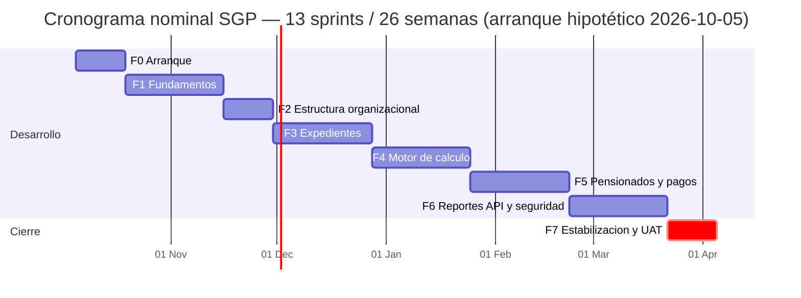
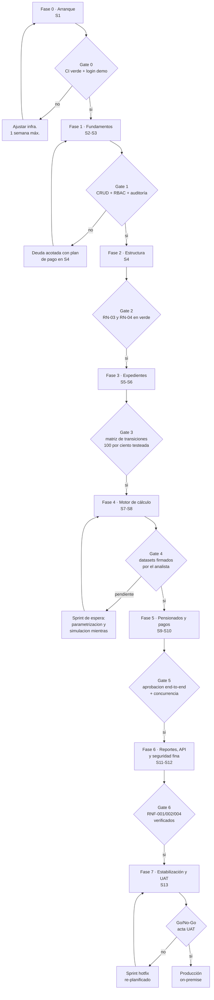

# Plan de Desarrollo por Fases — Sistema de Gestión de Pensionados (SGP)

| Campo | Valor |
|---|---|
| Proyecto | Sistema de Gestión de Pensionados (SGP) |
| Cliente | Ministerio de Trabajo (Cuba) |
| Documento | Plan de Desarrollo por Fases — Implementación del Backend |
| Versión | 1.2 |
| Fecha | 2026-09-26 |
| Estado | Borrador para aprobación del equipo |
| Documentos relacionados | `Requisitos funcionales.md` (RF/RNF/RN) · `Diseño de arquitectura.md` (módulos, TDD, ADR) · `Modelo de datos.md` (35 tablas, migraciones) |
| Alcance | Implementación completa del backend Laravel + MySQL hasta go-live |

---

## 1. Propósito y uso del plan

Este documento expande la sección 15 de `Diseño de arquitectura.md` en un **plan de ejecución operativo**: define, fase por fase y sprint por sprint, qué se construye, en qué orden, con qué dependencias, qué entregables se verifican y qué criterios objetivos permiten declarar cada etapa como terminada. No sustituye a los requisitos ni a la arquitectura: es el puente entre ambos y el código. Cualquier desviación detectada durante la ejecución se registra primero aquí (sección 11, gestión de cambios) y luego se refleja en los documentos fuente, para que la documentación viva nunca diverja del sistema real.

El plan está diseñado para **implementación incremental vertical**: cada fase entrega software funcionando y verificable en staging, nunca capas horizontales inconexas (p. ej., "todas las migraciones primero"). Este enfoque reduce el riesgo de integración tardía, permite validación funcional temprana con el analista del Ministerio y genera demos de fin de sprint con valor real desde el sprint 2. La estimación total es de **13 sprints de 2 semanas (26 semanas calendario)**, con un colchón implícito del ~15 % ya absorbido en la duración de cada fase.

### 1.1 Reglas de paso entre fases (gates)

Cada fase termina en un **gate de salida**: una lista de condiciones objetivas y verificables. Una fase no se considera cerrada —ni la siguiente puede iniciar su diseño detallado— hasta que todas las condiciones del gate se cumplen y quedan registradas. Si un gate no se supera, se activa el protocolo de la sección 11.3 (bloqueo y re-planificación), no se "arrastra deuda" silenciosamente. Las decisiones de re-planificación que afecten alcance, fechas o coste se documentan como entradas en la sección 11.2 y, si alteran decisiones arquitectónicas, generan un ADR nuevo en `Diseño de arquitectura.md`.

### 1.2 Convenciones de este documento

- **RF-XXX-NNN**, **RNF-NNN**, **RN-NNN** y **P-NN** referencian los artefactos de `Requisitos funcionales.md`.
- Cada fase usa una plantilla fija: objetivo · precondiciones (gate de entrada) · alcance funcional · tareas por sprint · entregables · Definition of Done (DoD) · gate de salida · riesgos.
- Las prioridades heredadas de requisitos son **M** (Must, bloqueante de go-live), **S** (Should, importante pero aplazable) y **C** (Could, opcional/propuesta).
- Las fechas del cronograma son **nominales**: se calculan desde una fecha de arranque hipotética (lunes 2026-10-05) y se recalculan al aprobarse el kickoff real.

## 2. Lineamientos transversales de ejecución

Estas reglas aplican a todas las fases y son condiciones permanentes del proyecto; su incumplimiento bloquea el merge del PR correspondiente, con independencia de la fase.

**Stack y estructura.** Laravel 12 sobre PHP 8.3 y MySQL 8.4 LTS, monolito modular con 12 módulos y capas Domain/Application/Infrastructure/Presentation por módulo (secciones 3-5 de `Diseño de arquitectura.md`). Las fronteras entre módulos se verifican con **deptrac** en cada PR (ADR-10): una dependencia no autorizada rompe el pipeline igual que un test en rojo. El dinero es siempre `DECIMAL(12,2)` (RN-005, RNF-008) y toda clave natural única se garantiza con constraint de base de datos (RN-008).

**Metodología de desarrollo.** TDD estricto conforme a la sección 12 de la arquitectura: Red-Green-Refactor en dominio y aplicación; datasets declarativos de Pest 3 para reglas tabulares (transiciones de estado, cálculo de pensiones); tests feature siempre contra MySQL 8.4 real, nunca SQLite (ADR-08). Cobertura mínima: ≥ 90 % en dominio/aplicación y ≥ 80 % global, verificada en CI con umbrales fallidos que rompen el build (RNF-007). PHPStan nivel 8 sin errores y Pint como formateador único.

**Control de versiones.** Conventional Commits (`feat:`, `fix:`, `refactor:`, `docs:`, `test:`); ramas efímeras `feat/SGP-<issue>` con vida máxima de 3 días; merge a `main` solo con PR aprobado por el CODEOWNER del módulo afectado y pipeline verde completo (Pint → PHPStan → deptrac → unitarios → feature+BD → cobertura → build Docker). `main` despliega automáticamente a staging; producción requiere tag anotado y aprobación manual registrada.

**Roles del equipo (referencia para estimación).** 1 tech lead/arquitecto al 50 % de dedicación, 2-3 desarrolladores backend a tiempo completo, 1 QA con foco en datasets y pruebas de carga, y 1 analista funcional del Ministerio como validador (imprescindible en fases 1, 4 y 7). La ausencia del analista en sus semanas críticas es un riesgo gestionado (sección 11.4).

**Calidad funcional continua.** Al cierre de cada sprint hay demo en staging contra datos sembrados de Cuba y revisión de la checklist de RFs tocados en el sprint. Ningún RF se marca como cubierto en la matriz de trazabilidad (sección 12) sin sus tests correspondientes en verde y validación funcional en la demo donde aplique.

## 3. Visión general del plan

| Fase | Sprints | Semanas | Módulos Laravel | RF principales | Resultado verificable |
|---|---|---|---|---|---|
| 0. Arranque | 1 (S1) | 2 | Shared (esqueleto) | RF-SEG-001 parcial | Pipeline CI verde; login demo en staging |
| 1. Fundamentos | 2 (S2-S3) | 4 | Catalogs, Settings, People, Security | RF-CAT, RF-PER, RF-SEG-002/003/004, RF-AUD-001/003/004 | CRUD de catálogos y personas en staging; seeders idempotentes |
| 2. Estructura organizacional | 1 (S4) | 2 | Organizations, LegalBasis | RF-ENT, RF-LEG | Jerarquías y coherencia geográfica probadas (RN-03/RN-04) |
| 3. Expedientes | 2 (S5-S6) | 4 | PensionCases | RF-EXP-001..011, RF-AUD-002 | Flujo completo submitted→approved/rejected sin pensionado |
| 4. Motor de cálculo | 2 (S7-S8) | 4 | PensionCalculation | RF-CAL-001..008 | Cálculo end-to-end con datasets firmados por el analista |
| 5. Pensionados y pagos | 2 (S9-S10) | 4 | Pensioners, Payments | RF-PEN, RF-PAG | Aprobación end-to-end con control bancario y nómina |
| 6. Reportes, API y seguridad fina | 2 (S11-S12) | 4 | Reporting, API pública | RF-REP, RF-API | Reportes con volúmenes objetivo ≤ RNF-002; hardening |
| 7. Estabilización y UAT | 1 (S13) | 2 | transversal | RNF completos | Acta UAT firmada; go-live aprobado |

El paso entre fases está gobernado por gates; el siguiente diagrama resume la cadena de decisiones y las salidas de contingencia cuando un gate no se supera:

**Principio de contingencia clave (Gate 4):** si el analista del Ministerio no ha firmado los datasets de cálculo al cierre de la fase 4, el equipo NO espera pasivamente: trabaja la parametrización, la simulación (RF-CAL-006) y adelanta tareas de la fase 5 que no dependan de la cuantía final (control bancario, secuencias). El gate se re-evalúa semanalmente hasta cerrarse.

---

## 4. Fase 0 — Arranque e infraestructura

**Sprint 1 · Semanas 1-2 · Módulos: Shared (esqueleto), infraestructura CI/CD**

### 4.1 Objetivo

Levantar los cimientos técnicos que harán verificable todo lo demás: repositorio con reglas de contribución, entorno Docker reproducible, pipeline de CI completo y el esqueleto modular de Laravel 12 con autenticación funcional. Al terminar la fase, cualquier desarrollador nuevo debe poder clonar el repositorio, ejecutar `docker compose up` y tener el sistema corriendo con login en menos de 30 minutos.

### 4.2 Precondiciones (gate de entrada)

- [x] Repositorio GitHub creado con acceso para todo el equipo (ya existente: `inass_siss`).
- [ ] Analista funcional del Ministerio designado y con disponibilidad agendada para las demos.
- [ ] Decisión de infraestructura de staging confirmada (VM accesible o servidor local del Ministerio).

### 4.3 Tareas del sprint

**Infraestructura y automatización (S1.1-S1.2)**
- [ ] `docker-compose.yml` con los servicios de la sección 14 de arquitectura: `app` (PHP 8.3-FPM), `web` (Nginx), `db` (MySQL 8.4 con volumen persistente), `queue` y `scheduler`.
- [ ] `Makefile` o scripts `composer` para comandos frecuentes: `make up`, `make test`, `make seed`, `make stan`.
- [ ] Imagen Docker de la aplicación con build reproducible en CI (multi-stage, sin dev-deps en runtime).
- [ ] Entorno `staging` desplegado con deploy automático desde `main` y healthcheck `/up` sondeado.

**Calidad desde el commit 1 (S1.3)**
- [ ] Pipeline GitHub Actions por PR: Pint → PHPStan nivel 8 → deptrac → Pest (unitarios + feature contra servicio MySQL 8.4 efímero) → umbrales de cobertura (90/80) → build de imagen.
- [ ] Configuración inicial de `deptrac.yaml` con las 12 módulos y sus dependencias autorizadas (tabla de la sección 4 de arquitectura).
- [ ] Protección de rama `main`: PR obligatorio, CODEOWNERS por módulo, squash-merge, verificación de estado requerida.
- [ ] Plantillas de PR e issue, `CHANGELOG.md` inicial, `CONTRIBUTING.md` con las convenciones del proyecto.

**Esqueleto de aplicación (S1.4-S1.5)**
- [ ] Bootstrap Laravel 12 con estructura `app/Modules/<Módulo>/{Domain,Application,Infrastructure,Presentation,Tests}` y `Providers/` de registro por módulo.
- [ ] Módulo `Shared` con los contratos núcleo: `ClockInterface`, `SequenceGeneratorInterface`, `TransactionManager`.
- [ ] Value objects base con sus tests: `Money` (inmutabilidad, redondeo bancario, rechazo de float), `CubanIdentityNumber` (validación de RN-001 corregida por ADR-30: 11 dígitos + mes/día + sexo por paridad del dígito 10), `Period` (RN-006: fin ≥ inicio).
- [ ] Login funcional con credenciales de demo (RF-SEG-001 en modo esqueleto; el hardening llega en fase 6), rate limiting básico de autenticación activado.
- [ ] Seeder de usuario administrador inicial idempotente.

### 4.4 Entregables

Pipeline CI/CD operativo; entorno local reproducible vía Docker; esqueleto modular con `Shared` completo; login demo en staging; documentos de gobernanza del repositorio (CONTRIBUTING, CODEOWNERS, CHANGELOG).

### 4.5 Definition of Done

- [ ] Un PR de prueba ("prueba del pipeline") recorre el flujo completo en verde: Pint, PHPStan 8, deptrac, Pest contra MySQL real, cobertura y build.
- [ ] `docker compose up` + `make seed` deja el sistema con login funcional en local, verificado por 2 desarrolladores distintos.
- [ ] La cobertura de `Shared` es ≥ 95 % (es el módulo más reutilizado del sistema).
- [ ] deptrac falla si se crea una dependencia no autorizada (probado deliberadamente en una rama de prueba).
- [ ] Staging despliega automáticamente desde `main` y `/up` responde 200.

### 4.6 Gate de salida

1. Pipeline verde desde el primer PR funcional.
2. Login demo operativo en staging.
3. Estructura modular y contratos `Shared` aprobados por el tech lead.

### 4.7 Riesgos de la fase

| Riesgo | Mitigación |
|---|---|
| Staging sin VM del Ministerio disponible | Arrancar staging en cloud privado del integrador; migración de entorno documentada y ensayada |
| Fricción con MySQL 8.4 en CI (imágenes, collation) | Contenedor de CI fijado a la misma versión menor que producción; prueba hecha en el propio sprint |

---

## 5. Fase 1 — Fundamentos: catálogos, configuración y personas

**Sprints 2-3 · Semanas 3-6 · Módulos: Catalogs, Settings, People, Security**

### 5.1 Objetivo

Construir la base de datos maestros sobre la que descansan expedientes y cálculo: catálogos simples y geográficos, configuración general versionada, secuencias de numeración, personas con su ciclo de vida, y el andamiaje transversal de seguridad (RBAC) y auditoría. Es la fase con más "madera oculta" del proyecto: todo lo que aquí quede flojo se pagará con intereses en las fases 3-5.

### 5.2 Precondiciones (gate de entrada)

- [ ] Gate 0 superado y registrado.
- [ ] Listas oficiales preliminares de catálogos entregadas por el analista (razas, niveles educacionales, categorías ocupacionales, tipos de pensión, regímenes). Si llegan incompletas: se siembran las conocidas y se registran huecos como `P-06` (los seeders son versionables y ajustables sin migraciones).

### 5.3 Alcance funcional

| Módulo | Requisitos | Notas |
|---|---|---|
| Catalogs | RF-CAT-001..004 (M), RF-CAT-006 (S) | CRUD de catálogos, municipios, agencias; carga inicial |
| Settings | RF-CAT-005 (M) + soporte a RF-PAG-006 | Configuración versionada `effective_from` + `numbering_sequences` |
| People | RF-PER-001..004 (M), RF-PER-005 (S) | Ciclo de vida de personas, duplicados |
| Security | RF-SEG-002, RF-SEG-003, RF-SEG-004 (M) | RBAC, restricción por estado, usuario↔persona |
| Auditoría | RF-AUD-001, RF-AUD-003, RF-AUD-004 (M) | Bitácora, consulta, borrado lógico |

### 5.4 Tareas por sprint

**Sprint 2 — Catálogos y configuración (S2.1-S2.5)**
- [ ] Migraciones de catálogos simples y geográficos conforme al modelo de datos (provincias, municipios con unicidad compuesta código+provincia, agencias, organismos, clasificadores) con constraints únicos de RN-008.
- [ ] `CubaGeographySeeder` idempotente: 15 provincias y 168 municipios con verificación de conteo en test.
- [ ] CRUD API REST de catálogos: endpoints resource con validación de unicidad devuelta como error 422 semántico (RF-API-002 se aplica desde ahora como convención transversal).
- [ ] Tests feature de CRUD + tests de infraestructura: migraciones aplican limpias en BD vacía y seeders son re-ejecutables sin duplicar.
- [ ] Configuración general versionada: tabla `general_settings` con `effective_from`/`effective_to`, acción de dominio que resuelve la vigente a una fecha dada, constraint de no solapamiento de vigencias (RN-007). TDD: primero el dataset de solapamientos y vigencia, después la implementación.
- [ ] `numbering_sequences` + implementación MySQL de `SequenceGeneratorInterface` con bloqueo pesimista (`SELECT ... FOR UPDATE` dentro de transacción) y test de concurrencia real con 8 procesos paralelos sin huecos ni duplicados (RN-009). Este es un entregable de infraestructura que se consumirá en fases 3 y 5.

**Sprint 3 — Personas y seguridad (S3.1-S3.5)**
- [x] Migración y dominio de `people`: alta, edición con auditoría de valores previos (RF-PER-002), registro de fallecimiento con fecha (RF-PER-003) y su efecto en búsquedas. ✅ 2026-09-27 (ADR-20, PR People)
- [x] Validador de identidad cubano aplicado en dominio y como regla de Request; unicidad de identidad garantizada por constraint de BD (RN-001). ✅ 2026-09-27 (`CubanIdentityNumber` como regla + UNIQUE contra activas y desactivadas); validación corregida 2026-09-30 (ADR-30: 11 dígitos + mes 01-12/día 01-31 + sexo por paridad del dígito 10 contrastado al alta y en PATCH — eliminados prefijo siglo/sexo y fecha de calendario)
- [x] Búsqueda de personas por identidad, nombre aproximado y filtros básicos, paginada (RF-PER-004); control de duplicados al alta con aviso confirmable (RF-PER-005). ✅ 2026-09-27 (`DuplicatePolicy`: 409 con persona registrada / homónimos confirmables)
- [x] Usuarios + RBAC con spatie/laravel-permission (ADR-05): roles y permisos iniciales del análisis (sección 2.2 de requisitos), matriz rol-permiso como dataset de Pest (anticipa la matriz completa de la fase 6). ✅ 2026-09-27 (ADR-18, PR #9)
- [x] Asociación usuario↔persona con unicidad (RF-SEG-004) y restricción de acciones por estado de persona (RF-SEG-003: p. ej., persona fallecida no puede iniciar expediente). ✅ 2026-09-28 (ADR-21, PR #13: `users.person_id` UNIQUE + FK RESTRICT con reserva sobre cuentas desactivadas, link/unlink idempotentes y auditados con 409 conversacional, `/auth/me` con roles/permisos y resumen `LinkedPerson` de la persona vinculada; `PeopleService::canStartNewProcess` materializa la regla de estado —viva y activa— que PensionCases (F3) consumirá al crear expedientes, la matriz completa de la sección 2.4 llega con la Fase 6)
- [x] Auditoría base con spatie/laravel-activitylog + observers propios: bitácora de toda escritura con valores previos (RF-AUD-001, RNF-005), consulta filtrable de bitácoras para roles autorizados (RF-AUD-003), borrado lógico con restauración auditada (RF-AUD-004). ✅ 2026-09-27 (ADR-19, PR #10)
- [x] Gestión de usuarios completa (RF-SEG-001, parte de administración): CRUD de cuentas con roles, bloqueo por N intentos fallidos con desbloqueo del Administrador, política de contraseñas (longitud, complejidad, caducidad opcional) con renovación propia y restablecimiento administrativo. ✅ 2026-09-28 (ADR-24, PR user-management — ejecutada antes de la Fase 3 por decisión del usuario: el personal técnico necesita provisionar operadores/especialistas antes de capturar expedientes; `LockoutPolicy`/`PasswordPolicy` como dominio puro desde `config/security.php`; email reservado por cuentas desactivadas; guardas de auto-desactivación y último administrador; secretos redactados en bitácora; matriz a 16 permisos con `users.view` para auditor) **Ajuste de usuario (Task 72/SGP-56, 2026-11-01):** las cuentas ganan el atributo `language` (es default institucional / en, CHECK espejo en BD, D-110) escribible por el Administrador (`POST`/`PATCH /users`) y por la PROPIA cuenta — `PATCH /auth/language` sin permiso, la PRIMERA autoedición de perfil — y servido en el directorio y `/auth/me`. ✅ 2026-11-01 IMPLEMENTADA (Task 72/SGP-56): migración `add_language_to_users_table` con backfill implícito por el DEFAULT, `UpdateOwnLanguageRequest` (`language` required in:es,en), `UserResource`//`auth/me` sirven `language`, la bitácora cubre la autoedición, suite 1684/7627 en verde y spec OpenAPI 1.27.0.

> **Orden de ejecución ajustado (2026-09-27, sin cambio de alcance)**: RBAC y bitácora se materializan ANTES del módulo People, porque RF-PER-002 (M) exige valores previos en bitácora para toda edición de personas y la bitácora transversal también cubre la escritura de catálogos que el DoD de la fase exige; así el slice de People cierra todos sus requisitos obligatorios en su propio PR. Secuencia real: PR RBAC (S3.4) → PR bitácora (RF-AUD-001/003/004) → PR People (S3.1-S3.3) → PR usuario↔persona y restricción por estado (S3.5).

### 5.5 Entregables

API de catálogos con datos oficiales sembrados; configuración versionada con resolución de vigencia; generador de secuencias concurrencia-seguro; ciclo de vida de personas completo; RBAC con matriz testeada; bitácora de auditoría transversal operativa.

### 5.6 Definition of Done

- [ ] CRUD de catálogos y personas demostrable en staging con datos de Cuba.
- [ ] Seeders idempotentes probados (re-ejecución no duplica ni falla).
- [ ] Test de concurrencia de secuencias en verde con evidencia adjunta al PR.
- [ ] Toda escritura de personas y catálogos genera bitácora con autor, fecha y valores previos (verificado con feature test).
- [ ] Cobertura ≥ 90 % en dominio de People/Settings; ≥ 80 % global.
- [ ] Demo de fin de fase con el analista: catálogos revisados y huecos de `P-06` registrados.

### 5.7 Gate de salida

1. CRUD de catálogos y personas en staging con suite verde.
2. RBAC y auditoría base operativos.
3. Configuración versionada y secuencias disponibles para consumo de fases posteriores.

### 5.8 Riesgos de la fase

| Riesgo | Mitigación |
|---|---|
| Listas de catálogos oficiales incompletas (P-06) | Seeders versionables; sembrar lo conocido; los vacíos no bloquean (P-06 documentado) |
| Complejidad latente de vigencias (solapamientos) | Regla resuelta por TDD antes de exponer API; constraint en BD como última línea |

---

## 6. Fase 2 — Estructura organizacional y base legal

**Sprint 4 · Semanas 7-8 · Módulos: Organizations, LegalBasis**

### 6.1 Objetivo

Modelar el mapa organizacional del Estado que interviene en cada expediente: entidades con jerarquías acíclicas, oficinas geográficamente coherentes, cargos y firmas autorizadas; y el corpus de base legal que respalda cada resolución de pensión.

### 6.2 Precondiciones (gate de entrada)

- [ ] Gate 1 superado y registrado.
- [ ] Estructura organizacional real (organismos, entidades, oficinas territoriales) disponible en formato consultable.

### 6.3 Alcance funcional

| Módulo | Requisitos | Notas |
|---|---|---|
| Organizations | RF-ENT-001..004 (M), RF-ENT-005 (S) | Entidades, oficinas, firmas, coherencia |
| LegalBasis | RF-LEG-001..003 (M), RF-LEG-004 (S) | Tipos, bases, vigencias |

### 6.4 Tareas del sprint

**Estructura organizacional (S4.1-S4.3)**
- [x] Migraciones y dominio de entidades y oficinas con jerarquías auto-referenciadas. *(ADR-22: migraciones `entities`/`offices` con FK compuesta RN-04 y claves naturales UNIQUE reservadas por soft delete)*
- [x] Estructura territorial de oficinas (corrección de usuario sobre RF-ENT-002): una sola nacional, una provincial por provincia, una municipal por provincia y municipio (entre activas); parent derivado del tipo con prerrequisitos de existencia del superior y nacional sembrada al arranque. *(ADR-31: `OfficeStructurePolicy` de dominio puro + puerto `findActiveOfType` en el repositorio — unicidad semántica porque MySQL no tiene índice parcial; 422 por campo ante contradicciones de parent y prerrequisitos; guard de hijas activas ante re-tipo/re-ubicación; `NationalOfficeSeeder` idempotente — regla 7 — y fumiga HTTP `scripts/smoke_office_structure.php` con 25 comprobaciones; 32 tests nuevos, suite 975/3100; re-visita 2026-10-11 — Task 56/SGP-41: `TerritorialOfficesSeeder` siembra la COBERTURA territorial completa — 15 provinciales + 167 municipales, Isla de la Juventud excluida por su `province_id` NULL — y la fumiga se re-escopa a la cobertura sembrada con restauración final vía re-seed)*
- [x] Regla de aciclicidad como test de dominio puro (RN-03): dataset con árboles válidos e inválidos; el algoritmo de detección de ciclos se implementa en `Domain`, no en BD, y se ejecuta antes de persistir. *(ADR-22: `HierarchyPolicy::wouldCreateCycle` + HierarchyPolicyTest con 12 datasets: raíz, cadena, árbol ancho, re-enraizado válido, self, 2-ciclo, 3-ciclo, cadena de 6 niveles, padre desconocido, pureza)*
- [x] Coherencia geográfica (RN-04, RF-ENT-004): toda entidad/oficina con provincia exige municipio perteneciente; validación en dominio + constraint compuesto en BD. *(ADR-22: 422 semántico por campo contra el estado resultante + FK compuesta, backstop probado con QueryException)*
- [x] Cargos y firmas autorizadas por entidad (RF-ENT-003): unicidad activa de firma (persona+cargo+entidad), historial de revocación. *(ADR-22: terna UNIQUE cubriendo revocadas — la revocación es soft delete auditado que preserva el historial y mantiene la terna reservada; ventana RN-006 y estado derivado `active`/`future`/`expired`)*
- [x] Consulta de estructura (RF-ENT-005): árbol de jerarquía paginado y búsqueda por nombre/NIT. *(ADR-22: `GET /entities/tree` y `/offices/tree` con 5 niveles y corte anunciado `deeper`; búsqueda `q` sobre código/nombre/NIT/objeto social — la columna `name` VARCHAR(120) NOT NULL llegó con la corrección de usuario de Task 31: nombre denominativo obligatorio en el alta (422 sin él), devuelto en listado/detalle/árbol; el conteo de expedientes por oficina llegó con la F3 ya en main: ADR-28 — `cases_count`/`scope_cases_count` en árbol y detalle vía `HierarchyTotals` puro + puerto implementado por PensionCases)*

- [x] Nombre denominativo de la entidad y código universal de catálogos (corrección de usuario, Task 31): `entities.name` VARCHAR(120) obligatorio (migración `2026_10_01_100000`, backfill con el propio código en filas preexistentes, búsqueda del listado ampliada) y columna `code` VARCHAR(10) UNIQUE en los siete catálogos antes solo-nombre (migración `2026_10_01_110000`, códigos de referencia sembrados por el `CatalogsSeeder`) — todos los listados de catálogo devuelven el campo código. *(suite 1040/3442 contra MySQL real; fumiga HTTP `scripts/smoke_task31_catalogs_entity.php` con 25 comprobaciones)*
✅ 2026-10-02 AMPLIADA por la corrección de usuario de Task 38 (SGP-32): columnas propias de los catálogos de pensión servidas por la maquinaria genérica de `extraRules` — `pension_regimes.sector` INT NULL opcional (migración `2026_10_02_120100`) y `pension_types.deceased_person` TINYINT(1) NOT NULL DEFAULT 0 (migración `2026_10_02_120200`, con el default espejado en memoria para que el 201 proyecte false sin recarga) devueltos por TODOS los endpoints del recurso genérico, y el PATCH relajado a `sometimes` para las columnas propias — más el FIX del listado de entidades: `GET /entities` devuelve los DATOS del director general y el económico como proyecciones completas de Persona (`director`/`economic_director`, null sin directores, `PersonResource` reutilizado con carga anticipada en el WITH del repositorio); suite 1069/3635, fumiga de expedientes con 54 comprobaciones

**Base legal (S4.4-S4.5)**
- [x] Tipos de base legal (catálogo sembrado) y registro de bases legales con organismo emisor, número, fecha y texto referencia. *(tipos ya servidos por el catálogo genérico ADR-15 desde el Sprint 2; `legal_bases` con terna tipo-número-año única e inmutable, año derivado de la emisión H-11 — ADR-23)*
- [x] Control de vigencias legales (RF-LEG-003, RN-006): `effective_from` ≤ `effective_to`, resolución de bases vigentes a una fecha. *(RN-006 como orden `effective_date ≥ issue_date` y `derogation_date ≥ effective_date` según el modelo 5.6, validado contra el estado resultante + CHECKs de BD; vigencia derivada al leer `effective`/`derogated`/`future` con cortes inclusivos y filtro SQL `status=effective` como selector de vigentes; la advertencia de «forzar una derogada» aterriza con la transición de aprobación de F3)*
- [x] Consulta documental filtrable (RF-LEG-004). *(búsqueda por año, tipo, organismo emisor y texto del número/referencia, paginada)*

### 6.5 Entregables

API de entidades/oficinas/firmas con reglas estructurales inviolables; corpus de bases legales con control de vigencia; tests de aciclicidad y coherencia geográfica como activos permanentes de regresión.

### 6.6 Definition of Done

- [ ] Tests de dominio de aciclicidad (RN-03) y coherencia (RN-04) en verde con datasets documentados.
- [ ] Carga de estructura organizacional real demostrada en staging.
- [ ] Una base legal puede crearse, caducar y consultarse como vigente/no vigente según fecha de corte.
- [ ] deptrac sigue en verde: Organizations solo depende de Shared/Catalogs/People.

### 6.7 Gate de salida

1. Jerarquías y coherencia geográfica probadas (RN-03/RN-04).
2. Bases legales con vigencias operativas.

### 6.8 Riesgos de la fase

| Riesgo | Mitigación |
|---|---|
| Estructura org. real con duplicidades o datos sucios | Importación validada con reporte de rechazos; corrección con el analista, no en código |

---

## 7. Fase 3 — Expedientes y flujo de resolución

**Sprints 5-6 · Semanas 9-12 · Módulos: PensionCases**

### 7.1 Objetivo

Construir el corazón administrativo del sistema: el expediente de pensión con sus subregistros (salarios, servicios, ciclos de trabajo), su máquina de estados completa y su historial inmutable. Al cierre, un expediente debe poder nacer, completarse, revisarse, aprobarse o denegarse —sin generar aún pensionado— con evidencia auditable de cada transición.

### 7.2 Precondiciones (gate de entrada)

- [ ] Gate 2 superado y registrado.
- [ ] RF-EXP-001..011 revisados con el analista: campos del expediente y evidencias exigibles por transición (nota, base legal).

### 7.3 Alcance funcional

| Módulo | Requisitos | Notas |
|---|---|---|
| PensionCases | RF-EXP-001..008, RF-EXP-011 (M); RF-EXP-009 (M); RF-EXP-010 (S) | Expediente, subregistros, estados, historial, búsquedas |
| Auditoría | RF-AUD-002 (M) | Historial de estados como bitácora especializada |

### 7.4 Tareas por sprint

**Sprint 5 — Expediente y subregistros (S5.1-S5.5)**
- [x] Migraciones del bloque PensionCases conforme al modelo de datos: `pension_cases`, `salary_records`, `service_records` (con marcador coletilla), `work_cycles`, relación única expediente↔persona (corrección H-02). ✅ 2026-09-28 (migraciones 2026_09_28_150000..150003; la unicidad de «un expediente abierto por persona» es física: columna generada `open_case_key` NULL en estados terminales + UNIQUE — los casos resueltos no ocupan lugar)
- [x] Creación del expediente (RF-EXP-001): número generado vía `SequenceGeneratorInterface` (consumo del entregable de fase 1), persona viva, oficina y régimen válidos, constraint único de expediente abierto por persona. ✅ 2026-09-28 (número de la secuencia `pension_case` emitido tras toda validación y antes de la transacción de negocio — un 422 no quema nada, un fallo de insert sí (hueco RN-009 aceptado); elegibilidad por `PeopleService::canStartNewProcess` con 422 accionable fallecido/desactivado; sondas de oficina/entidad/catálogos activos; 409 con el expediente abierto) ✅ 2026-09-30 AMPLIADO por las reglas de usuario 0-5 (ADR-32/33): número compuesto PP-YYYY-CCCCC (provincia de la oficina registrante + año en curso + consecutivo ANUAL por scope `pension_case:{año}` con `nextForYear` — el rodaje anual nace en 1 solo), la oficina ASUMIDA del usuario que registra (prohibida en el POST por el puerto Shared `CurrentUserOfficeProviderInterface`, actor sin oficina 422), clasificación de pensión obligatoria (tipo/régimen), par de Ejército Rebelde coherente (CHECKs directo e inverso), serie salarial de máximo 15 filas vivas (`SalarySeries::MAX_RECORDS`) y conceptos de ingreso como subregistro (UNIQUE caso-concepto, tabla `income_concept_records`, anidados en la creación atómica + endpoints propios); el listado carga el promovente COMPLETO (`PersonResource` reutilizado) — suite 1023/3279, fumiga HTTP `smoke_case_registration.php` de 20 comprobaciones ✅ 2026-10-01 AMPLIADO por ADR-34 (corrección de usuario sobre la regla 2 del número): PPMMAACCCCC — once dígitos contiguos: provincia (2) y municipio (2) de la oficina registrante, últimos dos dígitos del año en curso (2) y consecutivo (5) por el trío año/provincia/municipio — emitido por `nextForTerritory` sobre el scope `pension_case:{año}:{provincia}:{municipio}` que nace en 1 a su primera emisión (el `SettingsSeeder` ya no pre-declara scopes de expediente); suite 1032/3299, fumiga HTTP actualizada ✅ 2026-10-01 AMPLIADO por la corrección de usuario de Task 34: persona por del expediente — `persona_por` VARCHAR(120) NULL (migración `2026_10_01_130000`), texto libre opcional de quién presenta o gestiona el caso (422 con 121 caracteres; omisión = NULL) recibido en el alta y devuelto en el 201/detalle/listado — y revisión de la búsqueda del listado de entidades: `q` cubre código, nombre, NIT y objeto social (descripción OA del endpoint corregida); suite 1049/3485, fumiga de expedientes ampliada a 26 comprobaciones ✅ 2026-10-01 REDEFINIDA por la corrección de usuario de Task 35: la persona por pasa de texto libre a REFERENCIA a una persona REGISTRADA — `persona_por_id` FK → `people` (migración `2026_10_01_140000`), sonda sobre la superficie ACTIVA (desconocida/desactivada = 422, omisión = NULL) y 201/detalle/listado devolviendo el id más la proyección completa bajo `persona_por` (misma forma que `applicant`); suite 1050/3495, fumiga de expedientes con la persona por en 4 comprobaciones ✅ 2026-10-02 RENOMBRADA a columnas inglesas por la corrección de usuario de Task 36 (SGP-30, patrón ADR-03 vinculante para todo el desarrollo): forma_declaracion → declaration_form y persona_por_id → filed_by_person_id (migraciones `2026_10_02_100000`/`100100` con CHECK y FK renombrados a inglés; wire, proyección `filed_by`, OA y fumiga actualizados; los valores Documental|Testifical no cambian); suite 1050/3495 ✅ 2026-10-02 AMPLIADA por la corrección de usuario de Task 37 (SGP-31): internacionalista del promovente (`internationalist` TINYINT(1) NOT NULL DEFAULT 0, booleana OBLIGATORIA en el wire — 422 si se omite, paralelo de `rebel_army_member`) y par de contacto (`phone` VARCHAR(30) / `popular_council` VARCHAR(120), opcionales con techo, omisión = NULL) recibidos en el alta y devueltos en 201/detalle/listado (migración `2026_10_02_110000`); suite 1062/3562, fumiga con 4 comprobaciones propias ✅ 2026-10-02 AMPLIADA por la corrección de usuario de Task 40 (SGP-34): ciclo de vida del agregado — PUT de edición con el PROMOVENTE INMUTABLE (todo campo de la esfera de la persona y los de ciclo de vida responden 422 prohibido; semántica PATCH sobre los campos propios con probes espejo del alta) y DELETE de eliminación LÓGICA solo en `submitted` (409 fuera, con el estado actual) con liberación de la reservación de un-abierto-por-persona — la migración `2026_10_02_130000` re-crea la columna generada `open_case_key` con la expresión que también anula la clave en filas soft-deleted (el trait SoftDeletes ya estaba en el modelo y `deleted_at` en la tabla desde el Sprint 5) —; suite 1108/3788, fumiga lifecycle propia (`smoke_case_lifecycle.php`) de 28 comprobaciones TODO OK ✅ 2026-10-03 AMPLIADA por la corrección de usuario de Task 41 (SGP-35): el GET del listado con ALCANCE TERRITORIAL — solo cargan los expedientes cuya oficina coincide con la del usuario autenticado, `office_id` prohibido en la query (422 conversacional) porque el controlador lo deriva del puerto Shared `CurrentUserOfficeProviderInterface` (el mismo seam de la regla 0 del alta) y el servicio responde una página VACÍA fail-closed sin criterio de oficina (actor sin oficina o caller que olvida el scope: jamás el directorio sin alcance), con los filtros restantes angulando DENTRO del scope — suite 1113/3829 contra MySQL real, Pint/PHPStan 8/deptrac en verde, fumiga de expedientes ampliada a 61 comprobaciones (query prohibida, reasignación provincial/municipal moviendo el scope de punta a punta, actor sin oficina con página vacía) TODO OK
 ✅ 2026-10-02 AMPLIADA por la corrección de usuario de Task 38 (SGP-32): fecha de desvinculación del promovente — `termination_date` DATE NULL (migración `2026_10_02_120000`), opcional en el wire con regla de forma Y-m-d única (422 con formato inválido; sin sonda semántica), omisión/null/'' persisten NULL y el 201, el detalle y el listado la devuelven; suite 1069/3635, fumiga con 3 comprobaciones propias
- [x] Subregistros con validaciones RN-005/RN-006 (importes `DECIMAL(12,2)`, periodos coherentes) y solapamiento de servicios detectado y advertido. ✅ 2026-09-28 (Money de Shared en todos los importes; techo del año = año actual+1 contra `ClockInterface`; orden de fechas sondeado antes del CHECK; `SalarySeries` advierte huecos interiores y `ServicePeriods` solapes con días inclusivos y vínculos abiertos — advertencia, nunca bloque, viajan como objeto `warnings` junto a `data`) ✅ 2026-10-02 CORREGIDO por el usuario (Task 37/SGP-31): los períodos de servicio son CERRADOS y DISJUNTOS — `end_date` DATE NOT NULL OBLIGATORIA y ESTRICTAMENTE posterior al inicio (CHECK `end_date > start_date`, migración `2026_10_02_110100`; 422 si falta, si es igual o anterior al inicio) y NINGÚN par de subregistros comparte un día (`ServicePeriods::overlappingPairs` para las filas anidadas del alta con 422 sobre `service_records` nombrando los pares, `idsOverlappingWith` para el alta individual con 422 sobre `end_date` nombrando los registros cruzados; días inclusivos: el día siguiente al fin arranca limpio) — el vínculo vigente no existe y `warnings` queda solo con los años salariales interiores ausentes; suite 1062/3562, fumiga con 9 comprobaciones de período
- [x] API de subregistros con altas/bajas dentro del expediente en estados editables únicamente (borrador/submitted). ✅ 2026-09-28 (solo `submitted` — sin estado borrador en la matriz 2.4; fuera de él 409 con el estado actual; las bajas son físicas y auditadas con valores previos — borrado por instancia, nunca en masa) ✅ 2026-10-01 AMPLIADO por la corrección de usuario, Task 32: el alta de servicios gana `forma_declaracion` opcional (`in:Documental,Testifical`; migración `2026_10_01_120000` con VARCHAR(20) NOT NULL DEFAULT 'Documental' + CHECK de los dos valores legales — la omisión cae en Documental y el campo viaja en el 201 y el detalle); la suite no se ejecutó en esta sesión (toolchain del sandbox caído, precedente Task 29) — el CI del PR queda como válvula. ✅ 2026-10-01 AMPLIADO por Task 33: la forma de declaración viaja también POR FILA en el payload anidado de creación (`service_records.*.forma_declaracion`, `in:Documental,Testifical`; omisión = Documental, desconocido 422 todo-o-nada) — el hueco de la Task 32 (descarte silencioso del valor declarado en la creación anidada) queda cerrado; suite local completa en verde (1046 tests / 3467 aserciones contra MySQL real) y fumiga de expedientes ampliada a 23 comprobaciones ✅ 2026-10-02 RENOMBRADA a columna inglesa por Task 36 (SGP-30): forma_declaracion → declaration_form (migración `2026_10_02_100000`, CHECK `chk_service_records_declaration_form`); mismo comportamiento con el wire y el OA en inglés
- [x] Feature tests transaccionales: creación de expediente con subregistros atómica (todo o nada). ✅ 2026-09-28 (puerto `TransactionManager` de Shared materializado con `DatabaseTransactionManager`; el caso y sus subregistros declarados insertan en una sola transacción)
- [x] **Corrección de usuario (Task 42, SGP-36) — IMPLEMENTADA 2026-10-03** (la documentación se ajustó primero y el usuario validó con «implemnta»; migraciones `2026_10_03_100000`..`100300`, spec OpenAPI 1.4.0, suite 1133/3945 contra MySQL real, Pint/PHPStan 8/deptrac en verde, fumigas TODO OK): cuatro ajustes de modelo refinados por las respuestas del usuario — enum en MINÚSCULAS unificadas (`tarjeta magnetica` / `nomina electronica`), todos los campos nuevos obligatorios SALVO la cuenta bancaria (exigida cuando la forma de pago del tipo de agencia de cobro es `tarjeta magnetica`), el campo del catálogo obligatorio con DEFAULT `tarjeta magnetica`, el porciento obligatorio con rango 0–100 y 2 decimales, y el grupo nuevo del promovente MODIFICABLE por PUT.
- [x] (a) ELIMINAR el modelo Tipo de pago (migración `2026_10_03_100000`): caída de la tabla `payment_types`, retiro del `CatalogRegistry` (quedan 15 tipos uniformes), del `CatalogsSeeder`, de la enumeración de tipos válidos en la descripción OA del `CatalogController` y de los tres tests que lo nombran (`CatalogRegistryTest`, `CatalogCrudTest`, `CatalogSeedingTest`); `payment-types` pasa a responder 404 de catálogo desconocido (`UnknownCatalogException`); sin dependientes — la propuesta `pension_payments` no está construida —, baja limpia.
- [x] (b) `agency_types.payment_form` VARCHAR(20) NOT NULL DEFAULT 'tarjeta magnetica' + CHECK del enum (migración `2026_10_03_100100`): enum PHP `PaymentForm` en el dominio de Catalogs con los valores en minúsculas unificadas tal como los fijó el usuario; wire por la maquinaria `extraRules` (patrón Task 38): `in:tarjeta magnetica,nomina electronica` con la omisión del alta cayendo en el DEFAULT y el PATCH relajado a `sometimes`; devuelto por TODOS los endpoints de `agency-types` (201/detalle/listado/PATCH) con espejo `CatalogItem`; seeder de tipos de agencia con `payment_form` explícito.
- [x] (c) Grupo de DOMICILIO y COBRO del promovente en `pension_cases` (migración `2026_10_03_100200`): `current_address` VARCHAR(255) NOT NULL, `residence_province_id`/`residence_municipality_id` FK NOT NULL con coherencia RN-004 sondeada (422; P-09 para el municipio especial), `collection_agency_type_id` FK NOT NULL, `collection_agency_id` FK NOT NULL (sondas ACTIVA y de-ese-tipo) y `bank_account` VARCHAR(34) NULL OBLIGATORIA CONDICIONADA a la forma de pago `tarjeta magnetica` del tipo de agencia de cobro resuelto (422 sobre `bank_account` si falta; opcional con `nomina electronica`); recibidos en el POST (todos obligatorios salvo la cuenta), devueltos en 201/detalle/listado con proyecciones (provincia, municipio, tipo de agencia con `payment_form`, agencia) y EDITABLES por PUT con probes espejo del alta y la exigencia condicional re-evaluada contra el estado RESULTANTE; `StorePensionCaseRequest`/`UpdatePensionCaseRequest`/`PensionCaseService`/`PensionCaseResource` + OA del POST/PUT + anclas nuevas de `ApiDocsTest`; fumiga `smoke_case_registration.php` ampliada (cuenta exigida con `tarjeta magnetica`, opcional con `nomina electronica`, coherencias de municipio-provincia y agencia-tipo, PUT del grupo).
- [x] (d) `income_concept_records.applied_percent` DECIMAL(5,2) NOT NULL DEFAULT 0.00 + CHECK 0–100 (migración `2026_10_03_100300`): porciento a aplicar Double OBLIGATORIO en el wire con rango 0–100 y 2 decimales exactos (cadena decimal por la doctrina RN-005, jamás float); viaja por fila en el alta anidada y en el endpoint propio (`StoreIncomeConceptRecordRequest` + OA + anclas de ApiDocsTest); DEFAULT 0.00 solo para escrituras fuera del wire.
- [x] Plan de entrega (ejecutado): TDD rojo primero en cada frente (ApiDocsTest + suites de feature: alta sin el grupo → 422, cuenta condicional, coherencias municipio-provincia y agencia-tipo, porciento fuera de rango o con más decimales, PATCH del catálogo con `payment_form`, `payment-types` → 404), migraciones en el orden (a)-(d), spec OpenAPI 1.3.0 → 1.4.0 como señal de frescura, QA completo (Pest + Pint + PHPStan 8 + deptrac 0) y regresión sobre main; la propuesta `pension_payments` pierde el clasificador `payment_type_id` (UNIQUE de período ajustado a pensionado-año-mes).

- [x] **Corrección de usuario (Task 44, SGP-37) — IMPLEMENTADA 2026-10-03** (spec OpenAPI 1.5.0, suite 1134/3966 contra MySQL real, Pint/PHPStan 8/deptrac en verde, fumiga de expedientes de 73 comprobaciones TODO OK): el GET `/pension-cases` devuelve en cada fila los DATOS de provincia y municipio de residencia y de la agencia de cobro — `search` del repositorio Eloquent gana las cargas anticipadas de `residenceProvince`, `residenceMunicipality`, `collectionAgencyType` y `collectionAgency.province/municipality/agencyType` (la proyección ya vivía en `PensionCaseResource` bajo `whenLoaded` y el detalle las cargaba desde la Task 43: la brecha estaba solo en el listado), test de feature del listado anclando fila a fila las proyecciones (provincia, municipio, tipo con `payment_form`, agencia completa con su geografía) y fumiga ampliada sobre la BD sgp.

- [x] **Corrección de usuario (Task 48+66, SGP-38 — DECISIÓN 2026-10-04; TRUNCAMIENTO RESTAURADO por corrección de usuario 2026-10-23; IMPLEMENTADA)**: `worked_years` es **DOUBLE con TRUNCAMIENTO** al entero (el redondeo de la Task 48 queda retirado por la Task 66: 2000-01-01 → 2005-12-31 con M = 12 → 71/12 = 5.9167 → `5`; la media 6/12 = 0.5 → `0`, jamás sube) y se **AÑADE `worked_months` INTEGER** (SMALLINT UNSIGNED) — los MESES TOTALES del vínculo, `(AÑO(fecha_fin) - AÑO(fecha_ini)) × 12 + (MES(fecha_fin) - MES(fecha_ini))` SIN divisor M (71 en el ejemplo) —, calculado al crear la fila EN EL MISMO MOMENTO que `worked_years` (alta anidada y endpoint propio) con el MISMO comportamiento: campo DERIVADO (422 si el cliente lo envía, jamás un descarte silencioso), serializado como NÚMERO ENTERO JSON (type: integer) junto al `worked_years` NUMÉRICO (type: number, format: double; spec OpenAPI 1.22.0) en el 201, el detalle y el schema OA, CONGELADO al alta (sin edición de subregistros) con backfills SQL de una pasada por JOIN al régimen del expediente: ROUND en la migración `2026_10_04_200000` (MODIFY a DOUBLE + ADD + NOT NULL) y DIV (truncamiento restaurado) en la `2026_10_23_100000`. El resto se mantiene igual. Implementada por la Task 48 (suite 1157 tests / 4030 aserciones, fumiga HTTP de 20 comprobaciones) y truncamiento restaurado por la Task 66 (2026-10-23). ✅ IMPLEMENTADA 2026-10-23 (Task 66): suite 1552 tests / 6201 aserciones contra MySQL real (CERO tests nuevos: 10 expectativas re-ancladas al truncamiento — dominio, endpoint propio, alta anidada y anclas de spec), Pint (587 archivos)/PHPStan nivel 8 (0 errores)/deptrac (0 violaciones) en verde, spec OpenAPI 1.22.0 servida y anclada por `ApiDocsTest`, y fumiga HTTP dedicada de 22 comprobaciones TODO OK sobre la BD re-sembrada (71/12 → 5, la media 0.5 → 0, el múltiplo exacto → 1, la BD guardando [5.0, 0.0, 1.0] y las filas anidadas naciendo con 5/71 y 1/12).

**Sprint 6 — Máquina de estados, historial y búsqueda (S6.1-S6.5)**
- [x] Enum respaldado de estados `CaseStatus` con transiciones codificadas primero como **dataset de Pest** (la matriz completa de la sección 2.4 de requisitos): cada fila es un caso transición-permitida o transición-rechazada con su error esperado. La máquina de estados nace de ese dataset (estrategia TDD de la sección 15.2 de arquitectura). ✅ 2026-10-04 (Task 49, TDD rojo primero: 21 fallos del dataset antes de la implementación): `CaseStatus::transitionsTo` (la matriz plana de la sección 2.4 — 5 celdas permitidas, 11 prohibidas) y `CaseStatus::canReopenTo` (la excepción administrativa RF-EXP-010: terminales → under_review, NUNCA a submitted), con las 16 celdas cubiertas por el dataset (14 filas + las 2 celdas de fuga del test de consistencia) y la cobertura de reapertura como dataset propio; suite 1260/4353 en verde.
- [x] Transiciones como subrecurso POST (ADR-07): `POST /pension-cases/{id}/submit`, `/review`, `/approve`, `/reject`, cada uno con su evidencia exigible (nota, base legal vigente en approval/denial). ✅ 2026-10-04: la forma VINCULANTE es la del ADR-07/arquitectura 9.1 — UN endpoint declarativo `POST /pension-cases/{id}/transitions` con `{to, note, legal_basis_id, force}` (los verbos RPC por transición quedaron descartados por diseño: «evita verbos RPC ambiguos»); la evidencia: nota de resolución (mín. 10) y base legal VIGENTE en la aprobación (la derogada forzable SOLO por el Administrador con `force: true`, RF-LEG-003; la futura jamás), motivo (mín. 10) en la denegación y la reapertura; la decisión corre sobre la FILA BLOQUEADA dentro de una transacción (DoD: dos aprobaciones concurrentes no pueden ocurrir — test de carrera con proceso hijo real).
- [x] Revisión con validación de completitud (RF-EXP-006): checklist de datos mínimos que bloquea el avance si falta. ✅ 2026-10-04: 422 con la lista `missing` COMPLETA (service_records, salary_records, last_salary positivo; persona y centro de trabajo garantizados por FK NOT NULL); la elegibilidad preliminar (RF-CAL-006) queda registrada como dependencia de F4.
- [x] Denegación (RF-EXP-008) con base legal obligatoria; reapertura administrativa (RF-EXP-010) solo para rol Administrador, con motivo y bloqueo derivado. ✅ 2026-10-04 (con la precisión normativa de RF-EXP-008): la DENEGACIÓN exige MOTIVO obligatorio (mín. 10 caracteres, sin base legal — el RF solo demanda el motivo; la mención de base legal del plan queda cubierta por la aprobación, que sí la exige VIGENTE); la REAPERTURA es exclusiva del Administrador (permiso `cases.reopen` solo en su fila de la matriz), exige motivo, LIMPIA la evidencia de decisión y respeta la reservación de expediente-abierto-por-persona (409 con el expediente vivo); el bloqueo de pagos queda registrado como dependencia de F5.
- [x] Historial de estados append-only (RF-EXP-009, RF-AUD-002): tabla de transiciones con estado previo/nuevo, usuario, fecha, nota; inmutable y consultable por roles de auditoría. ✅ 2026-10-04: `pension_case_histories` (migración `2026_10_04_300000`) con CHECKs del catálogo de estados, una fila por transición legal escrita en la misma transacción, servida por GET /pension-cases/{id}/transitions (línea de tiempo ordenada con el actor {id, name}); el modelo RECHAZA update/delete (RN-010, test de inmutabilidad) y la bitácora genérica registra además cada cambio de estado con ambos lados + los intentos ilegales (evento `transition_rejected`).
- [x] Búsqueda y filtros (RF-EXP-011): por estado, oficina, persona, rango de fechas y número, con índices compuestos y paginación estricta; exportación CSV delegada a fase 6 (se registra la dependencia). ✅ 2026-10-04: los filtros componen con la búsqueda afinada `q` (nombres + identidad del promovente, semántica AND, dentro del alcance territorial SGP-35), índice compuesto `idx_cases_office_requested` (migración `2026_10_04_300000`) y paginación estricta (per_page ≤ 100); medida sobre 50 000 expedientes sintéticos (`PensionCaseVolumeSeeder`, opt-in — sembrado en 23.9 s): sin filtros 230 ms, estado 167 ms, rango 160 ms, q por apellido 313 ms, q por fragmento de carnet 396 ms; el CSV queda dependencia registrada de F6.

### 7.5 Entregables

Flujo completo de expediente en staging: `draft → submitted → under_review → approved/rejected` (+ reapertura) con número secuencial, subregistros validados, historial inmutable y búsquedas operativas; matriz de transiciones 100 % testeada como activo de regresión permanente.

### 7.6 Definition of Done

- [x] La suite de la matriz de transiciones cubre el 100 % de celdas de la matriz (permitidas y prohibidas) sin excepciones. ✅ 2026-10-04: las 16 celdas + las 6 filas de reapertura como datasets de Pest (CaseStatusTest) y cada par ilegal probado además por HTTP (dataprovider de 9 pares + el test de fuga de la reapertura en la matriz plana).
- [x] Dos aprobaciones concurrentes del mismo expediente no pueden ocurrir (test de carrera con transacción/lock). ✅ 2026-10-04: `CaseTransitionConcurrencyTest` con proceso hijo real — el perdedor se estaciona en el lock de la fila (leg 1: TIMEOUT con el lock del padre), relee el estado ya comprometido al soltarse y responde 422; exactamente UNA fila de aprobación.
- [x] Toda transición deja fila en historial; intentar mutar historial falla en test de inmutabilidad. ✅ 2026-10-04: cada transición legal dentro de la suite verifica la fila; el modelo lanza RuntimeException al actualizar y al borrar (suite + fumiga).
- [x] El número de expediente es único, secuencial y sin huecos bajo concurrencia (reuso del test de fases 1). ✅ 2026-10-04: la suite de la secuencia (`SequenceConcurrencyTest`) sigue en verde — el DoD se re-verifica por herencia, sin re-escritura.
- [ ] Cobertura ≥ 90 % en dominio de PensionCases. → medición del runner de CI (el sandbox de desarrollo no carga driver de cobertura: PHP estático sin pcov/xdebug; el pipeline la mide — el gate de Shared ya opera así desde la Fase 0).
- [ ] Demo con el analista: expediente completo de prueba caminado por los 5 estados. → pendiente del paso humano del gate (la fumiga HTTP de 47 comprobaciones camina el flujo completo contra la BD real mientras tanto).

### 7.7 Gate de salida

1. Flujo submitted→rejected/approved (sin pensionado) con matriz de transiciones 100 % testeada. ✅ 2026-10-04: caminado por la fumiga HTTP (submitted → under_review → devolución → revisión → approved, y submitted → rejected → reapertura) — la dependencia «sin pensionado» queda registrada para F5.
2. Historial de estados operativo e inmutable. ✅ 2026-10-04: GET /pension-cases/{id}/transitions sirve la línea de tiempo completa con el actor; el modelo rechaza mutaciones (RN-010).
3. Búsquedas de expedientes con rendimiento razonable en volumen sembrado (~50k expedientes sintéticos). ✅ 2026-10-04: 50 000 expedientes sembrados por el seeder opt-in (23.9 s) y cada superficie medida: 160-400 ms por página — fumiga de volumen TODO OK. Pendiente humano: la demo con el analista y la cobertura del runner de CI.

### 7.8 Riesgos de la fase

| Riesgo | Mitigación |
|---|---|
| Descubrimiento de estados/transiciones no previstos al validar con el analista | La matriz es un dataset declarativo: agregar una fila + ajustar el enum es un cambio local y barato |
| Rendimiento de búsquedas con datos sintéticos | Seeders de volumen desde ya; EXPLAIN en el DoD; índices compuestos por diseño del modelo |

---

## 8. Fase 4 — Motor de cálculo de pensiones

**Sprints 7-8 · Semanas 13-16 · Módulos: PensionCalculation**

### 8.1 Objetivo

Implementar el dominio financiero del sistema: verificación de elegibilidad, cómputo de años de servicio, salario promedio y cuantía con topes e incrementos, con estrategias por régimen, simulación sin persistencia y persistencia congelada de resultados. Es el corazón TDD del proyecto (sección 15.2 de arquitectura): cada regla de cálculo existe primero como dataset firmado.

### 8.2 Precondiciones (gate de entrada)

- [ ] Gate 3 superado y registrado.
- [ ] Datasets de cálculo elaborados por el equipo y **pendientes de firma** por el analista (P-01..P-03). El gate de salida exige la firma; el trabajo no se detiene mientras tanto (regla de contingencia de la sección 3).

### 8.3 Alcance funcional

| Módulo | Requisitos | Notas |
|---|---|---|
| PensionCalculation | RF-CAL-001..004, RF-CAL-006, RF-CAL-007, RF-CAL-008 (M); RF-CAL-005 (S) | Elegibilidad, servicio, promedio, cuantía, simulación, trazabilidad |

### 8.4 Tareas por sprint

**Sprint 7 — Elegibilidad, servicio, promedio y cuantía v1 (S7.1-S7.7, reajuste de usuario 2026-10-06)**
- [x] S7.1 `EligibilityChecker` por TDD (RF-CAL-001 reajustada): edad mínima por sexo (`min_age_men`/`min_age_women` del RÉGIMEN) y años mínimos GENERALES (`min_work_years`) contra AT truncado (C-3); edad = años cumplidos por cumpleaños a `requested_at` (dataset: bordes de cumpleaños — el día anterior no cumple, el día mismo sí — y años justos); booleano por criterio con explicación legible.
- [x] S7.2 `ServiceYearsCalculator` (RF-CAL-002 reajustada): AT = (Σ meses de los `service_records` NO coletilla) / `months_per_year`; aritmética AÑO/MES por registro (SGP-38, días ignorados, vínculos siempre cerrados); coletilla NO suma (P-03 resuelta, regla fija); `work_cycles` DIFERIDOS (P-02: dudas del usuario en la fórmula); determinista y reproducible.
- [x] S7.3 Salario promedio MENSUAL (RF-CAL-003 reajustada): `BestN`/`LastN`/`All` tras `AverageSalaryPolicy` (Strategy §6) elegidas por `average_strategy` del régimen; SPM = Σ(selección)/(N×12) con N = `required_salary_records` (sembrado 5 en el General); `Money` con redondeo bancario half-even a 2 decimales.
- [x] S7.4 Test de contrato Liskov entre las tres estrategias (mismo dataset de entrada → resultados documentados por política).
- [x] S7.5 Invariante RF-CAL-005 (corrección de usuario): los conceptos de ingreso NO participan — con y sin conceptos el cálculo es idéntico.
- [x] S7.6 `AmountCalculator` — cuantía PRIMERA VERSIÓN (RF-CAL-004 reajustada, sin conceptos de incremento): Cuantía = SPM×PCI + (ATE×PIA×SPM) con ATE = max(0, AT truncado − min_work_years); tope mínimo(Cuantía, SPM×PIL); porcientos DOUBLE [0,1] del régimen, jamás hardcodeados.
- [x] S7.7 Migración `2026_10_06_100000` (las OCHO columnas del régimen + backfill del General 0.60/0.02/0.90/25/60/55/5/`best_n`), catálogo con validación (porcientos 0..1, N 1..15, estrategia del enum) y spec OpenAPI 1.9.0; GATE EXCLUYENTE (C-2/C-6): submitted→under_review exige EXACTAMENTE N registros de salario (menos → 422 con el ítem `salary_records_count` en la lista `missing`; el (N+1)-ésimo alta rechazada con 422). ✅ 2026-10-06 IMPLEMENTADA (Task 50/S7, spec OpenAPI 1.9.0): migración `2026_10_06_100000` con las ocho columnas y backfill del General, suite 1328 tests / 4579 aserciones contra MySQL real, Pint (463 archivos), PHPStan nivel 8 y deptrac (Settings fuera de las dependencias) en verde, fumiga HTTP de 21 comprobaciones TODO OK (catálogo con los ocho parámetros, tope N estricto, gate de revisión y los números confirmados del motor) y la fumiga del S6 (47 comprobaciones) en verde sobre el gate re-escopado.

**Sprint 8 — Simulación, persistencia congelada y trazabilidad (S8.1-S8.7, re-escopado Task 51 2026-10-06)**
- [x] S8.1 DESACOPLE DEL N DE LA ESTRATEGIA (corrección de usuario 2026-10-06, V-1..V-4, retroactiva al S7): migración que añade `pension_regimes.average_years_count` (INT UNSIGNED NOT NULL, CHECK 1..15 y ≤ `required_salary_records`, backfill del General = 5) y ELIMINA `pension_cases.calculation_setting_id` (deprecada C-6: drop de FK y columna, jamás escrita); `CalculationInput.averageYearsCount` se llena desde el N PROPIO (no desde el gate); divisor N propio × 12 en las tres estrategias; catálogo valida 422 (1..15, ≤ gate y `all` → N propio = gate); spec OpenAPI 1.9.0 → 1.10.0.
- [x] S8.2 Simulación sin persistencia (RF-CAL-006): `POST /pension-cases/{id}/calculation-preview` sobre `CaseCalculationService` — permiso nuevo `cases.calculate` (especialista, Director y Administrador), alcance territorial de oficina, 409 fuera de `submitted`/`under_review`; respuesta con elegibilidad por criterio, AT (meses/exacto/truncado), SPM, excedentes, cuantía, parámetros del régimen y `warnings[]`; TEST DE TRANSACCIÓN VACÍA del DoD 8.6.
- [x] S8.3 Persistencia al aprobar (RF-CAL-007 + RF-EXP-007, C-1): dentro de la MISMA transacción con lock de fila del S6 — motor → snapshot append-only `pension_case_calculations` (UNIQUE(pension_case_id, sequence), columnas fuertes + `regime_parameters`/`inputs`/`eligibility` JSON, inmutabilidad RN-010 del modelo) + `computed_amount`; el 422 de ELEGIBILIDAD bloquea la aprobación del no elegible con la explicación por criterio; la reapertura limpia la referencia vigente, JAMÁS los snapshots (una re-aprobación genera `sequence` 2).
- [x] S8.4 Trazabilidad (RF-CAL-008, RNF-010): test de re-ejecución histórica — aprobar, MUTAR el régimen vivo por el catálogo y re-ejecutar el motor con `inputs` + `regime_parameters` congelados → `amount` idéntico y `computed_amount` intacto; `GET /pension-cases/{id}/calculation` con la línea de versiones por `sequence`.
- [x] S8.5 Datasets límite de cuantía (RF-CAL-004, consolidación de la fórmula v1 vinculante): tope atado exacto (Cuantía > SPM×PIL), excedentes cero (ATE = 0), ATE grande, SPM con redondeo half-even del divisor N propio e invariante de conceptos re-verificado. Nota: el ítem «`RegimeCalculationStrategyInterface` + estrategias por régimen» del plan original quedó ABSORBIDO por S7.3/S7.4 (estrategias `best_n`/`last_n`/`all` con test de contrato Liskov).
- [x] S8.6 Infection (mutación) sobre el paquete de cálculo: score ≥ 80 % (sección 12.4) — contingencia honesta: si el sandbox no lo sostiene, queda documentado como pendiente del runner de CI (como la cobertura hoy).
- [x] S8.7 Entrega: QA completo (Pest + Pint + PHPStan 8 + deptrac), fumigas HTTP (vista previa sin escrituras + ciclo aprobar → mutar régimen → re-ejecutar), docs de cierre con evidencias, rama `feat/S8-calculation-persistence`, PR, CI y merge (Task 51). ✅ 2026-10-06 IMPLEMENTADA (Task 51/S8): suite 1354 tests / 4703 aserciones contra MySQL real, Pint (471 archivos), PHPStan nivel 8 (0 errores) y deptrac (0 violaciones) en verde; fumiga HTTP S8 de 26 comprobaciones TODO OK sobre la BD sgp re-sembrada (más las de regresión S7 de 21 y S6 de 47 TODO OK) y spec OpenAPI 1.10.0 servida y anclada por ApiDocsTest. Nota S8.6 (contingencia C-7): infection ^0.35.6 instalado como dev-dependency con `infection.json5` (source: PensionCalculation, min-msi 80) y script `composer infection`; el RUN queda pendiente del runner de CI — el sandbox no carga driver de cobertura (pcov/phpdbg/xdebug), el mismo precedente documentado de la cobertura desde la Task 49.
- [x] S8.8 CORRECCIÓN DE ESPECIALISTAS — TOPE e IMPUTABILIDAD (Task 52, V-5..V-8 y D-1..D-5 confirmados 2026-10-09): migración `2026_10_09_100000` — `pension_cases.missing_salaries_attributable` TINYINT(1) NULL (tras `last_salary`) y `pension_case_calculations.average_years_effective` SMALLINT UNSIGNED (backfill = N, CHECK 1..15 y ≤ `average_years_count`) + `missing_salaries_attributable` congelada —; el gate de revisión pierde el ítem exact-N `salary_records_count` y gana `salary_records` (≥ 1) + `missing_salaries_attributable` (con déficit R < N de la estrategia); el motor deriva N_ef (R ≥ N ⇒ N; 0 < R < N ⇒ R o N según el flag; R = 0 ⇒ N) y divide N_ef×12 exponiendo `average_years_used`; vista previa y aprobación responden 422 con déficit sin declarar (D-4); el snapshot congela flag + N_ef como columnas explícitas (D-5) y `inputs` lleva el flag; el catálogo y las semillas SIN cambios (la corrección es de SEMÁNTICA del parámetro — el General 5 = 5 queda intacto y los números históricos no cambian); spec OpenAPI 1.10.0 → 1.11.0; QA + fumiga S8 extendida (déficit imputable / no imputable / indeterminado). Entrega como PR `feat/S8b-attribution-correction`. ✅ 2026-10-09 IMPLEMENTADA (Task 52/S8.8): migración `2026_10_09_100000` con las columnas y CHECKs, el motor deriva N_ef y expone `average_years_used`, el gate de revisión con `salary_records` ≥ 1 + declaración, Store/Update/preview (422 D-4) y congelado con columnas explícitas; suite 1367 tests / 4747 aserciones contra MySQL real, Pint (481 archivos), PHPStan 8 (0 errores), deptrac (0 violaciones), fumigas S8b (15) + S8 (26) + S7 (21) TODO OK y spec OpenAPI 1.11.0 anclada por ApiDocsTest.
- [x] S8.9 VERSIÓN DOS DE LA CUANTÍA — INCREMENTOS POR CONCEPTOS (Task 53, V-9..V-12 y D-6..D-13 confirmados 2026-10-09): SIN MIGRACIONES (D-8: el algoritmo es universal, no existe `calculation_version`) — (a) MOTOR: `CalculationInput` gana la lista pura de conceptos aplicables {income_concept_id, code, applied_percent}; `AmountCalculator` compone el factor TOTAL (PCI + ATE×PIA + Σ(applied_percent/100)) en bcmath y sufre UN solo redondeo half-even, con el tope final mínimo(Cuantía, SPM×PIL) (D-13); (b) COMPOSICIÓN: `CaseCalculationService` proyecta la RISB desde `income_concept_records` (relación `incomeConcept` con `withTrashed` — un concepto desactivado después de declarado no rompe el caso) por el puerto de PensionCases (deptrac: el motor no toca Catalogs); (c) SUPERFICIE: vista previa con `income_concept_terms[]` + porciento total de incrementos + warning del tope final que recorta (D-11) + nota de conceptos NO aplicables excluidos + RISB vacío SIN error (D-9), y `GET calculation` sirviendo los conceptos congelados; (d) CONGELADO: `inputs.income_concepts[]` — {income_concept_id, code, amount, applied_percent} de la RISB exacta (D-10) — SIN columnas nuevas; (e) INVARIANTE: la suite v1 «con y sin conceptos idénticos» se REESCRIBE (RF-CAL-005 invertida) y la re-ejecución histórica queda exacta (snapshots previos sin lista ⇒ Σ = 0 ⇒ parte base sola); (f) QA: datasets límite (aporte 0.00 / tope que recorta / no aplicables excluidos), fumiga S8 extendida y spec OpenAPI 1.11.0 → 1.12.0. Entrega ENCADENADA tras el S8.8 (D-12) como PR `feat/S8c-cuantia-concepts`. ✅ IMPLEMENTADA (PR feat/S8c-cuantia-concepts): suite 1391/4853, Pint/PHPStan 8/deptrac en verde, fumigas S8c (15) + S8/S8b/S7 TODO OK, spec 1.12.0.
- [x] S8.10 CORRECCIÓN DE USUARIO — RETIRO DEL `AMOUNT` DE LA CAPTURA DE CONCEPTOS (Task 54, SGP-39, D-14..D-17 confirmados 2026-10-10): (a) MIGRACIÓN `2026_10_10_100000_drop_amount_from_income_concept_records_table` — DROP de la columna `amount` DECIMAL(12,2) y del CHECK `chk_income_concept_records_amount` (D-16 (a); sin backfill: datos de desarrollo, la bitácora ADR-19 conserva los valores previos de las bajas físicas); (b) WIRE (D-14 (b)): el POST individual y las filas anidadas del alta atómica dejan de exigir `amount` — D-15 (a): 422 EXPLÍCITO si el payload lo trae (doctrina anti-descarte-silencioso, como `office_id` y los derivados SGP-38) — y las respuestas 201/GET del subregistro dejan de servirlo (`IncomeConceptRecordResource` y schema OA sin el campo); (c) CADENA: `StoreIncomeConceptRecordRequest`/`StorePensionCaseRequest` pierden la regla y ganan la prohibición, `PensionCaseService::addIncomeConceptRecord`/`incomeConceptRows` pierden el parámetro, repositorio y modelo sin la columna; (d) CONGELADO (D-17 (a)): `inputs.income_concepts[]` = {income_concept_id, code, applied_percent} — los snapshots PREVIOS con el campo se leen sin romper (el motor solo consume el porciento — RNF-010 a salva); (e) QA: tests del contrato reescritos (~32 ocurrencias en PensionCases + composición/preview/snapshot), fumigas `smoke_case_registration` y `smoke_s8c` re-escopadas, regresiones S8/S8b/S7 TODO OK y spec OpenAPI 1.12.0 → 1.13.0 anclada por ApiDocsTest. Entrega como PR `feat/SGP-39-drop-income-concept-amount` SOBRE la S8.9 ya mergeada (PR #72). IMPLEMENTADA 2026-10-10: migración `2026_10_10_100000` aplicada (SHOW COLUMNS queda id, pension_case_id, income_concept_id, applied_percent — columna y CHECK fuera del esquema), suite 1389 tests / 4853 aserciones contra MySQL real, Pint (485 archivos), PHPStan nivel 8 (0 errores) y deptrac (0 violaciones) en verde, fumiga HTTP S8c re-escopada de 17 comprobaciones TODO OK (la D-15a del 422 por amount y la D-17 del congelado SIN amount incluidas; regresiones S8 de 26, S8b de 15 y S7 de 21 TODO OK; bloque regla 5 de la fumiga de registro re-escopado TODO OK sobre terreno limpio — sus 5 fallos restantes son drift PREEXISTENTE de las Tasks 50/52, reproducido con el código original, ajeno a la Task 54) y spec OpenAPI 1.13.0 servida y anclada por ApiDocsTest.

### 8.5 Entregables

Motor de cálculo completo con estrategias por régimen; simulación operativa en staging; persistencia congelada y reproducible; datasets de cálculo firmados por el analista como artefacto de aceptación versionado en el repositorio.

### 8.6 Definition of Done

- [ ] Todos los datasets de cálculo (elegibilidad, servicio, promedio, cuantía, re-ejecución histórica) en verde y firmados por el analista.
- [ ] Las tres políticas de promedio (P-01) implementadas y seleccionables por régimen, con la elegida por defecto documentada.
- [ ] La simulación no escribe absolutamente nada (verificado por test de transacción vacía).
- [ ] Un expediente aprobado con configuración antigua recalcula hoy y produce la cuantía original exacta (test de RNF-010).
- [ ] Cobertura ≥ 95 % en dominio de PensionCalculation (estándar reforzado por criticidad financiera).
- [ ] Ningún literal numérico de política de pensión en el código (revisión de PR explícita de este punto; parámetros solo desde el RÉGIMEN — reajuste S7: Settings sin rol).
- [x] (Task 51/S8, C-1) La aprobación de un expediente NO elegible responde 422 con la explicación de cada criterio, dentro de la transición y sin escrituras parciales.
- [x] (Task 51/S8, V-3) El divisor del SPM es el N PROPIO de la estrategia (`average_years_count`), desacoplado del gate, en las tres estrategias (dataset: serie de 10, mejores 4 → 48 meses).

### 8.7 Gate de salida

1. Cálculo end-to-end demostrado con datasets aprobados por el analista.
2. Trazabilidad RF-CAL-008 verificada: re-ejecución histórica reproduce resultados.
3. Simulación disponible para uso en revisión de expedientes.

### 8.8 Riesgos de la fase

| Riesgo | Mitigación |
|---|---|
| Ambigüedad de reglas de cálculo (P-01..P-03) | Parametrización + validación temprana con datasets firmados; sprint de contingencia definido |
| Errores financieros silenciosos | Infection sobre cálculo; `Money` inmutable; revisión cruzada obligatoria de todo PR del paquete |

---

## 9. Fase 5 — Pensionados y pagos

**Sprints 9-10 · Semanas 17-20 · Módulos: Pensioners, Payments**

### 9.1 Objetivo

Cerrar el ciclo de negocio: la aprobación de un expediente genera el pensionado (atómicamente), el pensionado recibe control bancario con número de secuencia único, y la nómina electrónica se exporta por agencia. Se añade el registro de pagos periódicos como propuesta controlada (RF-PAG-005, C, pendiente de validación funcional H-16).

### 9.2 Precondiciones (gate de entrada)

- [ ] Gate 4 superado (datasets firmados) — requisito para las tareas dependientes de cuantía.
- [ ] Formatos de nómina por agencia recabados (P-05); si no están, la exportación se construye con plantilla configurable y una agencia piloto.

### 9.3 Alcance funcional

| Módulo | Requisitos | Notas |
|---|---|---|
| Pensioners | RF-PEN-001..003 (M), RF-PEN-004 (S) | Alta atómica, ficha, ciclo de vida, reclasificación |
| Payments | RF-PAG-001..003, RF-PAG-006 (M), RF-PAG-004 (S), RF-PAG-005 (C) | Control bancario, catálogos, secuencias, nómina, pagos (propuesta) |

### 9.4 Tareas por sprint

**Sprint 9 — Pensionados (S9.1-S9.4)**
- [x] Alta automática desde aprobación (RF-PEN-001, corrección H-04): en la MISMA transacción que la aprobación se crea el pensionado con persona, tipo y régimen de pensión y cuantía calculada; referencia única al expediente de origen (`origin_case_id`); fallo si la persona ya tiene pensionado activo. → Task 59/SGP-44 (ADR-42, D-40..D-46 validados 2026-10-16): puerto invertido `CasePensionerSyncInterface` (flecha Pensioners → PensionCases), `amount` hereda la `Money` congelada v3.1, unicidad por `active_pensioner_key` generada (D-41 (b)) con 409 de persona ya pensionada y 422 de fallecida, y espejo del ciclo administrativo del expediente (D-42 (b): reapertura suspende, re-aprobación reactiva y refresca, denegación tras reapertura termina); dependencia futura registrada: sobrevivencia — expedientes de personas fallecidas con BENEFICIARIOS como titulares de la pensión (directiva de usuario 2026-10-16).
- [x] Feature test transaccional end-to-end: aprobar expediente → verificar pensionado creado con exactamente la cuantía congelada; rollback simulado no deja pensionado huérfano. → Task 59: el rollback simulado decorará el puerto para fallar DESPUÉS de la provisión — sin huérfanos y con el expediente intacto en su estado previo.
- [x] Ficha del pensionado (RF-PEN-002): datos de persona, tipo/régimen, cuantía, expediente de origen, historial y controles bancarios; listados filtrables por provincia, tipo, régimen y estado. → Task 60/SGP-45 (D-47..D-52 validados 2026-10-19): ficha GET /api/v1/pensioners/{id} con el historial de estados servido DESDE LA BITÁCORA (ADR-42, sin tabla propia) y `bank_controls: []` hasta S10; listado GET /api/v1/pensioners filtrable por tipo/régimen/estado con persona completa por fila (la «provincia del control bancario» viaja con `bank_controls` de S10 — dependencia registrada, D-47 (a)); permiso `pensioners.view` en los cinco roles (D-50 (a)); spec OpenAPI 1.17.0. ✅ 2026-10-19 IMPLEMENTADA (Task 60/SGP-45): GET /api/v1/pensioners (+ /{id}) tras `pensioners.view` en los cinco roles, suite 1455 tests / 5587 aserciones contra MySQL real (baseline Task 59: 1444/5445 → +11/+142), Pint 512 PASS, PHPStan nivel 8 (0 errores) y deptrac (0 violaciones) en verde, fumiga HTTP S9d de 30 comprobaciones TODO OK ejecutada DOS veces (re-siembra entre corridas) y regresiones S7 (22)/S8 (26)/S8b (15)/S8c (18)/S9 (38)/S9b (30)/S9c (18) TODO OK (la S6 declarativa: 46/47 — el drift PREEXISTENTE del ítem retirado por la Task 52/S8.8); spec OpenAPI 1.17.0 anclada por ApiDocsTest.
- [ ] Ciclo de vida de la pensión (RF-PEN-003): suspensión, reanudación, extinción (fallecimiento enlaza con RF-PER-003) con transiciones auditadas; reclasificación (RF-PEN-004, S) con nuevo cálculo versionado. → Task 61/SGP-46 (RF-PEN-003, D-53..D-59 validados 2026-10-19 «Ejecutar»): PATCH /api/v1/pensioners/{id}/status con `pensioners.manage` (D-57: admin + director), matriz de 9 celdas en `PensionerStatus::transitionsTo()` con terminated IMPOSIBLE de revivir por el operador (doctrina D-42 (b)), `status_reason` obligatorio min:10 (D-55), bitácora por `AuditTrailObserver` + intentos rechazados en bitácora tras el rollback (D-58), advisory del fallecimiento en POST /people/{id}/death vía tercer puerto invertido `ActivePensionerProbeInterface` (D-56 (a)), 200 = ficha completa con las invariantes `amount`/`origin_case` intocables (D-58), spec OpenAPI 1.17.0 → 1.18.0 y CERO migraciones (D-59); la reclasificación (RF-PEN-004) queda para Task 62.
    ✅ 2026-10-19 IMPLEMENTADA (Task 61/SGP-46, la mitad RF-PEN-003): PATCH /api/v1/pensioners/{id}/status con matriz de 9 celdas, motivo obligatorio min:10, `pensioners.manage` en admin + director, intentos rechazados en bitácora e invariantes amount/origin_case; suite 1477/5719 (+22/+132), Pint 523/PHPStan 8 (0)/deptrac (0), fumiga S9e 34×2 TODO OK y regresiones TODO OK (S6 46/47, drift preexistente); spec OpenAPI 1.18.0. PENDIENTE de Task 62 (RF-PEN-004: reclasificación con nuevo cálculo versionado) — el ítem NO se marca completo hasta esa entrega.

**Corrección de usuario — Cuantía versión tres (Task 57/SGP-42, 2026-10-11)**
- [x] Bloque combatiente por umbral de la configuración ACTIVA (RF-CAL-004 v3, ADR-41): PAU si `rebel_army_join_date` < `combatant_threshold_date` (comparación ESTRICTA — la fecha exacta cuenta como posterior, D-29), PPU si no; sin fecha con miembro true el motor falla explícito (D-28) y el porciento compone el factor total del bloque SPM con UN redondeo (D-26).
- [x] RINSB sobre la instantánea (D-27/D-32): los conceptos NO aplicables suman CuantíaTmp × (pct/100) con la Σ compuesta y UN redondeo por bloque; orden tope SPM×PIL → II → IPmin → PMax (D-31); PMax 0.00 = sin tope final (D-30 (b)) y 422 sin configuración activa (D-30 (a)).
- [x] Congelado v3 sin columnas (D-33): banderas + RINSB + bloque `general_settings` dentro de `inputs`; re-ejecución histórica exacta (snapshots previos ⇒ neutral ⇒ v2 al centavo) y spec OpenAPI 1.14.0 → 1.15.0 con la superficie nueva de la vista previa.
**Sprint 10 — Control bancario y nómina (S10.1-S10.5)**
- [x] Catálogos del pago (RF-PAG-003): tipos de pago, formas, estados según modelo de datos. → S10.1 (cerrado EN DOCS por Task 63/SGP-48): ABSORBIDO POR CORRECCIÓN DE USUARIO Task 42/SGP-36 — `payment_types` ELIMINADO (la forma de cobro vive en `agency_types.payment_form`), conceptos de ingreso ya existentes (`income_concepts`, Fase 1) y estados en la propuesta pension_payments (RF-PAG-005, pendiente de validación); CERO código nuevo.
- [x] Registro de control bancario (RF-PAG-001): agencia, número de control generado vía `numbering_sequences` con **bloqueo pesimista** (corrección H-06/RF-PAG-006); unicidad garantizada por constraint de BD. → Task 63/SGP-48 (S10.2, D-60..D-64, validado 2026-10-20 «Ejecutar» tras TRES correcciones de usuario): `bank_controls` con `number` GLOBAL UNIQUE emitido UNA VEZ del scope `bank_control` (ADR-17 ya sembrado) y ESTABLE de por vida; relación 1 A 1 con el pensionado (`pensioner_id` UNIQUE físico — el control es «dónde se acredita el dinero», parte de su ciclo de vida); `electronic_payroll` DERIVADO del tipo de la agencia en cada escritura (D-64) y `account` con validación estructural 10–34 + regla fina pendiente de especificación bancaria (espejo P-05); SIN soft deletes (corregible por actualización, jamás borrado). ✅ 2026-10-20 IMPLEMENTADA (Task 63/SGP-48): PUT /api/v1/pensioners/{id}/bank-control tras pensioners.manage (admin + director), migración create_bank_controls (la primera de Payments, UNIQUE(pensioner_id) físico), suite 1492 tests / 5832 aserciones contra MySQL real (baseline Task 61: 1477/5719 → +15/+113), Pint 537 PASS, PHPStan nivel 8 (0 errores) y deptrac (0 violaciones) en verde, fumiga HTTP S10a de 49 comprobaciones TODO OK ejecutada DOS veces (re-siembra entre corridas) con la CONCURRENCIA REAL S10.4: 8 clientes HTTP paralelos sobre el mismo pensionado → exactamente UN control y UN número, y 8 sobre 8 pensionados distintos → números únicos CONSECUTIVOS (spread 7) sin duplicados ni huecos, contención medida ~1.1s; regresiones S7 (22)/S8 (26)/S8b (15)/S8c (18)/S9 (38)/S9b (30)/S9c (18)/S9d (30)/S9e (34) TODO OK (S6 46/47, drift PREEXISTENTE de la Task 52/S8.8); spec OpenAPI 1.19.0 anclada por ApiDocsTest.
- [x] Asignación al pensionado (RF-PAG-002): un control activo por pensionado, historial de reasignaciones auditado. → Task 63/SGP-48 (S10.3): CERO endpoints independientes (corrección de usuario) — `PUT /api/v1/pensioners/{id}/bank-control` es un UPSERT anidado tras `pensioners.manage` (admin + director): crea la primera vez (emite el número global) y ACTUALIZA EN SITIO después (misma fila, mismo número — la bala original «desactiva el previo y crea uno nuevo» quedó ANULADA por corrección de usuario 2026-10-20); el histórico lo sirve la bitácora ADR-19 (old/attributes por cambio, superficie audit.view) y el estado vigente viaja en la ficha `bank_control` + proyección mínima por fila del listado (sustituye `bank_controls: []` de S9.2) vía CUARTO puerto invertido (contratos en Pensioners, implementación en Payments, doble contrato r6); 422 para terminated, 404 inexistente/soft-deleted y permiso re-verificado tras el lock. ✅ 2026-10-20 IMPLEMENTADA (Task 63/SGP-48): PUT /api/v1/pensioners/{id}/bank-control tras pensioners.manage (admin + director), migración create_bank_controls (la primera de Payments, UNIQUE(pensioner_id) físico), suite 1492 tests / 5832 aserciones contra MySQL real (baseline Task 61: 1477/5719 → +15/+113), Pint 537 PASS, PHPStan nivel 8 (0 errores) y deptrac (0 violaciones) en verde, fumiga HTTP S10a de 49 comprobaciones TODO OK ejecutada DOS veces (re-siembra entre corridas) con la CONCURRENCIA REAL S10.4: 8 clientes HTTP paralelos sobre el mismo pensionado → exactamente UN control y UN número, y 8 sobre 8 pensionados distintos → números únicos CONSECUTIVOS (spread 7) sin duplicados ni huecos, contención medida ~1.1s; regresiones S7 (22)/S8 (26)/S8b (15)/S8c (18)/S9 (38)/S9b (30)/S9c (18)/S9d (30)/S9e (34) TODO OK (S6 46/47, drift PREEXISTENTE de la Task 52/S8.8); spec OpenAPI 1.19.0 anclada por ApiDocsTest. Ajuste de usuario (Task 67/SGP-51, 2026-10-30; IMPLEMENTADA): el control NACE CON LA APROBACIÓN — la transición que crea al pensionado genera también su control con agencia y cuenta de los datos de cobro del expediente y el marcador derivado de la forma de pago del tipo de agencia de cobro ('nomina electronica' → true, 'tarjeta magnetica' → false); la reaprobación jamás lo toca (PUT anidado única superficie de actualización) y la doctrina SKIP deja el control pendiente — la aprobación jamás bloquea por acreditación — ante cuenta ausente, cuenta fuera de formato o agencia desaparecida. ✅ 2026-10-30 IMPLEMENTADA (Task 67/SGP-51): la transición de aprobación genera el control dentro de la MISMA transacción (quinta inversión del patrón de puertos — contrato PensionerBankControlProvisionerInterface declarado por Pensioners, implementación provisionForNewPensioner en PensionerBankControlService de Payments, invocada por CasePensionerSync en la rama de nacimiento), suite 1559 tests / 6239 aserciones contra MySQL real (+7/+38 sobre la Task 66: 1552/6201, con TDD rojo de 3 fallos exactos antes de la implementación), Pint (589 archivos)/PHPStan nivel 8 (0 errores)/deptrac (0 violaciones) en verde, fumigas re-ancadas TODO OK DOS corridas cada una (S9d 30, S9e 34, S9c 18, S10a 50 con la comprobación nueva del nacimiento y S8 27 en spot-check; S6 46/47, drift PREEXISTENTE de la Task 52/S8.8) y spec OpenAPI 1.22.0 SIN bump — CERO cambios de wire. Ajuste de usuario (Task 72c, 2026-11-02; IMPLEMENTADA): doctrina CUENTA NULA/VACÍA (D-117) — «provisionForNewPensioner aplica la doctrina cuenta nula/vacía, no aplica SKIP»: el control nace en TODA aprobación y la cuenta ausente/vacía/fuera de formato viaja NULL (`bank_controls.account` y `pensioner_payments.account` nullable); el SKIP solo sobrevive a la agencia de cobro desaparecida del catálogo vivo (D-118). ✅ 2026-11-02 IMPLEMENTADA (Task 72c): migración `2026_11_02_100000_allow_null_account_on_bank_controls_and_pensioner_payments` (bank_controls.account y pensioner_payments.account NULLABLE, CHECK reescrito `account IS NULL OR REGEXP '^[A-Za-z0-9]{10,34}$'`, reversible), provisionForNewPensioner normaliza la cuenta inutilizable a NULL sin omitir la fila, el helper de agencia extinta (BPA-TM-X0) mantiene cubiertos el contrato null de la ficha y la rama create del PUT, y la generación congela la cuenta nula en el ledger. Evidencia: suite 1685 tests / 7660 aserciones contra MySQL 8.4.6 real (+1/+33 sobre la Task 72: 1684/7627), Pint 644 PASS, PHPStan nivel 8 (0 errores), deptrac (0 violaciones) y spec OpenAPI 1.27.0 → 1.28.0 (bank_control.account y PensionerPayment.account nullables, ancladas por ApiDocsTest). Ajuste de usuario (Task 72d, 2026-11-03; IMPLEMENTADA): «D-117 — Cuenta nula/vacía si la agencia es de nomina electronica» — la cuenta nula viaja SOLO con forma de cobro de nómina electrónica (D-117) y 'tarjeta magnetica' sin cuenta utilizable (flip del catálogo a mitad de revisión, captura legacy) deja el control PENDIENTE para el PUT (D-119, la misma forma que la agencia desaparecida D-118). ✅ 2026-11-03 IMPLEMENTADA (Task 72d): provisionForNewPensioner deriva el marcador del canal ANTES de la doctrina de la cuenta (agencia viva → D-118; 'nomina electronica' + cuenta inutilizable → cuenta NULL y el control NACE, D-117; 'tarjeta magnetica' + cuenta inutilizable → control PENDIENTE para el PUT, D-119 — misma forma que la agencia desaparecida), el mundo de pagos gana cuenta válida por defecto en el fixture de tarjeta (la captura business-normal) y el e2e de cuenta nula pasa null explícito; tests doctrinales +2 (malformed+nomina nace cuenta nula; tarjeta sin cuenta utilizable queda pendiente — re-anclaje del test malformed de la 72c que concluía cuenta nula para tarjeta) más el flip de payment_form del catálogo; CERO migraciones (la nullable de la 72c cubría ambos mundos). Evidencia: suite 1687 tests / 7671 aserciones contra MySQL 8.4.6 real (+2/+11 sobre la Task 72c: 1685/7660), Pint 644 PASS, PHPStan nivel 8 (0 errores), deptrac (0 violaciones) y spec OpenAPI 1.28.0 → 1.29.0 (descripciones D-119 en Pensioner.bank_control, account, PensionerPayment y payments/generate, anclas nullable intactas, verificadas por ApiDocsTest). Ajuste de usuario (Task 72e, 2026-11-03 segunda ronda; IMPLEMENTADA): «al aprobar un expediente que no tiene cuenta bancaria sigue sin generar el control bancario, esto es un error, se debe generar el control bancario con cuenta null» — D-119 DEROGADA: la cuenta nula/vacía vuelve a ser nacimiento INCONDICIONAL, el control nace con cuenta NULL en cualquier forma de cobro y el único nacimiento sin control es la agencia desaparecida del catálogo vivo (D-118). ✅ 2026-11-03 IMPLEMENTADA (Task 72e, derogación de D-119): provisionForNewPensioner restaura la cuenta nula/vacía INCONDICIONAL — la cuenta ausente/vacía/fuera del 10-34 viaja NULL y el control NACE en cualquier forma de cobro ('nomina electronica' Y 'tarjeta magnetica'; la arista D-119 de la Task 72d, que dejaba el control PENDIENTE con tarjeta sin cuenta utilizable, queda derogada por la corrección de usuario «al aprobar un expediente que no tiene cuenta bancaria sigue sin generar el control bancario, esto es un error, se debe generar el control bancario con cuenta null») y el único skip vuelve a ser la agencia desaparecida del catálogo vivo (D-118); los dos tests doctrinales de tarjeta se re-anclan al nacimiento con cuenta nula (cuenta fuera de formato y flip de payment_form sin cuenta) y skipped_no_control re-anclado a D-118 como única arista; CERO migraciones y CERO cambios de wire (las anclas nullable siguen, ahora para todo canal). Evidencia: suite 1687 tests / 7674 aserciones contra MySQL 8.4.6 real (+3 aserciones sobre la Task 72d: 1687/7671), Pint 644 PASS, PHPStan nivel 8 (0 errores), deptrac (0 violaciones) y spec OpenAPI 1.29.0 → 1.30.0 (descripciones derogando D-119 en Pensioner.bank_control, account, PensionerPayment y payments/generate, anclas nullable intactas, verificadas por ApiDocsTest).
- [x] Test de concurrencia real de secuencias de control bancario: N procesos paralelos generando controles sin duplicados ni huecos, con medición de tiempo de espera (riesgo de contención de la sección 15.3 de arquitectura). → Task 63/SGP-48 (S10.4, D-68): la emisión ya está probada en Pest (ADR-17, `SequenceConcurrencyTest`: 8 procesos × 5 emisiones = 40 valores exactos, sin duplicados ni huecos); la concurrencia del CONTROL se prueba sobre la superficie REAL en la fumiga S10a — N clientes HTTP paralelos (curl) autenticados como admin compitiendo por el MISMO pensionado (lockForUpdate del pensionado + UNIQUE(pensioner_id): exactamente UN control y UN número al final) y por pensionados DISTINTOS (números únicos, sin duplicados), con el tiempo de espera medido como evidencia de contención; el authorizer responde false en CLI (doctrina S6), así que la prueba multiproceso vive en el humo HTTP, no en un comando sonda. ✅ 2026-10-20 IMPLEMENTADA (Task 63/SGP-48): PUT /api/v1/pensioners/{id}/bank-control tras pensioners.manage (admin + director), migración create_bank_controls (la primera de Payments, UNIQUE(pensioner_id) físico), suite 1492 tests / 5832 aserciones contra MySQL real (baseline Task 61: 1477/5719 → +15/+113), Pint 537 PASS, PHPStan nivel 8 (0 errores) y deptrac (0 violaciones) en verde, fumiga HTTP S10a de 49 comprobaciones TODO OK ejecutada DOS veces (re-siembra entre corridas) con la CONCURRENCIA REAL S10.4: 8 clientes HTTP paralelos sobre el mismo pensionado → exactamente UN control y UN número, y 8 sobre 8 pensionados distintos → números únicos CONSECUTIVOS (spread 7) sin duplicados ni huecos, contención medida ~1.1s; regresiones S7 (22)/S8 (26)/S8b (15)/S8c (18)/S9 (38)/S9b (30)/S9c (18)/S9d (30)/S9e (34) TODO OK (S6 46/47, drift PREEXISTENTE de la Task 52/S8.8); spec OpenAPI 1.19.0 anclada por ApiDocsTest.
- [x] Exportación de nómina electrónica (RF-PAG-004): por agencia y período, en cola (`queue`), con plantilla de formato configurable por agencia (P-05) y archivo de verificación de conteo. → Task 64/SGP-49 (validado 2026-10-20 «Ejecutar a y b»): `POST /api/v1/payroll-exports` tras `payments.export` (admin + director) crea el RUN `queued` (202) y despacha `GeneratePayrollExportJob` (driver `database` sobre la jobs table — la cola declarada del compose; `queue:work` la consume): escribe el CSV de la agencia (layout de `PayrollLayoutResolver`: estándar + overrides por código — P-05 pendiente) y el ARCHIVO DE CONTROL con conteo y suma contra la BD (el gate de conteo/suma del 9.6); `GET /payroll-exports`, `GET /payroll-exports/{id}` y `GET /payroll-exports/{id}/download` sirven listado, estado y archivo (409 si no completó); período no futuro 422; re-ejecuciones = runs nuevos con sus archivos. ✅ 2026-10-20 IMPLEMENTADA (Task 64/SGP-49): migraciones `create_pension_payments_table` (UNIQUE pensionado-año-mes, CHECK H-16, sin soft deletes) y `create_payroll_export_runs` (ciclo lineal queued→processing→completed/failed), permisos `payments.view/manage/export` (matriz 29 → 32: admin/director completos, auditor solo view), suite 1552 tests / 6198 aserciones contra MySQL real (baseline Task 63: 1492/5832 → +60/+366), Pint PASS, PHPStan nivel 8 (0 errores) y deptrac (0 violaciones) en verde, fumiga HTTP S10b de 43 comprobaciones TODO OK ejecutada DOS veces (re-siembra entre corridas) con el worker REAL de la cola (`queue:work --stop-when-empty`): conteo y suma del archivo de control contra SQL directo (DoD 9.6), plantilla por CÓDIGO de agencia demostrada con override de configuración (P-05) y el flag `payments.enabled` OFF respondiendo 404 en TODA la superficie de pagos mientras la exportación seguía 202; regresiones S7 (22)/S8 (26)/S8b (15)/S8c (18)/S9 (38)/S9b (30)/S9c (18)/S9d (30)/S9e (34)/S10a (49) TODO OK (S6 46/47, drift PREEXISTENTE de la Task 52/S8.8); spec OpenAPI 1.20.0 anclada por ApiDocsTest.
- [x] Pagos periódicos (RF-PAG-005, C — propuesta H-16): implementación mínima controlada detrás de feature flag, marcada "pendiente de validación funcional" en la documentación viva; no bloquea el gate. → Task 64/SGP-49: `pension_payments` del modelo H-16 (UNIQUE pensionado-año-mes; pending/paid/cancelled con CHECK; `bank_control_id` opcional; sin soft deletes) tras el feature flag `payments.enabled` (env `PAYMENTS_ENABLED`, DEFAULT OFF, 404 apagado — la superficie NO existe hasta que el área la enciende): `POST /api/v1/payments/generate` idempotente (filas `pending` con cuantía congelada de los `active`; salta existentes y reporta created/skipped), `PATCH /api/v1/payments/{id}/status` espejo S9.3 (matriz pending→paid/cancelled con terminales sin salida, `paid_at` vía Clock, intentos rechazados en bitácora), `GET /api/v1/payments` (+ /{id}) y `GET /api/v1/payments/reconciliation` (conteos/sumas por estado del período, filtrable por agencia) con `payments.view`/`payments.manage`; la EXPORTACIÓN de nómina NO viaja tras el flag (es el entregable S del RF-PAG-004). **Ajuste de usuario (Task 68/SGP-52, 2026-10-30; DOCUMENTADA):** el motor pasa a modelo a DOS niveles — tabla `payments` (un objeto de pago por mes, año y forma de pago) + ledger `pensioner_payments` (rename de `pension_payments`: pago y control NOT NULL, agencia/cuenta CONGELADAS del control, `paid_at`/`paid_on`/`valid_from`) — con nacimiento por canal (`electronic_payroll` true → `pending` con `valid_from` = fecha actual; false/tarjeta magnética → `paid` con el cobro por registrar), matriz `pending → paid|expired|cancelled` con terminales inmutables, el cobro como operación de primera clase `POST /payments/{id}/collect` (pending→paid+sello atómico, paid→sello, re-cobro 422), el activo sin control omitido y reportado `skipped_no_control`, GET completos con filtros `payment_form`/`agency_id` y conciliación de 4 buckets por agencia congelada; spec OpenAPI 1.22.0 → 1.23.0. **Ajuste de usuario (Task 69/SGP-53, 2026-10-30):** matriz REDEFINIDA con `provitional` (pending→paid|provitional, provitional→expired|paid, expired→cancelled, cancelled→paid — paid terminal estricto), campos `set_provitional_at`/`set_expired_at` en el ledger y jobs de verificación diarios («igual o ya pasada»). **Ajuste de usuario (Task 71/SGP-55, 2026-10-31):** la generación NO recibe mes/año (período AUTOMÁTICO = MES SIGUIENTE a la fecha actual, D-106), el ledger NACE con `payment_day` estampado (D-107) y la validación de fecha futura SE ELIMINA en creación y export (D-108). **Ajuste de usuario (Task 70/SGP-54, 2026-10-31):** la configuración general gana `payment_day` (1–30)/`month_to_provitional`/`month_to_expired` (ambos > 0) y la generación ESTAMPA el calendario al nacer (`set_provitional_at` = base + mtp, `set_expired_at` = base + mtp + mte, base = paymentDay aclampado al mes del período; 422 sin configuración activa). ✅ 2026-10-20 IMPLEMENTADA (Task 64/SGP-49): migraciones `create_pension_payments_table` (UNIQUE pensionado-año-mes, CHECK H-16, sin soft deletes) y `create_payroll_export_runs` (ciclo lineal queued→processing→completed/failed), permisos `payments.view/manage/export` (matriz 29 → 32: admin/director completos, auditor solo view), suite 1552 tests / 6198 aserciones contra MySQL real (baseline Task 63: 1492/5832 → +60/+366), Pint PASS, PHPStan nivel 8 (0 errores) y deptrac (0 violaciones) en verde, fumiga HTTP S10b de 43 comprobaciones TODO OK ejecutada DOS veces (re-siembra entre corridas) con el worker REAL de la cola (`queue:work --stop-when-empty`): conteo y suma del archivo de control contra SQL directo (DoD 9.6), plantilla por CÓDIGO de agencia demostrada con override de configuración (P-05) y el flag `payments.enabled` OFF respondiendo 404 en TODA la superficie de pagos mientras la exportación seguía 202; regresiones S7 (22)/S8 (26)/S8b (15)/S8c (18)/S9 (38)/S9b (30)/S9c (18)/S9d (30)/S9e (34)/S10a (49) TODO OK (S6 46/47, drift PREEXISTENTE de la Task 52/S8.8); spec OpenAPI 1.20.0 anclada por ApiDocsTest.

### 9.5 Entregables

Ciclo completo expediente→pensionado→control bancario→nómina en staging; secuencias bancarias a prueba de concurrencia; exportación de nómina con plantillas por agencia; esqueleto de pagos periódicos acotado.

### 9.6 Definition of Done

- [x] La aprobación end-to-end (expediente completo → pensionado con control bancario) funciona en staging con la suite de integración en verde. → S10.2-S10.4 entregados por Task 63/SGP-48 (la cadena expediente→aprobación→pensionado→control se ejercita en la fumiga S10a); S10.5 (Task 64/SGP-49) añade el eslabón del pago y la exportación (fumiga S10b). ✅ 2026-10-20 IMPLEMENTADA (Task 64/SGP-49): migraciones `create_pension_payments_table` (UNIQUE pensionado-año-mes, CHECK H-16, sin soft deletes) y `create_payroll_export_runs` (ciclo lineal queued→processing→completed/failed), permisos `payments.view/manage/export` (matriz 29 → 32: admin/director completos, auditor solo view), suite 1552 tests / 6198 aserciones contra MySQL real (baseline Task 63: 1492/5832 → +60/+366), Pint PASS, PHPStan nivel 8 (0 errores) y deptrac (0 violaciones) en verde, fumiga HTTP S10b de 43 comprobaciones TODO OK ejecutada DOS veces (re-siembra entre corridas) con el worker REAL de la cola (`queue:work --stop-when-empty`): conteo y suma del archivo de control contra SQL directo (DoD 9.6), plantilla por CÓDIGO de agencia demostrada con override de configuración (P-05) y el flag `payments.enabled` OFF respondiendo 404 en TODA la superficie de pagos mientras la exportación seguía 202; regresiones S7 (22)/S8 (26)/S8b (15)/S8c (18)/S9 (38)/S9b (30)/S9c (18)/S9d (30)/S9e (34)/S10a (49) TODO OK (S6 46/47, drift PREEXISTENTE de la Task 52/S8.8); spec OpenAPI 1.20.0 anclada por ApiDocsTest.
- [x] Test de concurrencia de secuencias bancarias en verde con evidencia de tiempos. → entregado por Task 63/SGP-48 (fumiga S10a: 8 clientes paralelos sobre el mismo pensionado → UN control, 8 sobre 8 distintos → números consecutivos; contención ~1.1s). ✅ 2026-10-20 IMPLEMENTADA (Task 64/SGP-49): migraciones `create_pension_payments_table` (UNIQUE pensionado-año-mes, CHECK H-16, sin soft deletes) y `create_payroll_export_runs` (ciclo lineal queued→processing→completed/failed), permisos `payments.view/manage/export` (matriz 29 → 32: admin/director completos, auditor solo view), suite 1552 tests / 6198 aserciones contra MySQL real (baseline Task 63: 1492/5832 → +60/+366), Pint PASS, PHPStan nivel 8 (0 errores) y deptrac (0 violaciones) en verde, fumiga HTTP S10b de 43 comprobaciones TODO OK ejecutada DOS veces (re-siembra entre corridas) con el worker REAL de la cola (`queue:work --stop-when-empty`): conteo y suma del archivo de control contra SQL directo (DoD 9.6), plantilla por CÓDIGO de agencia demostrada con override de configuración (P-05) y el flag `payments.enabled` OFF respondiendo 404 en TODA la superficie de pagos mientras la exportación seguía 202; regresiones S7 (22)/S8 (26)/S8b (15)/S8c (18)/S9 (38)/S9b (30)/S9c (18)/S9d (30)/S9e (34)/S10a (49) TODO OK (S6 46/47, drift PREEXISTENTE de la Task 52/S8.8); spec OpenAPI 1.20.0 anclada por ApiDocsTest.
- [x] La nómina exportada pasa validación de conteo y suma contra la BD (archivo de control). → Task 64/SGP-49: el job escribe el archivo de control con conteo+suma; la fumiga S10b re-computa ambos contra SQL directo como evidencia del gate. ✅ 2026-10-20 IMPLEMENTADA (Task 64/SGP-49): migraciones `create_pension_payments_table` (UNIQUE pensionado-año-mes, CHECK H-16, sin soft deletes) y `create_payroll_export_runs` (ciclo lineal queued→processing→completed/failed), permisos `payments.view/manage/export` (matriz 29 → 32: admin/director completos, auditor solo view), suite 1552 tests / 6198 aserciones contra MySQL real (baseline Task 63: 1492/5832 → +60/+366), Pint PASS, PHPStan nivel 8 (0 errores) y deptrac (0 violaciones) en verde, fumiga HTTP S10b de 43 comprobaciones TODO OK ejecutada DOS veces (re-siembra entre corridas) con el worker REAL de la cola (`queue:work --stop-when-empty`): conteo y suma del archivo de control contra SQL directo (DoD 9.6), plantilla por CÓDIGO de agencia demostrada con override de configuración (P-05) y el flag `payments.enabled` OFF respondiendo 404 en TODA la superficie de pagos mientras la exportación seguía 202; regresiones S7 (22)/S8 (26)/S8b (15)/S8c (18)/S9 (38)/S9b (30)/S9c (18)/S9d (30)/S9e (34)/S10a (49) TODO OK (S6 46/47, drift PREEXISTENTE de la Task 52/S8.8); spec OpenAPI 1.20.0 anclada por ApiDocsTest.
- [ ] RF-PAG-005 claramente señalizado como propuesta en código y documentación.
- [ ] Cobertura ≥ 90 % en dominio de Pensioners/Payments.

### 9.7 Gate de salida

1. Aprobación end-to-end con control bancario demostrada.
2. Concurrencia de secuencias testeada y monitoreada.
3. Nómina electrónica exportada para la agencia piloto.

### 9.8 Riesgos de la fase

| Riesgo | Mitigación |
|---|---|
| Contención de la secuencia de control bancario | Bloqueo pesimista + tests de concurrencia real + monitoreo de espera; alternativa de rango reservado documentada si el tiempo de espera supera el umbral |
| Formato de nómina desconocido (P-05) | Plantillas configurables + agencia piloto; el formato no bloquea el resto del módulo |

---

## 10. Fase 6 — Reportes, API completa y seguridad fina

**Sprints 11-12 · Semanas 21-24 · Módulos: Reporting + endurecimiento transversal**

### 10.1 Objetivo

Elevar el sistema funcional a plataforma auditable y de alto rendimiento: reportes estadísticos con exportaciones, documentación OpenAPI completa de la API, y el endurecimiento de seguridad (políticas por rol y territorio, bloqueos, rate limiting integral). También es la fase de "pago de deudas menores": los RF tipo S aplazados se completan o se descartan explícitamente con registro.

### 10.2 Precondiciones (gate de entrada)

- [ ] Gate 5 superado y registrado.
- [ ] Volúmenes objetivo confirmados para pruebas de rendimiento (RNF-002: 500k personas, 200k expedientes) o el acuerdo del volumen real disponible.

### 10.3 Alcance funcional

| Módulo | Requisitos | Notas |
|---|---|---|
| Reporting | RF-REP-001, RF-REP-002, RF-REP-004 (M), RF-REP-003 (S), RF-REP-005 (C) | Reportes, exportaciones, tablero |
| API | RF-API-001..003 (M), RF-API-004 (S) | Versionado, convenciones, idempotencia, docs |
| Seguridad | refuerzo RF-SEG-001..004 + RNF-004 | Hardening OWASP, matriz de permisos completa |

### 10.4 Tareas por sprint

**Sprint 11 — Reportes y exportaciones (S11.1-S11.5)**
- [ ] Reportes de expedientes (RF-REP-001): por estado, oficina, período y régimen, agregados en SQL con índices compuestos; paginación estricta; reportes pesados en cola.
- [ ] Reportes de pensionados (RF-REP-002): activos/suspendidos/extintos por provincia y agencia; de pagos (RF-REP-003, S).
- [ ] Exportaciones CSV de listados filtrados (RF-REP-004, cierra la dependencia delegada desde fase 3): streaming para volúmenes grandes, en cola con notificación de finalización.
- [ ] Tablero de indicadores (RF-REP-005, C): versión mínima con contadores cacheados; se marca como ampliable post go-live.
- [ ] Pruebas de rendimiento preliminares de reportes sobre volumen sembrado; EXPLAIN de las 10 consultas más pesadas y ajuste de índices con evidencia.

**Sprint 12 — OpenAPI, idempotencia y hardening (S12.1-S12.6)**
- [ ] Documentación OpenAPI 3 generada desde el código (RF-API-004) y publicada internamente; validación de convenciones de respuesta (RF-API-002) en todos los endpoints. **Ajuste de usuario (Task 72/SGP-56, 2026-11-01; IMPLEMENTADA):** la envolvente gana la cláusula de idioma — los MENSAJES (éxitos, 422 campo a campo, aborts 403/404 y el 401) se componen en el idioma SELECCIONADO por la cuenta (usuario autenticado > Accept-Language > default es, middleware global `SetAppLocale`, ADR-45) sobre un catálogo central es|en con claves semánticas, `laravel/lang` para las líneas del framework, el contrato `TranslatableMessage` para las excepciones (28 implementan) y el test de paridad es↔en en CI; el payload de datos, la bitácora, los logs y el export bancario NO se traducen (D-114). ✅ 2026-11-01 IMPLEMENTADA: suite 1684/7627, fumiga i18n de 13 comprobaciones TODO OK ×2 y spec 1.27.0.
- [ ] Idempotencia y concurrencia de API (RF-API-003): cabeceras `If-Match`/ETag o versión optimista en escrituras críticas; retry seguro de transiciones con Idempotency-Key.
- [x] Gestión de roles (RF-SEG-002, parte de administración): CRUD de roles con el directorio completo — los cinco institucionales inmutables (`is_system`, permisos en la matriz) y los personalizados como subconjuntos del catálogo, asignables a cuentas de inmediato — con bitácora de concesiones y 409 conversacional al borrar roles en uso, más el catálogo de permisos de solo lectura que el editor consume (`GET /api/v1/permissions` con descomposición módulo/acción, tenedores institucionales y personalizados, y cuentas con acceso efectivo). ✅ 2026-09-29 (ADR-26/ADR-27, ejecutadas antes de la Fase 6 por decisión del usuario: el personal técnico necesita perfilar roles territoriales antes de los reportes; ADR-27 completa los endpoints de permisos que el CRUD necesita — sin rutas de escritura, la matriz es la única fuente de verdad — y el dataset de la matriz unit se completa con las celdas `cases.*` pendientes; la matriz completa endpoint × rol de S12.4 sigue pendiente y deberá cubrir también los roles personalizados)
- [ ] Matriz completa de permisos por rol (extensión del dataset de fase 1): cada endpoint × cada rol = permitido/denegado, testeada por Pest (miles de casos generados declarativamente).
- [ ] Ámbito territorial: usuarios de oficina solo ven/actúan sobre expedientes de su territorio (política de dominio, no filtro de UI).
- [ ] Hardening RNF-004: OWASP Top 10 revisado punto por punto (headers de seguridad, validación estricta de entrada, rate limiting por rol y endpoint, política de contraseñas, bloqueo por intentos).
- [ ] Revisión de seguridad interna (checklist en equipo + tech lead) con hallazgos registrados y corregidos; los no críticos pasan al backlog post go-live con severidad asignada.

### 10.5 Entregables

Reportes operativos con rendimiento medido; exportaciones robustas; OpenAPI publicada; matriz de permisos 100 % testeada; reporte de revisión de seguridad con hallazgos cerrados.

### 10.6 Definition of Done

- [ ] RNF-002 verificado: listados y reportes paginados ≤ 2 s (p95) sobre volúmenes objetivo en staging.
- [ ] La matriz de permisos cubre todos los endpoints publicados sin celdas sin test.
- [ ] OpenAPI refleja el 100 % de endpoints de `/api/v1` y pasa validación de esquema.
- [ ] Ningún hallazgo de seguridad crítico o alto abierto.
- [ ] RF-S aplazados completados o descartados con registro explícito en la matriz de trazabilidad.

### 10.7 Gate de salida

1. Reportes con volúmenes objetivo ≤ RNF-002 demostrado con evidencia.
2. Revisión de seguridad interna sin hallazgos críticos/altos abiertos.
3. API documentada y con convenciones uniformes verificadas.

### 10.8 Riesgos de la fase

| Riesgo | Mitigación |
|---|---|
| Rendimiento de reportes histórico/creciente | Índices compuestos por diseño, cola para pesados, caché de agregados del tablero |
| Explosión de casos de la matriz de permisos | Generación declarativa de casos (producto cartesiano rol×endpoint), no redacción manual |

---

## 11. Fase 7 — Estabilización, UAT y despliegue

**Sprint 13 · Semanas 25-26 · Módulos: transversal**

### 11.1 Objetivo

Demostrar que el sistema está listo para producción: verificación final de todos los RNF, prueba de carga formal, pruebas de aceptación con usuarios reales del Ministerio (UAT), manuales de operación y el plan de despliegue on-premise ejecutable. La fase termina con el acta UAT firmada y la decisión Go/No-Go.

### 11.2 Precondiciones (gate de entrada)

- [ ] Gate 6 superado y registrado.
- [ ] Usuarios UAT designados por el Ministerio (mínimo: 2 tramitadores, 1 revisor, 1 administrador, 1 auditor).
- [ ] Plan de migración de datos históricos acotado (P-07: si hay migración, es proyecto aparte; el go-live no la bloquea).

### 11.3 Tareas del sprint

**Verificación de RNF y carga (S13.1-S13.2)**
- [ ] Prueba de carga formal (RNF-001): 100 usuarios concurrentes, p95 ≤ 500 ms en APIs transaccionales, con reporte de resultados.
- [ ] Prueba de disponibilidad y observabilidad: healthcheck, logs estructurados con `request_id` correlacionable con bitácora, slow query log revisado.
- [ ] Simulacro de respaldo y restauración (RNF-009): dump diario + binlog, RPO ≤ 24 h / RTO ≤ 4 h cronometrados y documentados.

**UAT y cierre (S13.3-S13.5)**
- [ ] Guion de UAT por rol basado en los RF (recorridos completos: expediente de vida, cálculo, aprobación, nómina, auditoría).
- [ ] Ejecución de UAT con usuarios reales; hallazgos clasificados (bloqueante/menor) y los bloqueantes corregidos dentro del sprint o replanificados explícitamente.
- [ ] Manuales de operación: instalación on-premise (docker compose), respaldo/restauración, gestión de usuarios y roles, resolución de incidencias básicas.
- [ ] Plan de despliegue: checklist paso a paso, estrategia de rollback, verificación post-instalación.
- [ ] Reunión Go/No-Go con acta firmada por el Ministerio; en Go: despliegue a producción, tag `v1.0.0` y monitoreo intensivo la primera semana.

### 11.4 Entregables

Reportes de carga y restauración; guion y resultados de UAT; manuales de operación; plan de despliegue con rollback; acta UAT; producción desplegada (si Go).

### 11.5 Definition of Done

- [ ] RNF-001..010 verificados individualmente con evidencia archivada en el repositorio.
- [ ] Acta UAT firmada sin hallazgos bloqueantes abiertos.
- [ ] Simulacro de restauración ejecutado en el propio entorno de producción (o equivalente) dentro de los tiempos RPO/RTO.
- [ ] Manuales revisados por alguien ajeno a su redacción (prueba de "seguir los pasos tal cual").
- [ ] Tag `v1.0.0` y CHANGELOG de release publicado.

### 11.6 Gate de salida (final)

1. Acta UAT firmada.
2. RNF verificados.
3. Go-live aprobado y ejecutado con monitoreo de la primera semana sin incidentes críticos.

### 11.7 Riesgos de la fase

| Riesgo | Mitigación |
|---|---|
| Hallazgos bloqueantes de UAT tardíos | Guion de UAT ensayado en staging por el equipo antes de la sesión formal; presupuesto de corrección dentro del sprint |
| Infraestructura del Ministerio no lista | Plan de despliegue con checklist de prerrequisitos verificados 2 semanas antes; go-live diferido no penaliza el resto del sistema ya aceptado |
| Datos históricos sorpresivos (P-07) | Alcance de go-live sin migración; proyecto de migración aparte posterior |

---

## 12. Gobernanza del plan

### 12.1 Ceremonias y cadencia

Sprint de 2 semanas con: planning (primer día, 1 h), daily (15 min), review/demo al cierre con checklist de RFs tocados y participación del analista, y retrospective (30 min). Los gates de fase se revisan en la review del último sprint de cada fase y su superación se registra en el repositorio (carpeta `docs/gates/` con fecha, evidencias y firmante), quedando como actas verificables del avance.

### 12.2 Gestión de cambios de alcance

Todo cambio de alcance entra como issue etiquetado `scope-change` y se evalúa en weekly de control: si desplaza gates o fechas, se decide explícitamente entre aplazar (backlog por prioridad MoSCoW), sustituir (quitar equivalente) o ampliar (re-planificación formal con nueva fecha aprobada por el Ministerio). Ningún cambio entra "por la puerta de atrás": la matriz de trazabilidad (sección 13) es el espejo donde se refleja el alcance real en todo momento.

### 12.3 Bloqueos y re-planificación

Si un gate no se supera al cierre de su fase: (1) se documenta la causa raíz en `docs/gates/`; (2) se activa el plan de contingencia de la fase si existe (p. ej. Gate 4, sección 3); (3) si no existe, se convoca re-planificación dentro de las 48 h siguientes con decisión explícita: extender la fase (máximo +1 sprint), reducir su alcance (los RF-C/S pasan al backlog) o aceptar deuda con plan de pago fechado. Las tres opciones dejan rastro documentado.

### 12.4 Métricas de seguimiento

| Métrica | Umbral de alerta | Fuente |
|---|---|---|
| Velocidad del sprint (puntos) | -20 % frente a media de 3 sprints | Board del repositorio |
| Cobertura global / dominio | < 80 % / < 90 % | CI en cada PR |
| Deuda de gates abiertos | > 0 tras 1 semana de cierre nominal | `docs/gates/` |
| PRs abiertos > 3 días | > 20 % del total | Board del repositorio |
| Hallazgos de seguridad abiertos | cualquier crítico/alto | Revisión de fase 6 |
| RNF pendientes de verificar | > 3 en semana 24 | Checklist de fase 7 |

### 12.5 Gestión de riesgos global

La tabla de riesgos por fase (secciones 4.7 a 11.7) se consolida y re-evalúa en cada retrospective: probabilidad e impacto se recalifican, se añaden riesgos emergentes y se cierran los mitigados. El owner de cada riesgo es siempre una persona concreta, nunca "el equipo". Los riesgos de nivel Alto-Alto se reportan al Ministerio en la demo siguiente.

---

## 13. Matriz de trazabilidad del plan

### 13.1 Cobertura de RF por fase

| Fase | RF Must (M) | RF Should (S) | RF Could (C) |
|---|---|---|---|
| 0 | RF-SEG-001 (esqueleto) | — | — |
| 1 | RF-CAT-001..005, RF-PER-001..004, RF-SEG-002..004, RF-AUD-001/003/004 | RF-CAT-006, RF-PER-005 | — |
| 2 | RF-ENT-001..004, RF-LEG-001..003 | RF-ENT-005, RF-LEG-004 | — |
| 3 | RF-EXP-001..009, RF-EXP-011, RF-AUD-002 | RF-EXP-010 | — |
| 4 | RF-CAL-001..004, RF-CAL-006..008 | RF-CAL-005 | — |
| 5 | RF-PEN-001..003, RF-PAG-001..003, RF-PAG-006 | RF-PEN-004, RF-PAG-004 | RF-PAG-005 (propuesta H-16) |
| 6 | RF-REP-001/002/004, RF-API-001..003 | RF-REP-003, RF-API-004 | RF-REP-005 |
| 7 | (verificación integral) | — | — |

Los 66 RF del catálogo quedan asignados: 54 M (todos con fase), 10 S distribuidos y 2 C acotados con condición. Cualquier RF sin fase es un error de este plan que debe corregirse en la primera weekly de control.

### 13.2 Cobertura de RNF por fase

| RNF | Verificado en | Nota |
|---|---|---|
| RNF-001, RNF-002 | Fase 6 (preliminar) + Fase 7 (formal) | Pruebas de carga |
| RNF-003 | Fase 7 | Monitoreo de primera semana post go-live |
| RNF-004 | Fases 0 (básico) + 6 (completo) | Revisión OWASP |
| RNF-005 | Fase 1 | Bitácora transversal desde el primer CRUD |
| RNF-006 | Fase 7 | Despliegue limpio on-premise |
| RNF-007 | Fase 0 en adelante (continuo) | CI en cada PR |
| RNF-008 | Fases 1-4 (continuo) | Money + DECIMAL en cada migración |
| RNF-009 | Fase 7 (simulacro) | Respaldos configurados desde fase 0 |
| RNF-010 | Fase 4 | Re-ejecución histórica congelada |

### 13.3 Referencias cruzadas

- Requisitos, prioridades y preguntas abiertas: `Requisitos funcionales.md` (secciones 4-7).
- Módulos, capas, patrones, TDD y ADR: `Diseño de arquitectura.md` (secciones 3-16).
- Tablas, constraints, índices, migraciones y seeders: `Modelo de datos.md`.
- Este plan expande la sección 15 de `Diseño de arquitectura.md`; ante conflicto de criterio, prevalecen los ADR de arquitectura y las decisiones se reconcilian por gestión de cambios (sección 12.2 de este documento).

## 14. Control de versiones del documento

| Versión | Fecha | Cambios | Autor |
|---|---|---|---|
| 1.0 | 2026-09-26 | Versión inicial: 8 fases, 13 sprints, gates, DoD, trazabilidad completa | Arquitectura Backend |
| 1.1 | 2026-09-27 | Sprint 3: nota de orden de ejecución dependencia-conducente (RBAC y bitácora antes de People para cerrar RF-PER-002 dentro del slice de personas); sin cambios de alcance, fechas ni gates | Arq. Backend |
| 1.2 | 2026-09-27 | Sprint 3: S3.1-S3.3 (Personas, ADR-20) marcados completos junto a S3.4 (RBAC, ADR-18/PR #9) y auditoría base (ADR-19/PR #10); queda pendiente del sprint únicamente S3.5 (usuario↔persona + restricción por estado) | Arq. Backend |
| 1.3 | 2026-09-28 | Sprint 3: S3.5 marcado completo (ADR-21, PR #13) — asociación usuario↔persona con unicidad en BD y 409 conversacional, `/auth/me` enriquecido con la persona vinculada y regla de estado `canStartNewProcess`; Sprint 3 cerrado al 100% | Arq. Backend |
| 1.4 | 2026-09-28 | Sprint 4: S4.1-S4.3 (Estructura organizacional, ADR-22) marcados completos — entidades/oficinas/firmas con jerarquías acíclicas por dominio puro, coherencia geográfica RN-04 doble, firmas con terna reservada y estado derivado, árboles de 5 niveles; permisos `organizations.*` en la matriz; queda pendiente del sprint la base legal (S4.4-S4.5) | Arq. Backend |
| 1.5 | 2026-09-28 | Sprint 4: S4.4-S4.5 (Base legal, ADR-23) marcados completos — `legal_bases` con terna única e inmutable, año derivado (H-11), vigencias derivadas con selector `status=effective`, derogación como edición auditada y consulta documental; permisos `legalbases.*` en la matriz (15 permisos); Sprint 4 cerrado al 100% | Arq. Backend |
| 1.6 | 2026-09-28 | S3.6 (gestión de usuarios, ADR-24) añadida y completada — orden ajustado por decisión del usuario ANTES de abrir la Fase 3: bloqueo por intentos fallidos con desbloqueo del Administrador, política de contraseñas con caducidad opcional, CRUD administrativo con roles y revocación de sesiones, renovación propia y restablecimiento; permiso `users.view` (16 permisos) | Arq. Backend |
| 1.7 | 2026-09-28 | Sprint 5 de la Fase 3 (S5.1-S5.5, ADR-25) — expediente con número secuencial y unicidad física de expediente abierto por persona (columna generada), creación atómica con subregistros vía TransactionManager, altas/bajas de subregistros solo en submitted, advertencias de evidencia (huecos salariales, solapes, vínculos abiertos) como objeto warnings; matriz a 19 permisos (cases.view/create/edit) | Arq. Backend |
| 1.8 | 2026-09-29 | Gestión de roles (RF-SEG-002, ADR-26, adelantada desde la Fase 6 por decisión del usuario) — CRUD `/api/v1/roles`: institucionales `is_system` inmutables + personalizados con subconjuntos del catálogo, asignación de personalizados a cuentas, bitácora de concesiones con set previo, 409 al borrar roles en uso; matriz a 21 permisos (roles.view/roles.manage) | Arq. Backend |
| 1.9 | 2026-09-29 | Catálogo de permisos de solo lectura (RF-SEG-002, ADR-27, extensión de la gestión de roles) — `GET /api/v1/permissions` + detalle por clave natural `modulo.accion` con descomposición módulo/acción, tenedores institucionales desde la matriz, roles personalizados desde los pivotes y `users_count` con desactivadas incluidas; gate `roles.view`, sin rutas de escritura; dataset de la matriz completado con las 15 celdas `cases.*` que el Sprint 5 dejó sin cubrir y test de convención de nombres | Arq. Backend |
| 1.10 | 2026-09-30 | Conteo de expedientes por oficina «en su ámbito» (RF-ENT-005 segunda parte, ADR-28 — la pieza que ADR-22 dejó «diferida a F3», desbloqueada por el Sprint 5) — `cases_count`/`scope_cases_count` en el árbol y el detalle de oficinas vía `HierarchyTotals` de dominio puro y el puerto `OfficeCaseCountQueryInterface` implementado por PensionCases; y pertenencia del usuario a una oficina (ADR-29, base del ámbito territorial de S6) — `users.office_id` nullable validado contra el directorio activo, PATCH con semántica de presencia, `/auth/me` y el directorio de cuentas portan la oficina, guard de desactivación 422 mientras queden usuarios activos asignados y `Security → Organizations` en deptrac | Arq. Backend |
| 1.11 | 2026-09-30 | Validación del carné de identidad corregida (RN-001, ADR-30, corrección de usuario): 11 dígitos, mes (dígitos 3-4) y día (dígitos 5-6) — año y consecutivo sin validar — y el sexo codificado en el dígito 10 (par masculino, impar femenino) contrastado contra el declarado al alta y contra el número inmutable en PATCH; eliminados el prefijo siglo/sexo 1-6 y la fecha real del calendario del value object (ítem S2.1 anotado) | Arq. Backend |
| 1.12 | 2026-09-30 | Estructura territorial de oficinas (ADR-31, corrección de usuario sobre RF-ENT-002, ítem S4.1 ampliado): unicidad nacional/provincial-por-provincia/municipal-por-municipio entre activas, `parent_office_id` derivado del tipo, prerrequisitos del superior, guard de hijas activas ante re-tipo/re-ubicación y `NationalOfficeSeeder` al arranque — suite 975/3100, fumiga HTTP de 25 comprobaciones | Arq. Backend |
| 1.13 | 2026-09-30 | Reglas de usuario 0-5 del expediente (ADR-32/33, ítem S5.2 ampliado): oficina asumida del usuario que registra (puerto Shared `CurrentUserOfficeProviderInterface`), número PP-YYYY-CCCCC con consecutivo anual (`nextForYear` sobre scope `pension_case:{año}`), tope de 15 salarios vivos, clasificación de pensión y par de Ejército Rebelde, conceptos de ingreso como subregistro (tabla `income_concept_records` + endpoints) y listado con promovente completo — suite 1023/3279, fumiga HTTP de 20 comprobaciones | Arq. Backend |
| 1.14 | 2026-10-01 | Numeración territorial del expediente (ADR-34, corrección de usuario sobre la regla 2, ítem S5.2 ampliado): el número pasa a PPMMAACCCCC — once dígitos contiguos: provincia y municipio de la oficina registrante, últimos dos dígitos del año en curso y consecutivo de 5 por el trío año/provincia/municipio (`nextForTerritory` sobre scope `pension_case:{año}:{provincia}:{municipio}` que nace en 1 a su primera emisión, sin pre-declaración del seeder) — suite 1032/3299 | Arq. Backend |
| 1.15 | 2026-10-01 | Corrección de usuario (Task 31, ítem S4.1 ampliado): nombre denominativo obligatorio de la entidad (`entities.name` VARCHAR(120) NOT NULL, migración `2026_10_01_100000`, búsqueda `q` ampliada) y código como clave natural de TODOS los catálogos uniformes (las siete tablas solo-nombre ganan `code` VARCHAR(10) UNIQUE con semilla de referencia, migración `2026_10_01_110000`; todos los listados devuelven el campo) — suite 1040/3442, fumiga HTTP `scripts/smoke_task31_catalogs_entity.php` de 25 comprobaciones | Arq. Backend |
| 1.16 | 2026-10-01 | Corrección de usuario (Task 32, ítem S5.4 ampliado): forma de declaración del tiempo de servicio — `service_records.forma_declaracion` VARCHAR(20) NOT NULL DEFAULT 'Documental' con CHECK de los dos valores legales (migración `2026_10_01_120000`); el POST de servicios acepta el campo opcional (`in:Documental,Testifical`, omisión = Documental) y lo devuelve en el 201 y el detalle — suite no ejecutada en esta sesión (toolchain del sandbox caído, precedente Task 29): el CI del PR queda como válvula | Arq. Backend |
| 1.17 | 2026-10-01 | Task 33 (ítem S5.4 ampliado, cierre del hueco de Task 32): forma de declaración en el alta anidada — `service_records.*.forma_declaracion` en `POST /pension-cases` (`in:Documental,Testifical`; omisión = Documental; desconocido 422 todo-o-nada), normalizada por `serviceRows` y persistida por `createServiceRecords`; suite local completa en verde (1046 tests / 3467 aserciones contra MySQL real), Pint/PHPStan 8/deptrac en verde y fumiga de expedientes ampliada a 23 comprobaciones | Arq. Backend |
| 1.18 | 2026-10-01 | Corrección de usuario (Task 34, ítem S5.2 ampliado): persona por del expediente — `pension_cases.persona_por` VARCHAR(120) NULL (migración `2026_10_01_130000`), texto libre opcional recibido en el alta (422 sobre 121 caracteres, omisión = NULL) y devuelto en el 201, el detalle y el listado; revisión de la búsqueda `q` del listado de entidades (código, nombre, NIT y objeto social; descripción OA corregida) — suite 1049/3485 contra MySQL real, Pint/PHPStan 8/deptrac en verde y fumiga de expedientes a 26 comprobaciones | Arq. Backend |
| 1.19 | 2026-10-01 | Corrección de usuario (Task 35, sobre la Task 34; ítem S5.2 ampliado): la persona por pasa de texto libre a REFERENCIA a una persona registrada — `persona_por_id` BIGINT UNSIGNED NULL FK → `people` (migración `2026_10_01_140000` que sustituye el VARCHAR(120)), sonda `assertPersonaPorIsRegistered` sobre la superficie ACTIVA (desconocida/desactivada = 422 sobre `persona_por_id`, omisión = NULL normalizada), proyección `persona_por_id` + `persona_por` completa (`PersonResource` reutilizado) en 201/detalle/listado y schemas OA del requestBody y del response actualizados — suite 1050/3495 contra MySQL real, Pint/PHPStan 8/deptrac en verde y fumiga de expedientes con la persona por en 4 comprobaciones | Arq. Backend |
| 1.20 | 2026-10-02 | Corrección de usuario (Task 36, SGP-30; ítems S5.2 y S5.4 ampliados): las columnas añadidas en español por las correcciones Task 32-35 pasan al patrón INGLÉS de todas las columnas previas (ADR-03, vinculante para todo el desarrollo) — `forma_declaracion` → `declaration_form` (migración `2026_10_02_100000`, CHECK renombrado) y `persona_por_id` → `filed_by_person_id` (migración `2026_10_02_100100`, FK renombrada); wire, proyección `filed_by`, OA y fumiga en inglés; los valores Documental\|Testifical no cambian — suite 1050/3495 contra MySQL real, Pint/PHPStan 8/deptrac en verde y fumiga TODO OK | Arq. Backend |
| 1.21 | 2026-10-02 | Corrección de usuario (Task 37, SGP-31; ítems S5.2 y S5.3 ampliados): internacionalista del promovente (`internationalist` TINYINT(1) NOT NULL DEFAULT 0, booleana OBLIGATORIA en el wire) y par de contacto `phone`/`popular_council` (VARCHAR(30)/(120) opcionales; migración `2026_10_02_110000`) recibidos en el alta y devueltos en 201/detalle/listado; subregistros de servicio con períodos CERRADOS y DISJUNTOS — `end_date` NOT NULL estrictamente posterior (CHECK `end_date > start_date`, migración `2026_10_02_110100`) y solapamiento rechazado con 422 en ambos puntos de entrada por `ServicePeriods` (sin vínculos abiertos; `warnings` reducido a los años salariales ausentes) — suite 1062/3562 contra MySQL real, Pint/PHPStan 8/deptrac en verde y fumiga de expedientes ampliada TODO OK | Arq. Backend |
| 1.22 | 2026-10-02 | Corrección de usuario (Task 38, SGP-32; ítems S4.1 y S5.2 ampliados): fecha de desvinculación del promovente (`termination_date` DATE NULL, migración `2026_10_02_120000`) opcional con regla de forma Y-m-d y devuelta en 201/detalle/listado; columnas propias de los catálogos de pensión (`pension_regimes.sector` INT NULL, `2026_10_02_120100`; `pension_types.deceased_person` DEFAULT false, `2026_10_02_120200`) devueltas por TODOS los endpoints del catálogo genérico con el PATCH relaxado a `sometimes`; FIX del listado de entidades devolviendo los DATOS del director general y el económico como proyecciones completas de Persona — suite 1069/3635 contra MySQL real, Pint/PHPStan 8/deptrac en verde y fumiga de expedientes ampliada a 54 comprobaciones TODO OK | Arq. Backend |
| 1.23 | 2026-10-02 | Corrección de usuario (Task 40, SGP-34; ítem S5.2 ampliado): ciclo de vida del expediente — `PUT /pension-cases/{id}` edita los campos propios en `submitted` con semántica PATCH y probes espejo del alta mientras el PROMOVENTE queda INMUTABLE (todo campo de la esfera de la persona y los de ciclo de vida responden 422 prohibido), y `DELETE /pension-cases/{id}` soft-delete SOLO en `submitted` (la fila sobrevive con `deleted_at`, los subregistros quedan físicos, el detalle responde 404) con la reservación de un-abierto-por-persona LIBERADA (migración `2026_10_02_130000`: `open_case_key` NULL también en filas borradas) — suite 1108/3788 contra MySQL real, Pint/PHPStan 8/deptrac en verde y fumiga HTTP del ciclo de vida de 28 comprobaciones TODO OK | Arq. Backend |
| 1.24 | 2026-10-03 | Corrección de usuario (Task 41, SGP-35; ítem S5.2 ampliado): el listado de expedientes queda con ALCANCE TERRITORIAL — solo cargan los expedientes cuya oficina coincide con la del usuario autenticado; la oficina NO viaja en la petición (`office_id` prohibido en la query, 422) y el scope se deriva del puerto Shared `CurrentUserOfficeProviderInterface` con guard fail-closed en el servicio (sin criterio de oficina → página VACÍA, jamás el directorio sin alcance); spec OpenAPI 1.3.0 anclada por ApiDocsTest — suite 1113/3829 contra MySQL real, Pint/PHPStan 8/deptrac en verde y fumiga de expedientes ampliada a 61 comprobaciones TODO OK | Arq. Backend |
| 1.25 | 2026-10-03 | Corrección de usuario (Task 42, SGP-36; IMPLEMENTADA tras la validación del usuario): la documentación de desarrollo incorpora los cuatro ajustes — eliminación del catálogo `payment_types`, `agency_types.payment_form` (enum en minúsculas unificadas `tarjeta magnetica`/`nomina electronica`, OBLIGATORIO con DEFAULT `tarjeta magnetica`), grupo de DOMICILIO y COBRO del promovente en el expediente (`current_address`, provincia y municipio de residencia con RN-004, tipo de agencia y agencia de cobro, `bank_account` OBLIGATORIA CONDICIONADA a `tarjeta magnetica`, todo el grupo editable por PUT) y `income_concept_records.applied_percent` (DECIMAL(5,2) obligatorio 0–100 con 2 decimales exactos) — con ADR-35, los ítems de implementación preparados al cierre del Sprint 5 y los changelogs de Modelo de datos (1.26) y Arquitectura (1.34) alineados; IMPLEMENTADA tras la validación del usuario (migraciones `2026_10_03_100000`..`100300`, spec 1.4.0, suite 1133/3945 contra MySQL real, Pint/PHPStan 8/deptrac en verde, fumigas TODO OK) | Arq. Backend |
| 1.26 | 2026-10-03 | Corrección de usuario (Task 44, SGP-37; IMPLEMENTADA): el listado de expedientes devuelve en cada fila los DATOS de provincia y municipio de residencia y de la agencia de cobro — cargas anticipadas de las cuatro relaciones del grupo de domicilio y cobro en `search` del repositorio (la proyección ya vivía en `PensionCaseResource` condicionada a `whenLoaded`; el detalle las cargaba desde la Task 43, el listado no), ítem de implementación añadido al cierre del Sprint 5 y changelogs de Modelo de datos (1.27) y Arquitectura (1.35) alineados — spec OpenAPI 1.5.0 anclada por ApiDocsTest, suite 1134/3966 contra MySQL real, Pint/PHPStan 8/deptrac en verde y fumiga de expedientes ampliada a 73 comprobaciones TODO OK | Arq. Backend |
| 1.27 | 2026-10-04 | Corrección de usuario (Task 45, SGP-38; DOCUMENTADA — implementación pendiente de la validación del usuario): los subregistros de servicio ganan `worked_years` DECIMAL(5,2) — años de trabajo del vínculo calculados al alta con la fórmula del usuario (meses de diferencia entre start y end divididos por el M del régimen, redondeados a 2 posiciones; ejemplo del usuario: 71/12 → `'5.92'`) —, rechazado en el wire (422, campo derivado), serializado `'5.92'` en 201/detalle y CONGELADO al alta; ítem DOCUMENTADA añadido al cierre del Sprint 5 y changelogs de Modelo de datos (1.28) y Arquitectura (1.36) alineados | Arq. Backend |
| 1.28 | 2026-10-04 | Ajuste de usuario (Task 46, SGP-38; DOCUMENTADA — implementación pendiente de la validación del usuario): `worked_years` pasa a ENTERO — SMALLINT UNSIGNED en lugar del DECIMAL(5,2) de 1.27 —, la fórmula redondea al ENTERO más cercano (mitad hacia arriba; 71/12 = 5.9167 → `6`) y la serialización es NÚMERO ENTERO JSON (type: integer); ítem del cierre del Sprint 5 reescrito y changelogs de Modelo de datos (1.29) y Arquitectura (1.37) alineados | Arq. Backend |
| 1.29 | 2026-10-04 | Corrección de usuario (Task 47, SGP-38; IMPLEMENTADA): el usuario decidió TRUNCAMIENTO en lugar del redondeo mitad-arriba de 1.28 (la fracción se descarta: 71/12 → `5`, la media 6/12 → `0`) y validó la implementación — cerrada con migración `2026_10_04_100000`, dominio puro `ServicePeriods::workedYears` + puerto `monthsPerYearOfRegime`, 422 del campo derivado, NÚMERO ENTERO JSON en 201/detalle/schema OA (spec 1.6.0), suite 468/4008, Pint/PHPStan/deptrac y fumiga HTTP en verde; ítem del cierre del Sprint 5 desmarcado a [x] y changelogs de Modelo de datos (1.30) y Arquitectura (1.38) alineados | Arq. Backend |
| 1.38 | 2026-10-10 | Corrección de usuario (Task 54/SGP-39; IMPLEMENTADA): S8.10 — retiro del `amount` de la captura de conceptos de ingreso (422 explícito D-14 (b)/D-15 (a), DROP COLUMN + CHECK D-16 (a), congelado {income_concept_id, code, applied_percent} D-17 (a), spec 1.12.0 → 1.13.0); changelogs de Modelo de datos (1.39) y Arquitectura (1.47) alineados IMPLEMENTADA 2026-10-10: migración `2026_10_10_100000`, 422 explícito por amount en ambas vías del wire, respuestas 201/GET sin él y congelado {income_concept_id, code, applied_percent}; suite 1389 tests / 4853 aserciones contra MySQL real, Pint/PHPStan 8/deptrac en verde, fumiga S8c de 17 comprobaciones (más regresiones S8/S8b/S7) TODO OK y spec OpenAPI 1.13.0 anclada por ApiDocsTest. | Arq. Backend |
| 1.39 | 2026-10-11 | Carga inicial territorial completa (Task 56/SGP-41; IMPLEMENTADA): seeder de las 15 oficinas provinciales y las 167 municipales (Isla de la Juventud EXCLUIDA — `province_id` NULL incompatible con la FK compuesta RN-004), idempotente por ámbito territorial sin oficina ACTIVA, direcciones placeholder (P-06); fumiga S4 re-escopada a la cobertura sembrada con restauración final por re-seed; changelogs de Modelo de datos (1.40) y Arquitectura (1.48) alineados; IMPLEMENTADA 2026-10-11: suite 1389 tests / 5123 aserciones contra MySQL real (+6 tests / +234 aserciones), Pint/PHPStan 8/deptrac en verde y fumiga S4 re-escopada de 29 comprobaciones TODO OK | Arq. Backend |
| 1.40 | 2026-10-11 | Versión tres de la cuantía (Task 57/SGP-42; IMPLEMENTADA): corrección de usuario sobre RF-CAL-004 — bloque combatiente con umbral de la configuración ACTIVA (D-24..D-29), conceptos NO aplicables como incrementos sobre la instantánea CuantíaTmp (D-27/D-32), orden de topes e incrementos absolutos II/IPmin/PMax (D-30/D-31), congelado de banderas + RINSB + bloque `general_settings` sin columnas nuevas (D-33) y flecha PensionCalculation→Settings restaurada vía DTO puro (D-35, ADR-41); changelogs de Modelo de datos (1.41) y Arquitectura (1.49) alineados | Arq. Backend |
| 1.41 | 2026-10-12 | Corrección V3.1 del bloque final de la cuantía (Task 58/SGP-43; IMPLEMENTADA): bloque IPmin+PMax anidado bajo «Cuantía < PMax» (D-37), PMax 0.00 mata el bloque (D-38 (a)), vista previa con `above_maximum` (D-39) y re-anclaje de la re-ejecución histórica; CERO migraciones; changelogs de Arquitectura (1.50) y Modelo de datos (1.42) alineados | Arq. Backend |
| 1.42 | 2026-10-16 | Sprint 9 (Task 59/SGP-44; IMPLEMENTADA): S9.1 — alta atómica del pensionado (ADR-42: puerto invertido `CasePensionerSyncInterface`, clave activa generada D-41 (b), espejo del ciclo del expediente D-42 (b), 422 de fallecida y 409 de persona ya pensionada, bitácora ADR-19 sin tabla nueva); dependencia futura registrada (sobrevivencia: expedientes de fallecidos con beneficiarios como titulares de la pensión); changelogs de Arquitectura (1.51) y Modelo de datos (1.43) alineados | Arq. Backend |
| 1.43 | 2026-10-19 | Sprint 9 (Task 60/SGP-45; IMPLEMENTADA): S9.2 — ficha y listado del pensionado (RF-PEN-002): GET /api/v1/pensioners (+ /{id}) con permiso `pensioners.view` (D-50 (a)), historial de estados servido desde la bitácora (ADR-42: activity_log, sin tabla de historial), `bank_controls: []` como contrato del RF hasta S10 y el filtro «provincia del control bancario» diferido con `bank_controls` (D-47 (a)); listado sin scope territorial con filtros tipo/régimen/estado (D-48). IMPLEMENTADA 2026-10-19: suite 1455/5587 (+11/+142), Pint/PHPStan 8/deptrac en verde, fumiga S9d 30×2 TODO OK, regresiones S7/S8/S8b/S8c/S9/S9b/S9c TODO OK (S6 46/47, drift preexistente) y spec OpenAPI 1.17.0 | Plan. Fase 5 |
| 1.44 | 2026-10-19 | Sprint 9 (Task 61/SGP-46; IMPLEMENTADA): S9.3/RF-PEN-003 — ciclo de vida de la pensión: PATCH /pensioners/{id}/status (matriz de 9 celdas con terminated imposible de revivir por el operador, `status_reason` obligatorio min:10, `pensioners.manage` en admin + director), intentos rechazados en bitácora tras el rollback, advisory del fallecimiento en el death vía tercer puerto invertido (D-56 (a)), 200 = ficha completa con invariantes amount/origin_case, CERO migraciones y spec 1.17.0 → 1.18.0; changelog de Arquitectura (1.53) alineado. IMPLEMENTADA 2026-10-19: suite 1477/5719 (+22/+132), Pint 523/PHPStan 8 (0)/deptrac (0), fumiga S9e 34×2 TODO OK y regresiones TODO OK (S6 46/47, drift preexistente) | Plan. Fase 5 |
| 1.50 | 2026-10-30 | Ajuste de usuario (Task 68, SGP-52; DOCUMENTADA): ítem S10.5 re-anclado al modelo a dos niveles del motor de pagos (`payments` por período × forma + ledger `pensioner_payments` con nacimiento por canal del marcador del control, matriz con `expired`, cobro `POST /payments/{id}/collect`, `valid_from` por canal, congelados de agencia/cuenta y conciliación de 4 buckets); changelogs de Arquitectura (1.59) y Modelo de datos (1.49) alineados | Plan. Correcciones | ✅ 2026-10-30 IMPLEMENTADA (Task 68/SGP-52): migraciones `create_payments_table` (UNIQUE forma×período + CHECK de los literales del enum) y `rebuild_pension_payments_as_pensioner_payments` (rename/reconstrucción del ledger: fila nacida COMPLETA, congelados, CHECK de 4 estados, UNIQUE pensionado+pago — reversible al shape Task 64), suite 1579 tests / 6481 aserciones contra MySQL real (baseline Task 67: 1559/6239 → +20/+242, con TDD rojo de 33 fallos exactos antes de la implementación), Pint (597 archivos)/PHPStan nivel 8 (0 errores)/deptrac (0 violaciones) en verde, fumiga S10b re-ancada de 52 comprobaciones TODO OK ejecutada DOS veces (re-siembra entre corridas: nacimiento por canal, cobro con sello y re-cobro 422, inmutabilidad terminal — una fila nacida paid jamás se anula, P-09 literal —, skipped_no_control y su entrada en la corrida siguiente, conciliación de 4 buckets por snapshot de agencia contra SQL) y spec OpenAPI 1.23.0 servida y anclada por ApiDocsTest (escalera de frescura).
| 1.51 | 2026-10-30 | Ajuste de usuario (Task 69, SGP-53): ítem S10.5 re-anclado a la matriz con `provitional` y los jobs de verificación de la ventana de cobro (`set_provitional_at`/`set_expired_at`, barrido diario «igual o ya pasada», cobro en ventana y conciliación de 5 buckets); el ítem de registro de personas (RF-PER-001) re-anclado a la validación carné↔fecha de nacimiento con seis dígitos; changelogs de Arquitectura (1.60) y Modelo de datos (1.50) alineados | Plan. Correcciones | ✅ 2026-10-30 IMPLEMENTADA (Task 69/SGP-53): migración `add_provitional_schedule_to_pensioner_payments` (dos fechas DATE NULL + CHECK de CINCO estados, reversible con normalización provitional→pending y restauración del CHECK de 4), matriz de 25 celdas en `PaymentStatus`, servicio `PaymentScheduleVerificationService` + job en cola `VerifyPaymentStatuses` (scheduler diario 00:05, no-op con el flag OFF) + regla `IdentityBirthDateMatch` con `CubanIdentityNumber::matchesBirthDate()`, suite 1625 tests / 6737 aserciones contra MySQL real (baseline Task 68: 1579/6481 → +46/+256), Pint (604 archivos)/PHPStan nivel 8 (0 errores)/deptrac (0 violaciones) en verde, fumiga S10b re-ancada de 59 comprobaciones TODO OK ejecutada DOS veces (re-siembra entre corridas) y fumiga carné 10/10 (el triple 890131/1989-01-31), PermissionMatrix 32 SIN cambio y spec OpenAPI 1.24.0 servida y anclada por ApiDocsTest (escalera de frescura). |
| 1.52 | 2026-10-31 | Ajuste de usuario (Task 70, SGP-54): ítem S10.5 re-anclado al calendario de la ventana de cobro — la configuración general gana `payment_day`/`month_to_provitional`/`month_to_expired` (ambos meses > 0) y la generación estampa `set_provitional_at`/`set_expired_at` al nacer cada fila (422 sin configuración activa; congelado al nacer); changelogs de Arquitectura (1.61) y Modelo de datos (1.51) alineados | Plan. Correcciones | ✅ 2026-10-31 IMPLEMENTADA (Task 70/SGP-54): migración `add_payment_schedule_to_general_settings` (payment_day TINYINT UNSIGNED CHECK 1–30 + month_to_provitional/month_to_expired SMALLINT UNSIGNED CHECK >= 1 — la directriz «monthToProvitional y monthToExpired > 0 ambos» hecha CONSTRAINT —, backfill 15/1/1, reversible), VO de dominio `PaymentWindow` (base = paymentDay ACLAMPADO al mes del período, suma con `addMonthsNoOverflow` y set_expired_at LITERAL desde la base, constructor que asserta la invariante completa) + proyección pura `PaymentScheduleParameters`/`activePaymentSchedule()` (la flecha Payments→Settings de ADR-44 — espejo de ADR-41 —, deptrac actualizado), estampado al nacer en AMBOS canales con 422 explícito sin configuración activa (D-102, espejo de D-30 (a)) y calendario congelado al nacer (D-104), suite 1648 tests / 6858 aserciones contra MySQL real (baseline Task 69: 1625/6737 → +23/+121, con TDD rojo de 34 fallos exactos antes de la implementación), Pint (608 archivos)/PHPStan nivel 8 (0 errores)/deptrac (0 violaciones) en verde, fumiga S10b re-ancada TODO OK ejecutada DOS veces (re-siembra entre corridas: el calendario NACE ESTAMPADO en ambos canales contra SQL — 2026-11-15/2026-12-15 para el período 10/2026 con la semilla 15/1/1 —, re-publicación 20/5/3 SIN re-estampado de las filas nacidas y la fila nueva con el calendario nuevo 2027-03-20/2027-06-20) y fumiga S9 re-ancada TODO OK ×2 (semilla mínima 15/1/1 servida por current, DIEZ campos exigidos, 422 explícito de día 0/31 y de meses 0), PermissionMatrix 32 SIN cambio y spec OpenAPI 1.25.0 servida y anclada por ApiDocsTest (escalera de frescura). |
| 1.53 | 2026-10-31 | Ajuste de usuario (Task 71, SGP-55): ítem S10.5 re-anclado — la creación del pago NO recibe mes/año (período AUTOMÁTICO del mes siguiente a la fecha actual), el ledger gana `payment_day` DATE estampado al nacer y la validación de fecha futura SE ELIMINA (creación y export de nómina — un mes por adelantado); changelogs de Arquitectura (1.62) y Modelo de datos (1.52) alineados | Plan. Correcciones | ✅ 2026-10-31 IMPLEMENTADA (Task 71/SGP-55): migración `2026_10_31_200000_add_payment_day_to_pensioner_payments` (payment_day DATE NULL tras valid_from, reversible, SIN backfill — las filas pre-política conservan NULL, doctrina D-103), `PayrollPeriod::next()` (el mes posterior resuelto desde el PRIMER día del mes actual — 31/01 responde febrero, no marzo — con cruce de año natural) y la sonda `isFuture` RETIRADA del código (la doctrina «la nómina futura no existe» cayó con la directriz), `PaymentWindow::paymentDayFor()` (la base aclampada materializada) y la generación estampa `payment_day` + ventana en AMBOS canales al nacer (GeneratePaymentsRequest BORRADO — el endpoint NO recibe cuerpo); el export de nómina PIERDE la puerta de futuro (el archivo del mes que está por pagarse viaja POR ADELANTADO). Evidencia: TDD rojo de 61 fallos exactos, suite 1652 tests / 6882 aserciones contra MySQL real (+4/+124 sobre la Task 70: 1648/6858), Pint 608 PASS, PHPStan nivel 8 (0 errores), deptrac (0 violaciones), fumiga S10b TODO OK ejecutada DOS veces con re-siembra (el período AUTOMÁTICO 2026-11 reportado y verificado contra SQL, payment_day 2026-11-15 nacido estampado, calendario CONGELADO completo tras re-publicar 20/5/3, export del período automático con archivo de control S10B-NE,2026-11,3,882.00 y el futuro 2027-01 en 202) y spec OpenAPI 1.26.0 anclada por ApiDocsTest (generate SIN requestBody, PensionerPayment gana payment_day). Incluye la REPARACIÓN del arrastre Task 70: tres filas de changelog que el row_after sin salto había PEGADO a la fila siguiente (Arq 1.61+1.58, Modelo 1.51+1.48, Plan 1.52+1.49) vuelven a renderizar como filas propias. |
| 1.54 | 2026-11-01 | Ajuste de usuario (Task 72, SGP-56): ítem S3.6 re-anclado (el atributo `language` de la cuenta + `PATCH /auth/language`, la primera autoedición de perfil) y el ítem de convenciones de respuesta del Sprint 12 re-anclado (mensajes de la envolvente en el idioma seleccionado — es default / en, middleware `SetAppLocale`, catálogo central, `TranslatableMessage` y paridad es↔en en CI); changelogs de Arquitectura (1.63) y Modelo de datos (1.53) alineados | Plan. Correcciones | ✅ 2026-11-01 IMPLEMENTADA (Task 72/SGP-56): migración `2026_11_01_100000_add_language_to_users_table` (language VARCHAR(5) NOT NULL DEFAULT 'es' + CHECK espejo `users_language_supported`, backfill implícito por el DEFAULT, reversible), `PATCH /auth/language` sin permiso con bitácora, `POST`/`PATCH /users` aceptan `language in:es,en`, middleware global `SetAppLocale` (guard sanctum explícito, q-values de RFC 9110, default es desde la clave inmutable `app.default_locale`), catálogo `lang/<locale>/<módulo>.php` con claves semánticas y `attributes()` por familia de requests, `laravel/lang` para el framework, contrato `TranslatableMessage` (28 excepciones, el inglés conservado para logs/bitácora) y `TranslationParityTest` en CI. Evidencia: suite 1684 tests / 7627 aserciones contra MySQL real (+32/+745 sobre la Task 71: 1652/6882), Pint (643 archivos) PASS, PHPStan nivel 8 (0 errores), deptrac (0 violaciones, CERO flechas nuevas), fumiga i18n de 13 comprobaciones TODO OK ejecutada DOS veces (login 401/422 en ambos idiomas, `PATCH /auth/language` es→en→es anclado contra SQL, el idioma seleccionado vence sobre el header, 404/422 en ambos idiomas y paridad del catálogo) y spec OpenAPI 1.26.0 → 1.27.0 anclada por ApiDocsTest. |
| 1.55 | 2026-11-02 | Corrección de usuario (Task 72c): ítem de asignación del control (RF-PAG-002) re-anclado a la doctrina CUENTA NULA/VACÍA del nacimiento — el control bancario nace en TODA aprobación del expediente con la cuenta que trae (ausente/vacía/fuera del 10-34 → NULL, D-117) y el SKIP de la Task 67 solo sobrevive a la agencia de cobro desaparecida del catálogo vivo (D-118); changelogs de Arquitectura (1.64) y Modelo de datos (1.54) alineados | Plan. Correcciones | ✅ 2026-11-02 IMPLEMENTADA (Task 72c): migración `2026_11_02_100000_allow_null_account_on_bank_controls_and_pensioner_payments` (bank_controls.account y pensioner_payments.account NULLABLE, CHECK reescrito `account IS NULL OR REGEXP '^[A-Za-z0-9]{10,34}$'`, reversible), provisionForNewPensioner normaliza la cuenta inutilizable a NULL sin omitir la fila, el helper de agencia extinta (BPA-TM-X0) mantiene cubiertos el contrato null de la ficha y la rama create del PUT, y la generación congela la cuenta nula en el ledger. Evidencia: suite 1685 tests / 7660 aserciones contra MySQL 8.4.6 real (+1/+33 sobre la Task 72: 1684/7627), Pint 644 PASS, PHPStan nivel 8 (0 errores), deptrac (0 violaciones) y spec OpenAPI 1.27.0 → 1.28.0 (bank_control.account y PensionerPayment.account nullables, ancladas por ApiDocsTest) |
| 1.56 | 2026-11-03 | Corrección de usuario (Task 72d): ítem de asignación del control (RF-PAG-002) re-anclado al refinamiento de la doctrina CUENTA NULA/VACÍA — la cuenta nula viaja SOLO con forma de cobro 'nomina electronica' (D-117) y 'tarjeta magnetica' sin cuenta utilizable deja el control PENDIENTE para el PUT del operador (D-119); changelogs de Arquitectura (1.65) y Modelo de datos (1.55) alineados | Plan. Correcciones | ✅ 2026-11-03 IMPLEMENTADA (Task 72d): provisionForNewPensioner deriva el marcador del canal ANTES de la doctrina de la cuenta (agencia viva → D-118; 'nomina electronica' + cuenta inutilizable → cuenta NULL y el control NACE, D-117; 'tarjeta magnetica' + cuenta inutilizable → control PENDIENTE para el PUT, D-119 — misma forma que la agencia desaparecida), el mundo de pagos gana cuenta válida por defecto en el fixture de tarjeta (la captura business-normal) y el e2e de cuenta nula pasa null explícito; tests doctrinales +2 (malformed+nomina nace cuenta nula; tarjeta sin cuenta utilizable queda pendiente — re-anclaje del test malformed de la 72c que concluía cuenta nula para tarjeta) más el flip de payment_form del catálogo; CERO migraciones (la nullable de la 72c cubría ambos mundos). Evidencia: suite 1687 tests / 7671 aserciones contra MySQL 8.4.6 real (+2/+11 sobre la Task 72c: 1685/7660), Pint 644 PASS, PHPStan nivel 8 (0 errores), deptrac (0 violaciones) y spec OpenAPI 1.28.0 → 1.29.0 (descripciones D-119 en Pensioner.bank_control, account, PensionerPayment y payments/generate, anclas nullable intactas, verificadas por ApiDocsTest) |
| 1.57 | 2026-11-03 | Corrección de usuario (Task 72e, segunda ronda): ítem de asignación del control (RF-PAG-002) re-anclado a la derogación de D-119 — la cuenta nula/vacía vuelve a ser nacimiento INCONDICIONAL (el control nace con cuenta NULL en cualquier forma de cobro, también con tarjeta magnética sin cuenta utilizable) y el único nacimiento sin control es la agencia de cobro desaparecida del catálogo vivo (D-118); changelogs de Arquitectura (1.66) y Modelo de datos (1.56) alineados | Plan. Correcciones | ✅ 2026-11-03 IMPLEMENTADA (Task 72e, derogación de D-119): provisionForNewPensioner restaura la cuenta nula/vacía INCONDICIONAL — la cuenta ausente/vacía/fuera del 10-34 viaja NULL y el control NACE en cualquier forma de cobro ('nomina electronica' Y 'tarjeta magnetica'; la arista D-119 de la Task 72d, que dejaba el control PENDIENTE con tarjeta sin cuenta utilizable, queda derogada por la corrección de usuario «al aprobar un expediente que no tiene cuenta bancaria sigue sin generar el control bancario, esto es un error, se debe generar el control bancario con cuenta null») y el único skip vuelve a ser la agencia desaparecida del catálogo vivo (D-118); los dos tests doctrinales de tarjeta se re-anclan al nacimiento con cuenta nula (cuenta fuera de formato y flip de payment_form sin cuenta) y skipped_no_control re-anclado a D-118 como única arista; CERO migraciones y CERO cambios de wire (las anclas nullable siguen, ahora para todo canal). Evidencia: suite 1687 tests / 7674 aserciones contra MySQL 8.4.6 real (+3 aserciones sobre la Task 72d: 1687/7671), Pint 644 PASS, PHPStan nivel 8 (0 errores), deptrac (0 violaciones) y spec OpenAPI 1.29.0 → 1.30.0 (descripciones derogando D-119 en Pensioner.bank_control, account, PensionerPayment y payments/generate, anclas nullable intactas, verificadas por ApiDocsTest) |
| 1.58 | 2026-11-12 | Ajuste de usuario (Task 73): PAGO INICIAL del pensionado (entidad `initial_payments`, instrucción obligatoria `initial_payment_amount`/`description` en la aprobación de un nuevo expediente — amount = cuantía + monto, D-7311 CONFIRMADO —, listado `GET /pensioners/{id}/initial-payments` y liquidación de pendientes en la generación con `settled_initial_payments`); VENTANA SALARIAL ANUAL del gate de revisión (dominio SalaryWindow: últimos N=`required_salary_records` años del año de la desvinculación cuando predata la actual, exigencia condicionada a los años cubiertos por servicios, salarios por debajo de la ventana prohibidos, detalles `missing_salary_years`/`out_of_window_salary_years` en el 422) y DIVISOR POR MESES IMPUTABLES (`pension_cases.imputable_salary_months` 1..180 solo en la rama no imputable, congelado en el snapshot, `average_divisor_months` en preview/congelado) | Plan. Correcciones | ✅ 2026-11-12 IMPLEMENTADA (Task 73): suite 1719 tests / 7854 aserciones contra MySQL 8.4.10 real (+30/+161 sobre la Task 72f: 1689/7693), Pint 657 PASS, PHPStan nivel 8 (0 errores), deptrac 0 violaciones, spec OpenAPI 1.30.0 → 1.31.0 anclada por ApiDocsTest y smoke scripts/smoke_73_pago_inicial.php TODO OK (viaje completo: ventana, pago inicial, listado, liquidación, idempotencia) |
| 1.59 | 2026-11-12 | Ajuste de usuario (Task 74): CATÁLOGO ENFERMEDAD (entidad `diseases` uniforme, nace VACÍA y se llena por CRUD — D-7401); TIPO DE JUBILACIÓN del tipo de pensión (`pension_types.retirement_type` Enum(edad, invalidez, fallecimiento) NOT NULL sin default — D-7403 —, editable en PATCH — D-7405 —, sustituye y RETIRA el booleano fallecido `deceased_person` de la Task 38, mapeo EDAD/INV/SOB + fallback edad — D-7404) y BLOQUE DE INVALIDEZ del expediente: con invalidez la captura exige enfermedad (activa), requiere cuidado de otra persona, origen (comun/profesional/accidente_trabajo/accidente_trayecto, sin tildes), temporal y — solo si temporal — fecha de re-peritaje ESTRICTAMENTE FUTURA (D-7409, sonda del servicio contra el reloj); prohibido en las demás ramas (422, D-7408); PUT en submitted contra el estado RESULTANTE (D-7407) y lectura de SOLO los cinco escalares — disease_id sin proyección (D-7410) | Plan. Correcciones | ✅ 2026-11-12 IMPLEMENTADA (Task 74): suite 1748 tests / 8095 aserciones contra MySQL 8.4.10 real (+29/+241 sobre la Task 73: 1719/7854), Pint 665 PASS, PHPStan nivel 8 (0 errores), deptrac 0 violaciones, spec OpenAPI 1.31.0 → 1.32.0 anclada por ApiDocsTest, 21 fixtures de PensionType + 2 smokes re-ancados y smoke scripts/smoke_74_enfermedad_invalidez.php TODO OK (viaje completo: eje del catálogo, enfermedad, bloque, pares, futuridad, PATCH resultante) |
| 1.60 | 2026-11-14 | Ajuste de usuario (Task 75): FAMILIA DE CONFIGURACIÓN DE INVALIDEZ (Regla de Invalidez por origen con porciento base y de incremento — un origen una regla, D-7503; porcientos [0,100], D-7504 —, Tramo de incremento por rango de años sin solapes, D-7505, y Modificación Especial nominada con porciento propio, código inmutable ADR-15 — las tres NACEN VACÍAS, D-7506, y viven en Settings bajo settings.view/manage) y ELEMENTO DE ILEGIBILIDAD SALARIAL del calculation-preview de los invalidantes (criterio salary_records con la doctrina SalaryWindow del pase a revisión y los años faltantes como missing_salary_years, D-7501; veredicto compuesto sin tocar el motor ni el congelado C-1, D-7502) | Plan. Correcciones | ✅ 2026-11-14 IMPLEMENTADA (Task 75): suite 1770 tests / 8285 aserciones contra MySQL 8.4.10 real (+22/+190 sobre la Task 74: 1748/8095), Pint 694 PASS, PHPStan nivel 8 (0 errores), deptrac 0 violaciones, spec OpenAPI 1.32.0 → 1.33.0 anclada por ApiDocsTest y smoke scripts/smoke_75_reglas_invalidez.php TODO OK (21 comprobaciones) |
| 1.61 | 2026-11-15 | Ajuste de usuario (Task 76, confirmaciones 5.1..5.8): MOTOR DE CÁLCULO de invalidez/fallecimiento (regla del origen — invalidez por disease_origin del expediente, fallecimiento por el QUINTO literal, opción A — con tramos de porciento ANUAL propio y multiplicadores ×(1+incremento de la regla) y ×(1+SR GRAN_INVALID, sembrado al 20%); factor F_dis sobre años truncados C-3 con consumo de tramos «espera por consumido»; cadena versión-tres completa (RISB/PCT en F1, RINSB, tope del régimen, II, zona PMin) y SIN elegibilidad edad/años; criterio salarial del preview extendido a fallecimiento; snapshot congela la doctrina) + REGLA DE BENEFICIARIO sin consumidor + BLOQUE de invalidez del expediente EXIGIDO también en fallecimiento + `annual_increment_percent` del tramo e `increment_percent` NOT NULL DEFAULT 0 | Plan. Correcciones | ✅ 2026-11-15 IMPLEMENTADA (Task 76): suite 1795 tests / 8448 aserciones contra MySQL 8.4.10 real (+25/+163 sobre la Task 75: 1770/8285), Pint 718 PASS, PHPStan nivel 8 (0 errores), deptrac 0 violaciones, spec OpenAPI 1.33.0 → 1.34.0 anclada por ApiDocsTest y smoke scripts/smoke_76_motor_invalidez.php TODO OK ×2 (30 comprobaciones re-ejecutables) |
| 1.62 | 2026-11-18 | Corrección de usuario (Task 77, con pseudocódigo): TOPE DURO de la pensión máxima en el bloque final de la cuantía — con PMax > 0 la cuantía que ya superó el máximo se RECORta a PMax (la lectura v3.1 «viaja entera» derogada); zona del mínimo y recorte interior intactos, PMax 0.00 sigue matando el bloque; evidencia y advertencias re-escopadas, spec OpenAPI 1.34.0 → 1.35.0 | Plan. Correcciones | ✅ 2026-11-18 IMPLEMENTADA (Task 77): suite 1795/8450, Pint/PHPStan 8/deptrac en verde, fumiga S9b re-escopada a v3.2 TODO OK ×2 (30 comprobaciones) y regresión smoke_76 TODO OK |
| 1.63 | 2026-11-19 | Corrección de usuario (Task 78, con pseudocódigo): AJUSTE A LA PENSIÓN MÁXIMA en el bloque final de la cuantía — el «si no» de la condición INTERNA: si Cuantía < PMax → (a) Cuantía < PMin → += IPmin; (b) SI NO (PMin ≤ Cuantía < PMax) → Cuantía = PMax; la zona superior VIAJA ENTERA (tope duro derogado) y el IPmin sin recorte interior; evidencia y advertencias re-escopadas, spec OpenAPI 1.35.0 → 1.36.0 | Plan. Correcciones | ✅ 2026-11-19 IMPLEMENTADA (Task 78): suite 1798/8480, Pint/PHPStan 8/deptrac en verde, fumiga S9b re-escopada a v3.3 TODO OK ×2 (31 comprobaciones, con el caso de zona media) y regresión smoke_76 TODO OK |
| 1.64 | 2026-11-20 | Corrección de usuario (Task 79, confirmada): la VENTANA SALARIAL del gate de revisión y del calculation-preview se ancla al AÑO EN CURSO (N años; la exigencia condicionada al servicio; el año en curso exige solo con vínculo vigente; bajo-ventana prohibido relativo al reloj; la desvinculación queda informativa) y el criterio `salary_records` alcanza a la rama edad (age + service + salary_records); spec OpenAPI 1.36.0 → 1.37.0 | Plan. Correcciones | ✅ 2026-11-20 IMPLEMENTADA (Task 79): suite 1797/8487, Pint/PHPStan 8/deptrac en verde, fumigas 73/75/76 re-anciadas TODO OK y la 72f reparada (fallos preexistentes) |
| 1.65 | 2026-11-20 | Nuevo requerimiento (Task 80): FAMILIARES Y DEFUNCIÓN — edad de mayoría de edad en la configuración (11º campo), porciento máximo del tipo de beneficiario, bloque de defunción propio de la rama fallecimiento (confirmación 5.1 superada, CHECK de tres formas) y el subrecurso familiar con derecho (tutor por mayoría de edad, tope por parentezco, cobro espejo del expediente, UNIQUE caso-beneficiario); spec OpenAPI 1.37.0 → 1.38.0 | Plan. Correcciones | ✅ 2026-11-20 IMPLEMENTADA (Task 80): suite 1820/8771, Pint/PHPStan 8/deptrac en verde, fumigas 72f/73/75/76 TODO OK con re-siembra |
| 1.66 | 2026-11-22 | Nuevo requerimiento (Task 81, confirmado tras análisis con D-8101..D-8110): cuantía asignada del familiar con derecho (swap del porcentaje, nace en cero, solo el reparto la escribe), gate de revisión de fallecimiento con ≥ 1 familiar, reparto de la aprobación sobre la regla de beneficiario del tamaño de la familia (tope por parentezco, sin regla ⇒ 422 en ambas superficies), un pensioner por familiar con tutor/control/pago inicial propios y UNIQUE (origen, persona), y el preview con `entitled_relatives_count` + `individual_amount`; spec OpenAPI 1.38.0 → 1.39.0 | Plan. Correcciones | ✅ 2026-11-22 IMPLEMENTADA (Task 81): suite 1833/8895, Pint/PHPStan 8/deptrac en verde |
| 1.67 | 2026-11-22 | Corrección de usuario (Task 82): el GET /pension-cases/{id} y el 201 del alta del familiar responden los familiares CON SUS DATOS — personas completas del beneficiario y del tutor (regla de usuario 3), parentezco con la forma del catálogo y punto de cobro con las proyecciones del grupo de cobro del expediente (el front no podía mostrarlos con ids solos); cero migraciones; spec OpenAPI 1.39.0 → 1.40.0 | Plan. Correcciones | ✅ 2026-11-22 IMPLEMENTADA (Task 82): suite 1833/8935, Pint/PHPStan 8/deptrac en verde |
| 1.68 | 2026-11-23 | Corrección de usuario (Task 83): el motor de cálculo resuelve la REGLA DE INVALIDEZ por el `disease_origin` del expediente en ambas ramas exigentes (invalidez Y fallecimiento — la opción A del quinto literal queda superada), el eje `disability_rules.origin` cierra a los cuatro orígenes (migración con DELETE de las filas del literal caído + CHECK restaurado) y el payload del literal responde 422; una migración; spec OpenAPI 1.40.0 → 1.41.0 | Plan. Correcciones | ✅ 2026-11-23 IMPLEMENTADA (Task 83): suite 1833/8935, Pint/PHPStan 8/deptrac en verde, smoke 76 TODO OK ×3 |
| 1.69 | 2026-11-24 | Corrección de usuario (Task 84): el tope del parentezco aplica como FACTOR DIRECTO en la cuantía asignada del familiar (la /100 muere, el valor viaja como fracción), las fechas del bloque de defunción ganan las reglas cruzadas (fallecimiento estrictamente antes del certificado, ambas estrictamente después del nacimiento) y el bloque gana el sexto campo `forced_age_retirement` (true ⇒ cuantía por los parámetros del régimen — el motor de edad; false ⇒ la doctrina del origen de la Task 83); una migración; spec OpenAPI 1.41.0 → 1.42.0 | Plan. Correcciones | ✅ 2026-11-24 IMPLEMENTADA (Task 84): suite 1837/8991, Pint/PHPStan 8/deptrac en verde, smoke 76 TODO OK |
| 1.49 | 2026-10-30 | Ajuste de usuario (Task 67, SGP-51; IMPLEMENTADA): control bancario NACIDO CON LA APROBACIÓN del expediente — la transición que crea al pensionado escribe su `bank_controls` en la misma transacción (agencia + cuenta de los datos de cobro del expediente, marcador derivado del tipo de agencia de cobro; quinta inversión del patrón de puertos, contrato en Pensioners e implementación en Payments); doctrina SKIP (fila PENDIENTE ante cuenta ausente/fuera de formato o agencia desaparecida — la aprobación jamás bloquea), reaprobación jamás toca la fila y SIN cambios de esquema ni de wire; changelogs de Arquitectura (1.58) y Modelo de datos (1.48) alineados. ✅ 2026-10-30 IMPLEMENTADA (Task 67/SGP-51): la transición de aprobación genera el control dentro de la MISMA transacción (quinta inversión del patrón de puertos — contrato `PensionerBankControlProvisionerInterface` declarado por Pensioners, implementación `provisionForNewPensioner` en `PensionerBankControlService` de Payments, invocada por `CasePensionerSync` en la rama de nacimiento), suite 1559 tests / 6239 aserciones contra MySQL real (+7/+38 sobre la Task 66: 1552/6201, con TDD rojo de 3 fallos exactos antes de la implementación), Pint (589 archivos)/PHPStan nivel 8 (0 errores)/deptrac (0 violaciones) en verde, fumigas re-ancadas TODO OK ejecutadas DOS veces con re-siembra entre corridas (S9d 30, S9e 34, S9c 18, S10a 50 con la comprobación nueva del nacimiento y S8 27 en spot-check; S6 46/47, drift PREEXISTENTE de la Task 52/S8.8) y spec OpenAPI 1.22.0 SIN bump — CERO cambios de wire | Plan. Correcciones |
| 1.48 | 2026-10-23 | Corrección de usuario (Task 66, SGP-38; IMPLEMENTADA): worked_years TRUNCADO de nuevo — la cantidad de años del subregistro de servicio se devuelve truncada al entero (71/12 = 5.9167 → `5`, la media 6/12 = 0.5 → `0`, jamás sube), el redondeo de la Task 48 retirado, el DOUBLE y worked_months intactos; migración `2026_10_23_100000` (backfill DIV), spec OpenAPI 1.22.0; changelogs de Arquitectura (1.57) y Modelo de datos (1.47) alineados. ✅ IMPLEMENTADA 2026-10-23 (Task 66): suite 1552 tests / 6201 aserciones contra MySQL real (CERO tests nuevos: 10 expectativas re-ancladas al truncamiento — dominio, endpoint propio, alta anidada y anclas de spec), Pint (587 archivos)/PHPStan nivel 8 (0 errores)/deptrac (0 violaciones) en verde, spec OpenAPI 1.22.0 servida y anclada por `ApiDocsTest`, y fumiga HTTP dedicada de 22 comprobaciones TODO OK sobre la BD re-sembrada (71/12 → 5, la media 0.5 → 0, el múltiplo exacto → 1, la BD guardando [5.0, 0.0, 1.0] y las filas anidadas naciendo con 5/71 y 1/12). | Plan. Correcciones |
| 1.47 | 2026-10-21 | Ajuste de usuario (Task 65/SGP-50; IMPLEMENTADA): AT exacto servido a 2 decimales en los DOS endpoints de cálculo (preview `service_years.exact` + congelado `service_years_exact`) — redondeo de PRESENTACIÓN en los resources (311/12 → 25.92; el DOUBLE exacto persiste congelado en el snapshot, RNF-010 intacto), motor intacto (compara con el TRUNCADO, C-3) y `worked_years` por registro fuera del ajuste (doctrina SGP-38); spec 1.20.0 → 1.21.0; changelogs de Arquitectura (1.56) y Modelo de datos (1.46) alineados. ✅ IMPLEMENTADA 2026-10-21: suite 1552 tests / 6201 aserciones (+0/+3 — CERO tests nuevos, anclaje contractual del valor servido y del DOUBLE persistido), Pint (586)/PHPStan 8 (0)/deptrac (0) en verde, fumiga S8 28×2 TODO OK (la columna guardando 25.916666666666668 contra el wire sirviendo 25.92) y regresiones PensionCalculation 160/993 + PensionCases 330/1124 TODO OK | Arq. Backend |
| 1.46 | 2026-10-20 | Sprint 10 (Task 64/SGP-49; IMPLEMENTADA): S10.5 — exportación de nómina electrónica (RF-PAG-004: runs `payroll_export_runs` en cola `database` con `queue:work`, plantilla configurable por agencia P-05 pendiente de especificación bancaria, archivo de control conteo/suma contra la BD) + pagos periódicos (RF-PAG-005/H-16: `pension_payments` tras feature flag `payments.enabled` default OFF, generación mensual idempotente de los `active` con cuantía congelada, transiciones `PaymentStatus` espejo S9.3, conciliación por período y agencia); permisos `payments.view/manage/export` (matriz 29 → 32: admin/director completos, auditor solo view); changelogs de Arquitectura (1.55) y Modelo de datos (1.45) alineados  ✅ IMPLEMENTADA 2026-10-20: suite 1552 tests / 6198 aserciones (+60/+366 sobre la Task 63: 1492/5832), Pint/PHPStan 8/deptrac en verde, fumiga S10b 43×2 TODO OK con el worker real de la cola y el gate de conteo/suma contra SQL directo, flag OFF → 404 en pagos y 202 en la exportación, regresiones TODO OK (S6 46/47 preexistente) y spec 1.20.0| Plan. Fase 5 |
| 1.45 | 2026-10-20 | Sprint 10 (Task 63/SGP-48; IMPLEMENTADA): S10.2+S10.3+S10.4 — control bancario del cobro con las TRES correcciones de usuario 2026-10-20 (1:1 físico UNIQUE(pensioner_id), actualización EN SITIO con número global estable emitido una vez de `bank_control`, marcador DERIVADO del tipo de agencia, número legible en los GET de pensionado, CERO endpoints independientes → `PUT /api/v1/pensioners/{id}/bank-control` upsert tras `pensioners.manage`); RF-PAG-002 bala 2 ANULADA por corrección (jamás desactiva+crea), ficha `bank_control` + proyección mínima en listado vía CUARTO puerto invertido, bitácora ADR-19 como histórico, 422 para terminated, migración `create_bank_controls` (primera de Payments) y S10.1 cerrado EN DOCS como absorbido por la corrección Task 42; changelogs de Arquitectura (1.54) y Modelo de datos (1.44) alineados | Plan. Fase 5 |
| 1.37 | 2026-10-09 | Versión dos de la cuantía (Task 53/S8.9; IMPLEMENTADA): S8.9 — algoritmo universal v1 + INCREMENTOS por conceptos de ingreso aplicables (RISB = `income_concept_records` con `applies_base_salary = true`; aporte SPM × applied_percent/100 por fila; tope final SPM×PIL; D-6 suma sobre v1 — la base y ATE×PIA se mantienen —; D-8 sin `calculation_version` y SIN migraciones; D-13 factor total compuesto con UN redondeo; D-9 RISB vacío aporta 0.00 sin 422; D-10 `inputs.income_concepts[]` congelado; D-11 aviso del tope que recorta; D-12 entrega encadenada tras el S8.8 como PR `feat/S8c-cuantia-concepts`; spec 1.11.0 → 1.12.0); changelogs de Modelo de datos (1.38) y Arquitectura (1.46) alineados | Arq. Backend |
| 1.36 | 2026-10-09 | Corrección de especialistas (Task 52/S8.8; IMPLEMENTADA): S8.8 — doctrina del TOPE (`required_salary_records` = tope máximo: entrada a lo sumo N, gate de revisión con ≥ 1 registro + declaración de imputabilidad con déficit, ítem `salary_records_count` retirado) y N EFECTIVO por imputabilidad (`missing_salaries_attributable` TINYINT(1) NULL en `pension_cases` declarada solo en `submitted` — D-3 —, motor con divisor N_ef×12 y `average_years_used` expuesto, 422 con déficit sin declarar — D-4 —, snapshot con `average_years_effective` + flag congeladas — D-5 —; migración `2026_10_09_100000`, spec 1.10.0 → 1.11.0, PR `feat/S8b-attribution-correction`); changelogs de Modelo de datos (1.37) y Arquitectura (1.45) alineados | Arq. Backend |
| 1.35 | 2026-10-06 | Sprint 8 (Task 51; IMPLEMENTADA): S8.1-S8.7 desmarcados con evidencia (desacople `average_years_count` con migración `2026_10_06_200000` y CHECKs; vista previa `POST calculation-preview` con permiso `cases.calculate`, 409 y warnings; congelación al aprobar dentro de la transición con lock — snapshot `pension_case_calculations` migración `2026_10_06_300000` + `computed_amount` — y gate de elegibilidad C-1; trazabilidad con re-ejecución histórica y `GET calculation`; datasets límite de cuantía; Infection instalado/configurado con corrida pendiente del runner CI sin driver de cobertura — contingencia C-7); spec OpenAPI 1.10.0; fumigas S8 (26) + S7 (21) + S6 (47) TODO OK sobre la BD re-sembrada; changelogs de Modelo de datos (1.36) y Arquitectura (1.44) alineados | Arq. Backend |
| 1.34 | 2026-10-06 | Sprint 8 (Task 51; DOCUMENTADO — pendiente de la confirmación del usuario para implementar): re-escopado a S8.1-S8.7 — S8.1 desacople del N de la estrategia (V-1..V-4: `average_years_count` 1..15 y ≤ gate, divisor N propio × 12, `all` = gate, backfill 5 = 5, eliminación de `calculation_setting_id` — C-6); S8.2 vista previa `POST calculation-preview` (permiso `cases.calculate`, 409 fuera de submitted/under_review, `warnings[]`, test de transacción vacía); S8.3 persistencia congelada al aprobar dentro de la transición con lock (snapshot append-only `pension_case_calculations` por resolución + `computed_amount`, gate de elegibilidad C-1 con 422); S8.4 trazabilidad con re-ejecución histórica (mutar el régimen → reproducir `amount`) y `GET calculation`; S8.5 datasets límite de la cuantía v1; S8.6 Infection ≥ 80 % con contingencia; S8.7 entrega con PR `feat/S8-calculation-persistence`; DoD 8.6 ampliado (C-1 y V-3) y «parámetros solo desde el RÉGIMEN»; changelogs de Modelo de datos (1.35) y Arquitectura (1.43) alineados | Arq. Backend |
| 1.33 | 2026-10-06 | Sprint 7 (Task 50; IMPLEMENTADA): el motor del reajuste VIVE — S7.1-S7.7 desmarcados con evidencia (EligibilityChecker por cumpleaños + AT truncado; ServiceYearsCalculator sin coletilla y sin ciclos; BestN/LastN/All con contrato Liskov y divisor N×12 en Money::divideBy half-even; AmountCalculator de un solo factor con tope; PensionCalculator orquestador; la composición CaseCalculationService desde el expediente persistido; migración `2026_10_06_100000` + catálogo validado + spec OpenAPI 1.9.0; gate EXACTAMENTE N con el ítem `salary_records_count` y tope del (N+1)-ésimo); la fumiga del S6 (47) re-verificada sobre el gate re-escopado; changelogs de Modelo de datos (1.34) y Arquitectura (1.42) alineados; IMPLEMENTADA 2026-10-06: suite 1328 tests / 4579 aserciones contra MySQL real, Pint/PHPStan 8/deptrac en verde y fumiga S7 de 21 comprobaciones TODO OK |
| 1.32 | 2026-10-06 | Reajuste de usuario (Task 50, Sprint 7; DOCUMENTADO — pendiente de la confirmación del usuario para implementar): el motor de cálculo se reajusta de raíz — los parámetros (PCI/PIA/PIL DOUBLE [0,1], min_work_years GENERAL, min_age por sexo, N estricto y average_strategy) viven en `pension_regimes` (ADR-36; `general_settings` sin rol, deprecación diferida C-5); AT = (Σ meses no coletilla)/months_per_year con TRUNCAMIENTO para elegibilidad y ATE (C-3; ciclos DIFERIDOS por dudas de fórmula — P-02 — y coletilla NO suma — P-03 resuelta); SPM = Σ(estrategia)/(N×12) MENSUAL; Cuantía v1 = SPM×PCI + ATE×PIA×SPM topeada por mínimo(Cuantía, SPM×PIL) SIN conceptos de ingreso (RF-CAL-005 corregida); gate EXACTAMENTE N en submitted→under_review (C-2/C-6, techo 15 de la regla de usuario 1 como cota del parámetro); Sprint 7 re-escopado a S7.1-S7.7; changelogs de Modelo de datos (1.33) y Arquitectura (1.41) alineados | Arq. Backend |
| 1.31 | 2026-10-04 | Sprint 6 (Task 49; IMPLEMENTADA): la máquina de estados, el historial append-only y la búsqueda afinada viven — los ítems S6.1-S6.5 desmarcados con evidencia (dataset de Pest de la matriz 2.4 + reapertura, endpoint declarativo POST /pension-cases/{id}/transitions con lock de fila y permiso exacto por transición — `cases.review` especialista / `cases.approve`+`cases.reject` Director / `cases.reopen` solo Administrador, vía el puerto Shared `CurrentUserAuthorizerInterface` —, completitud RF-EXP-006 con la lista missing, base legal VIGENTE en la aprobación con la excepción RF-LEG-003 de forzado por el Administrador, motivo ≥ 10 en denegación y reapertura, `pension_case_histories` migración `2026_10_04_300000` + GET del historial con el actor, inmutabilidad RN-010 del modelo, búsqueda q de nombres+identidad dentro del alcance territorial con `idx_cases_office_requested` y seeder de volumen opt-in de 50k); DoD y gate de salida anotados (las dependencias F4/F5/F6 registradas: elegibilidad preliminar, alta del pensionado, bloqueo de pagos, CSV; cobertura → runner de CI; demo → analista); spec OpenAPI 1.8.0; changelogs de Modelo de datos (1.32) y Arquitectura (1.40) alineados; IMPLEMENTADA 2026-10-04: suite 1260 tests / 4353 aserciones contra MySQL real, Pint/PHPStan 8/deptrac en verde, fumiga de transiciones (47 comprobaciones) y fumiga de volumen (50k, búsquedas 160-400 ms) TODO OK |
| 1.30 | 2026-10-04 | Corrección de usuario (Task 48, SGP-38; DECISIÓN — implementación en la misma corrida): `worked_years` pasa a DOUBLE con REDONDEO al entero más cercano en lugar del TRUNCAMIENTO de 1.29 (la fracción ya no se descarta: 71/12 = 5.9167 → `6`; la media 6/12 = 0.5 → `1`) y se AÑADE `worked_months` INTEGER — meses totales de diferencia sin divisor M (71 en el ejemplo) —, calculado al crear la fila EN EL MISMO MOMENTO que worked_years con el comportamiento hermano completo (DERIVADO, 422 en el wire, NÚMERO JSON congelado); spec OpenAPI 1.7.0 (worked_years type: number/format double, worked_months type: integer) y migración de ajuste `2026_10_04_200000` (MODIFY a DOUBLE + ADD + backfill ROUND + NOT NULL); ítem del cierre del Sprint 5 reescrito y changelogs de Modelo de datos (1.31) y Arquitectura (1.39) alineados; IMPLEMENTADA 2026-10-04: suite 1157 tests / 4030 aserciones y fumiga HTTP en verde | Arq. Backend |

