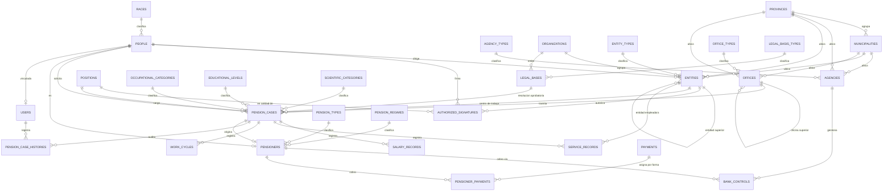
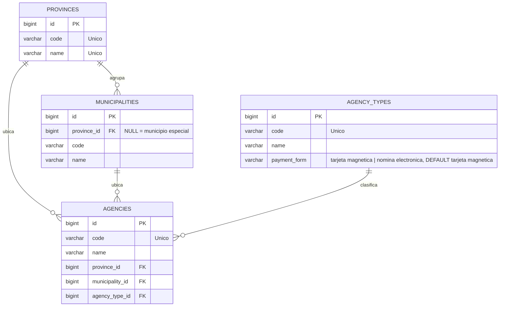
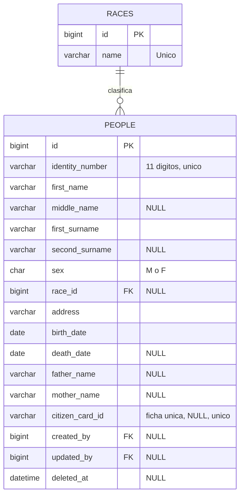
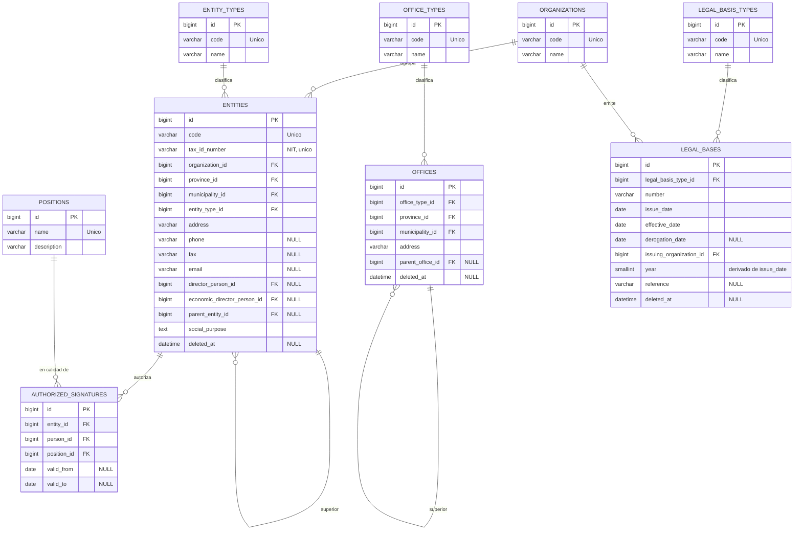
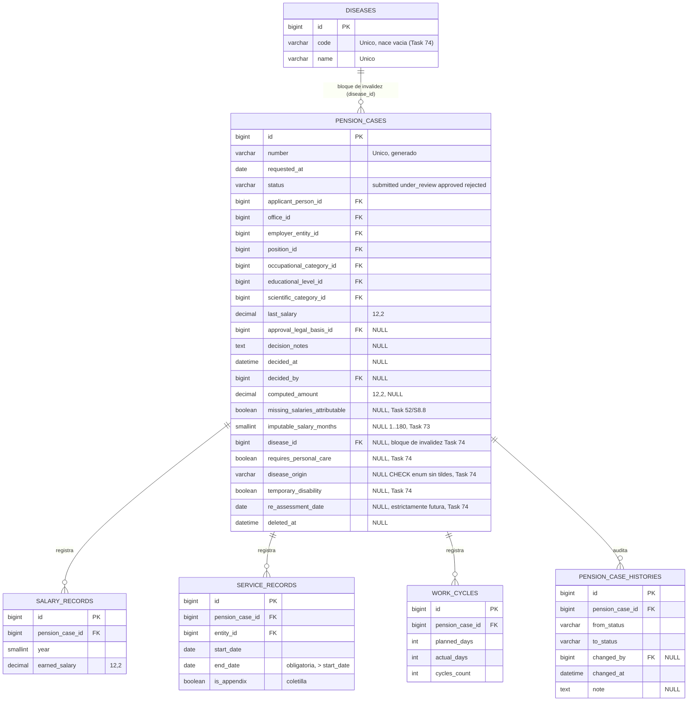
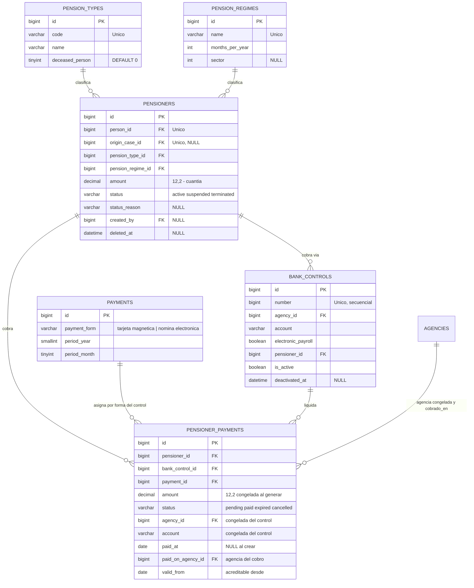
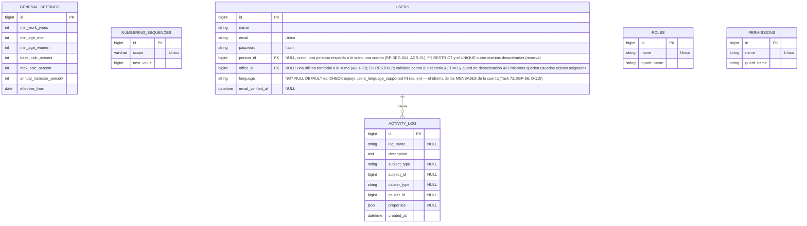

# Modelo de Datos — Sistema de Gestión de Pensionados (SGP)

| Campo | Valor |
|---|---|
| Proyecto | Sistema de Gestión de Pensionados (SGP) |
| Cliente | Ministerio de Trabajo |
| Documento | Modelo de Datos |
| Versión | 1.5 |
| Fecha | 2026-09-27 |
| Estado | Borrador para revisión del equipo de desarrollo |
| Documentos relacionados | `Requisitos funcionales.md`, `Diseño de arquitectura.md` |

---

## 1. Introducción y convenciones

### 1.1 Propósito

Este documento traduce el modelo conceptual entregado (`mdeditor.a8RzJZB8.md`) al modelo lógico-físico definitivo para MySQL 8.4: corrige los defectos detectados en el análisis (sección 2), establece el diccionario de datos completo, los diagramas entidad-relación, los dominios restringidos, las reglas de integridad, los índices y los artefactos Laravel (migraciones y seeders). Es la referencia única para desarrolladores: si una tabla o columna no está aquí, no existe.

### 1.2 Convenciones generales

| Aspecto | Convención |
|---|---|
| Motor y charset | MySQL 8.4 LTS, InnoDB, `utf8mb4` / `utf8mb4_0900_ai_ci` |
| Nomenclatura | Tablas y columnas en inglés `snake_case` plural/singular; glosario de equivalencias en la sección 3 |
| Clave primaria | `id BIGINT UNSIGNED AUTO_INCREMENT` surrogate en todas las tablas |
| Auditoría temporal | `created_at`, `updated_at` TIMESTAMP NULL en todas; `deleted_at` (soft delete) en tablas de negocio |
| Autoría | `created_by`, `updated_by` BIGINT UNSIGNED NULL → `users.id` en tablas de negocio críticas |
| Dinero | Siempre `DECIMAL(12,2)`; nunca FLOAT/DOUBLE (RN-005, RNF-008) |
| Enumeraciones | PHP backed enum + `VARCHAR(20)` + `CHECK` en BD; valores en inglés `snake_case` |
| Claves foráneas | Naming `tabla_fk_columna_foreign`; `ON DELETE RESTRICT` `ON UPDATE CASCADE` por defecto; FKs siempre indexadas |
| Unicidad | Constraints `UNIQUE` explícitos para toda clave natural (RN-008) |
| Catálogos | PK surrogate + `UNIQUE(name)`; `code` solo donde el dominio original lo define; baja lógica solo cuando tienen referencias potenciales |

## 2. Análisis del modelo conceptual y correcciones

El análisis completo de hallazgos (severidad y decisiones) consta en `Requisitos funcionales.md` sección 3 (H-01…H-16). Aquí se documentan las correcciones con impacto directo en el esquema:

| Hallazgo | Corrección aplicada al esquema |
|---|---|
| H-01 Persona como catálogo | `people` es tabla de negocio del módulo People con auditoría y soft delete |
| H-02/H-03 dinero Double/int | `last_salary`, `earned_salary`, `amount` (cuantía) y montos de pago: `DECIMAL(12,2)` |
| H-04 Expediente↔Pensionado ausente | `pensioners.origin_case_id` FK `UNIQUE` hacia `pension_cases` |
| H-05 Base legal huérfana | `pension_cases.approval_legal_basis_id` FK hacia `legal_bases` |
| H-06 contador en configuración | tabla `numbering_sequences` con bloqueo pesimista; `general_settings` queda puramente paramétrica y versionada (`effective_from`) |
| H-08 unicidades implícitas | `UNIQUE` en: CI, ficha única, códigos de catálogo, NIT, número de expediente, número de control, terna de firma, par caso-año de salarios, terna tipo-número-año legal |
| H-09 sin auditoría | `created_by/updated_by`, `deleted_at`, `activity_log` (spatie) y `pension_case_histories` |
| H-10 estado texto libre | `status VARCHAR(20)` + `CHECK IN (...)` respaldando el enum PHP `CaseStatus` |
| H-11 año redundante | `year SMALLINT` derivado de `issue_date`, indexado para consulta documental |
| H-12 catálogos heterogéneos | PK surrogate + `UNIQUE(name)` uniforme; `code` preservado solo en catálogos que lo traen del dominio |
| H-13 provincia+municipio redundante | ambas columnas se mantienen (conveniencia de consulta) + validación RN-004 en aplicación |
| H-16 sin pagos | tabla propuesta `pension_payments`, marcada (P), pendiente de validación funcional → S10.5 (Task 64/SGP-49): construida tras flag; Task 68/SGP-52: modelo a DOS niveles (`payments` + `pensioner_payments`) |

Correcciones semánticas de nomenclatura: `proponente` (era "propovente"), `firma autorizada` (era "atorizada"), `ciclo` y `cantidad de ciclos` (eran "cliclo"/"clicos"), `nivel educacional` (era "eduacional").

## 3. Glosario de equivalencias ES↔EN

| Concepto del dominio (ES) | Tabla (EN) | Modelo Eloquent |
|---|---|---|
| Provincia | `provinces` | `Province` |
| Municipio | `municipalities` | `Municipality` |
| Tipo de agencia | `agency_types` | `AgencyType` |
| Agencia | `agencies` | `Agency` |
| Organismo | `organizations` | `Organization` |
| Categoría científica | `scientific_categories` | `ScientificCategory` |
| Nivel educacional | `educational_levels` | `EducationalLevel` |
| Categoría ocupacional | `occupational_categories` | `OccupationalCategory` |
| Tipo de pensión | `pension_types` | `PensionType` |
| Enfermedad | `diseases` | `Disease` |
| Regla de invalidez | `disability_rules` | `DisabilityRule` |
| Tramo de incremento de invalidez | `disability_increment_brackets` | `DisabilityIncrementBracket` |
| Modificación especial de invalidez | `special_disability_modifications` | `SpecialDisabilityModification` |
| Tipo de beneficiario | `beneficiary_types` | `BeneficiaryType` |
| Raza | `races` | `Race` |
| Persona | `people` | `Person` |
| Cargo | `positions` | `Position` |
| Régimen de pensión | `pension_regimes` | `PensionRegime` |
| Concepto de ingreso | `income_concepts` | `IncomeConcept` |
| Configuración general | `general_settings` | `GeneralSetting` |
| Secuencia de numeración | `numbering_sequences` | `NumberingSequence` |
| Tipo de entidad | `entity_types` | `EntityType` |
| Tipo de oficina | `office_types` | `OfficeType` |
| Oficina | `offices` | `Office` |
| Entidad | `entities` | `Entity` |
| Firma autorizada | `authorized_signatures` | `AuthorizedSignature` |
| Tipo de base legal | `legal_basis_types` | `LegalBasisType` |
| Base legal | `legal_bases` | `LegalBasis` |
| Expediente | `pension_cases` | `PensionCase` |
| Ciclo (de trabajo) | `work_cycles` | `WorkCycle` |
| Registro de salario | `salary_records` | `SalaryRecord` |
| Registro de concepto de ingreso | `income_concept_records` | `IncomeConceptRecord` |
| Registro de servicio | `service_records` | `ServiceRecord` |
| Historial del expediente | `pension_case_histories` | `PensionCaseHistory` |
| Pensionado | `pensioners` | `Pensioner` |
| Control bancario | `bank_controls` | `BankControl` |
| Pago del período por forma (S10.5/Task 68/SGP-52, tras flag) | `payments` | `Payment` |
| Pago de pensión (S10.5/Task 64/SGP-49, tras flag; Task 68/SGP-52 rename) | `pensioner_payments` | `PensionerPayment` |
| Corridas de export de nómina (S10.5/Task 64/SGP-49) | `payroll_export_runs` | `PayrollExportRun` |
| Usuario | `users` | `User` |
| Bitácora de acciones | `activity_log` | (spatie/activitylog) |

Nota sobre `pension_cases`: se evita el nombre natural `cases` porque `case` es palabra reservada de PHP (`match`/`switch`) y rompería la generación del modelo Eloquent.

## 4. Diagramas entidad-relación (Mermaid)

### 4.1 Panorama general

Vista completa de entidades y relaciones; los atributos se detallan por área en 4.2–4.7.



Entidades sin relación externa en el diagrama (autónomas): `general_settings` (versión de parámetros consumida por el motor de cálculo), `numbering_sequences` (numeración centralizada), `beneficiary_types` e `income_concepts` (catálogos de referencia con uso previsto en el motor de cálculo y en la futura extensión de beneficiarios, pregunta abierta P-04).

### 4.2 Geografía y agencias



`municipalities.province_id` es nullable para modelar el municipio especial Isla de la Juventud, que no pertenece a provincia alguna (168 municipios en total).

### 4.3 Personas



### 4.4 Estructura organizacional y base legal



### 4.5 Expediente y subregistros



`computed_amount` congela la CUANTÍA VIGENTE al aprobar (RF-CAL-007): referencia rápida del expediente resuelto, escrita dentro de la MISMA transacción de la aprobación (S8.3) y limpiada por la reapertura administrativa como el resto de la decisión; la EVIDENCIA completa — entradas y parámetros del régimen congelados — vive en la tabla append-only `pension_case_calculations`, y la re-ejecución histórica sobre el snapshot reproduce la cuantía original (RF-CAL-008/RNF-010); desde la Task 53/S8.9 (versión dos del algoritmo, RF-CAL-004) la cuantía congelada INCLUYE los incrementos por conceptos de ingreso aplicables. Desde la Task 52/S8.8 (corrección de especialistas, V-5/V-6) el expediente además declara `missing_salaries_attributable` (TINYINT(1) NULL, migración `2026_10_09_100000`): la cantidad de salarios del régimen es TOPE — la serie puede declarar MENOS — y la declaración gobierna el N EFECTIVO del divisor del SPM (V-7: no imputable → R×12; imputable → N×12 con los ausentes a salario cero). `calculation_setting_id` queda DEPRECADA (Task 51/S8, C-6): sin rol desde el reajuste del S7 — el motor no lee `general_settings` —, se retira del wire (spec OpenAPI 1.10.0) y se ELIMINA del esquema en la migración de S8.1 (nunca fue escrita); desde la Task 57/SGP-42 (ADR-41) el motor v3 SÍ lee la configuración ACTIVA — pero por la PROYECCIÓN `GeneralDoctrineParameters` y por el bloque congelado `inputs.general_settings` del snapshot: la columna NO regresa (D-34).

### 4.6 Pensionados y pagos



`pensioner_payments` (Task 68/SGP-52; antes `pension_payments`) es el ledger del módulo de pagos — un pago por pensionado y `payments` (el pago del período por forma) —; se construyó tras el flag `payments.enabled` y la forma de cada fila la decide el marcador `electronic_payroll` del control.

### 4.7 Configuración, secuencias, seguridad y auditoría



`roles`, `permissions` y sus tablas puente (`model_has_roles`, `model_has_permissions`, `role_has_permissions`) siguen el esquema estándar de spatie/laravel-permission y se crean desde su migración vendor; no se duplican aquí.

## 5. Diccionario de datos

**Columnas comunes** a todas las tablas (no se repiten en cada definición): `id BIGINT UNSIGNED AUTO_INCREMENT PRIMARY KEY`, `created_at TIMESTAMP NULL`, `updated_at TIMESTAMP NULL`. Las tablas de negocio añaden `deleted_at TIMESTAMP NULL` (soft delete) y, donde se indica, `created_by`/`updated_by` BIGINT UNSIGNED NULL → `users.id`. Todas las FK son `BIGINT UNSIGNED` con índice.

### 5.1 Catálogos geográficos y organizacionales

**`provinces`** — Provincias (15 filas sembradas).

| Columna | Tipo | Nulo | Clave | Descripción |
|---|---|---|---|---|
| code | VARCHAR(4) | NO | UNIQUE | Código oficial de la provincia |
| name | VARCHAR(80) | NO | UNIQUE | Nombre |

**`municipalities`** — Municipios (168 filas sembradas).

| Columna | Tipo | Nulo | Clave | Descripción |
|---|---|---|---|---|
| province_id | BIGINT UNSIGNED | SÍ | FK → provinces | NULL = municipio especial (Isla de la Juventud) |
| code | VARCHAR(4) | NO | — | Código del municipio |
| name | VARCHAR(80) | NO | — | Nombre |
| — | — | — | UNIQUE | (`province_id`, `code`) |

**`agency_types`** — Tipos de agencia bancaria.

| Columna | Tipo | Nulo | Clave | Descripción |
|---|---|---|---|---|
| code | VARCHAR(4) | NO | UNIQUE | Código del tipo de agencia |
| name | VARCHAR(80) | NO | UNIQUE | Nombre |
| payment_form | VARCHAR(20) | NO | CHECK, DEFAULT 'tarjeta magnetica' | Forma de pago del cobro (Task 42/SGP-36, corrección de usuario, IMPLEMENTADA — migración `2026_10_03_100100`): enum `tarjeta magnetica` / `nomina electronica` — valores en MINÚSCULAS unificadas, sin tildes, tal como los fijó el usuario —, OBLIGATORIA con DEFAULT `tarjeta magnetica` (la omisión del alta del catálogo cae en el default; el patrón `deceased_person` de la Task 38) y PATCH relajado a `sometimes`; servida por la maquinaria `extraRules` del recurso genérico y condiciona la obligatoriedad de la cuenta bancaria del cobro del expediente (sección 5.7) |

CHECK: `payment_form IN ('tarjeta magnetica', 'nomina electronica')`.

**`agencies`** — Agencias bancarias.

| Columna | Tipo | Nulo | Clave | Descripción |
|---|---|---|---|---|
| code | VARCHAR(10) | NO | UNIQUE | Código de la agencia |
| name | VARCHAR(120) | NO | — | Nombre |
| province_id | BIGINT UNSIGNED | NO | FK → provinces | Provincia |
| municipality_id | BIGINT UNSIGNED | NO | FK → municipalities | Municipio (debe pertenecer a la provincia, RN-004) |
| agency_type_id | BIGINT UNSIGNED | NO | FK → agency_types | Tipo |

**`organizations`** — Organismos (OACE y equivalentes). `code VARCHAR(10) UNIQUE`, `name VARCHAR(120) UNIQUE`.

**`entity_types`** — Tipos de entidad. `code VARCHAR(10) UNIQUE`, `name VARCHAR(80) UNIQUE`.

**`office_types`** — Tipos de oficina (nacional, provincial, municipal). `code VARCHAR(10) UNIQUE`, `name VARCHAR(80) UNIQUE`.

### 5.2 Catálogos clasificatorios

Patrón común: PK surrogate + `code VARCHAR(10) UNIQUE` (clave natural inmutable presente en TODOS desde la corrección de usuario de Task 31 — antes solo nueve tablas la declaraban; migración `2026_10_01_110000`) + `name VARCHAR(80) NOT NULL UNIQUE` + los campos propios. Se listan solo los campos propios:

| Tabla | Campos propios | Semilla de referencia (a validar, P-06) |
|---|---|---|
| `scientific_categories` | — | IT/Investigador Titular, IA/Investigador Auxiliar, PT/Profesor Titular, PA/Profesor Auxiliar |
| `educational_levels` | `description VARCHAR(255) NULL` | PRIM/Primaria, SECB/Secundaria Básica, TMED/Técnico Medio, PRE/Preuniversitario, SUP/Nivel Superior |
| `occupational_categories` | — | DIR/Dirigente, ESP/Especialista, TEC/Técnico, OBR/Obrero, SER/Servicios |
| `pension_types` | `retirement_type VARCHAR(15) NOT NULL CHECK IN ('edad','invalidez','fallecimiento')` (Task 74: sustituye al booleano fallecido `deceased_person` de la Task 38; SIN default — el eje de clasificación se declara explícito en el alta, D-7403) | EDAD/Por edad/`edad`, INV/Por invalidez/`invalidez`, SOB/Por sobrevivencia/`fallecimiento` |
| `beneficiary_types` | `description VARCHAR(255) NULL` | TIT/Titular, VIU/Viuda/o, HRF/Huérfano, OTR/Otro (uso futuro, P-04) |
| `races` | — | BLA/Blanca, NEG/Negra, MUL/Mestiza o Mulata, CHN/China, OTR/Otra |
| `diseases` | — (molde uniforme races/positions, Task 74) | Nace VACÍA (D-7401): sin semilla, se llena por el CRUD uniforme |
| `positions` | `description VARCHAR(255) NULL` | JDEPT/Jefe de Departamento, JAREA/Jefe de Área, ESP/Especialista, TEC/Técnico, ASERV/Auxiliar de Servicios |
| `pension_regimes` | `months_per_year INT UNSIGNED NOT NULL CHECK (> 0)`, `sector INT NULL` (Task 38), + NUEVE columnas del motor (reajuste S7 + corrección Task 51/S8): `base_calc_percent DOUBLE NOT NULL`, `annual_increase_percent DOUBLE NOT NULL`, `limit_percent DOUBLE NOT NULL` (las tres con CHECK 0..1), `min_work_years INT UNSIGNED NOT NULL`, `min_age_men INT UNSIGNED NOT NULL`, `min_age_women INT UNSIGNED NOT NULL`, `required_salary_records INT UNSIGNED NOT NULL` (CHECK 1..15), `average_strategy VARCHAR(8) NOT NULL` (CHECK del enum), `average_years_count INT UNSIGNED NOT NULL` (CHECK 1..15 y ≤ `required_salary_records`; Task 51/S8.1, V-1: N de la ESTRATEGIA de promedio, desacoplado del gate — con `average_strategy='all'` debe IGUALAR al gate, validado 422 en el catálogo) | GEN/General sembrado: 12 meses/año, 0.60, 0.02, 0.90, 25, 60, 55, 5, `best_n`, 5 (N de la estrategia = N del gate en el General — los números confirmados no cambian); especiales a validar (P-02) |
| `income_concepts` | `description VARCHAR(255) NULL`, `applies_base_salary TINYINT(1) NOT NULL DEFAULT 0` | SALB/Salario base (1), PGR/pagos por resultados (0)… |

`pension_regimes` incluye además `description VARCHAR(255) NULL` documentando la regla de cómputo del régimen. Desde la Task 38 (corrección de usuario, SGP-32) dos catálogos de pensión ganan columnas propias servidas por la maquinaria genérica de `extraRules`: el régimen de jubilación lleva `sector INT NULL` (opcional, sin constraint — la corrección no declara dominio; migración `2026_10_02_120100`) y el tipo de pensión lleva persona fallecida `deceased_person TINYINT(1) NOT NULL DEFAULT 0` (paralelo de `applies_base_salary`: la omisión del alta cae en el DEFAULT false, y el modelo lleva el mismo default en memoria para que el 201 proyecte false sin recarga; migración `2026_10_02_120200`) — ambos devueltos por TODOS los endpoints del recurso genérico, y el PATCH relaja a `sometimes` las reglas `required` de las columnas propias de modo que editar el sector ya no exige arrastrar `months_per_year`. Desde la Task 42 (corrección de usuario, SGP-36, IMPLEMENTADA) el catálogo `payment_types` quedó ELIMINADO — tabla, modelo `PaymentType`, seeder y superficie `payment-types` del recurso genérico dejan de existir; quedan QUINCE catálogos uniformes — y en su lugar el TIPO DE AGENCIA gana la columna propia `payment_form` (sección 5.1) servida por la misma maquinaria `extraRules`: devuelta por TODOS los endpoints de `agency-types`, omisión del alta → DEFAULT `tarjeta magnetica` y PATCH `sometimes`. **Reajuste de usuario (Task 50/S7, 2026-10-06):** el régimen de jubilación recoge los PARÁMETROS DEL MOTOR DE CÁLCULO — `base_calc_percent`/`annual_increase_percent`/`limit_percent` como DOUBLE fracciones en [0, 1] (porciento de base de cálculo, de incremento anual y límite; excepción documentada a la doctrina RN-005 decidida por el usuario, igual que `worked_years`), `min_work_years` (años mínimos trabajados GENERALES), `min_age_men`/`min_age_women` (edades mínimas por sexo), `required_salary_records` (cantidad de registros de salario como TOPE MÁXIMO por expediente — corrección de especialistas 2026-10-09, Task 52/S8.8, V-5: la entrada rechaza el (N+1)-ésimo pero la revisión ADMITE series menores con la declaración de imputabilidad; fue EXACTA hasta el S7 —, con el techo 15 de la regla de usuario 1 como cota del parámetro) y `average_strategy` (estrategia del promedio: `best_n`/`last_n`/`all`) — migración `2026_10_06_100000` con backfill idempotente del General; el CRUD del catálogo valida las nuevas columnas (porcientos 0..1, N 1..15, estrategia del enum). ✅ 2026-10-06 IMPLEMENTADA (Task 50/S7): columnas NOT NULL con DEFAULT del General (los fixtures directos convergen), CHECKs en BD (porcientos [0,1], mínimos > 0, N 1..15, enum de estrategia), serialización por TODOS los endpoints del catálogo y spec OpenAPI 1.9.0.
**Ajuste de usuario (Task 74, 2026-11-12):** el tipo de pensión gana el TIPO DE JUBILACIÓN `retirement_type` — enum `edad`/`invalidez`/`fallecimiento` NOT NULL SIN DEFAULT con CHECK espejo (migración `2026_11_12_110100`: mapeo por código sembrado EDAD→edad, INV→invalidez, SOB→fallecimiento con fallback `edad` para filas operatorias, D-7404, antes del MODIFY NOT NULL) — servido por TODOS los endpoints del recurso genérico, exigido en el alta (422 sin default, D-7403) y editable en PATCH (D-7405); el booleano `deceased_person` de la Task 38 se RETIRA (DROP COLUMN: cero consumidores de negocio verificados). El catálogo de ENFERMEDADES `diseases` nace con el molde uniforme (migración `2026_11_12_110000`) y VACÍO (D-7401) — dieciséis catálogos uniformes.

### 5.3 Configuración y secuencias

**`general_settings`** — Configuración general de doctrina con regla de ÚNICA VERSIÓN ACTIVA (RF-CAT-005, REIMPLEMENTADA Task 55/SGP-40, 2026-10-11; CONSUMIDA por el motor v3 desde la Task 57/SGP-42 — ADR-41). La tabla guarda EXACTAMENTE los siete campos de la doctrina 2026; los seis parámetros v1 (años/edades mínimas y porcientos del motor) cayeron con su CHECK y su UNIQUE de `effective_from` (migración `2026_10_11_100000`, DELETE de la data previa no traducible). **Task 70/SGP-54 (ajuste de usuario 2026-10-31):** la tabla gana TRES enteros del calendario de cobro — `payment_day` (1–30), `month_to_provitional` y `month_to_expired` (ambos >= 1, directriz «monthToProvitional y monthToExpired > 0 ambos») — y pasa de siete a DIEZ campos (migración `2026_10_31_100000_add_payment_schedule_to_general_settings`, backfill 15/1/1, reversible).
**Ajuste de usuario (Task 75, 2026-11-13):** la configuración general gana la FAMILIA DE INVALIDEZ (migraciones `2026_11_13_100000/100100/100200`, módulo Settings): `disability_rules` — la regla de porcientos por ORIGEN de la enfermedad (`origin` VARCHAR(32) UNIQUE con CHECK de los cuatro literales del wire comun/profesional/accidente_trabajo/accidente_trayecto, D-7503; `base_percent` DECIMAL(5,2) NOT NULL y `increment_percent` DECIMAL(5,2) NULL, ambos CHECK [0,100], D-7504) —, `disability_increment_brackets` — el rango de años de la regla (`disability_rule_id` FK cascadeOnDelete, `min_years` SMALLINT UNSIGNED NOT NULL, `max_years` SMALLINT UNSIGNED NULL = sin techo, UNIQUE `uq_disability_brackets_rule_min` (regla, min), CHECK max ≥ min y el NO-SOLAPE entre hermanos como regla SEMÁNTICA del servicio, D-7505) — y `special_disability_modifications` — el caso nominado (`code` VARCHAR(20) UNIQUE inmutable, `description` VARCHAR(160) NULL, `percent_to_apply` DECIMAL(5,2) NOT NULL CHECK [0,100]). Las tres con autoría `created_by`/`updated_by` FK RESTRICT (AuditableObserver), timestamps, bitácora (AuditTrailObserver) y SIN soft delete deliberado (D-7507); NACEN VACÍAS (D-7506): sin semilla — el Administrador las llena por el CRUD `/api/v1/disability-rules`, `/api/v1/disability-increment-brackets` y `/api/v1/special-disability-modifications` antes del cableado del motor de invalidez.
**Ajuste de usuario (Task 76, 2026-11-15, confirmaciones 5.1..5.4):** la familia se CABLEA al motor — `disability_rules.origin` gana el QUINTO literal `fallecimiento` en su CHECK (la regla del sobreviviente que el motor selecciona por ese literal, opción A) e `increment_percent` pasa a DECIMAL(5,2) NOT NULL DEFAULT 0.00 con backfill de las filas NULL (el multiplicador ×(1+pct/100) siempre existe; CHECK sin la rama NULL); `disability_increment_brackets` gana `annual_increment_percent` DECIMAL(5,2) NOT NULL DEFAULT 0.00 CHECK [0,100] (el porciento de incremento ANUAL propio del tramo — el motor atribuye max(0, min(AT, max??∞)−min) años por tramo); `special_disability_modifications` NACE con la fila `GRAN_INVALID` SEMBRADA al 20.00% legal (SettingsSeeder, firstOrCreate por código: idempotente, jamás sobreescribe la fila del Administrador — el resto de la familia sigue naciendo vacía, D-7506); y la nueva `beneficiary_rules` (cantidad mínima SMALLINT UNSIGNED NOT NULL, cantidad máxima SMALLINT UNSIGNED NULL = sin techo con CHECK max ≥ min, porciento aplicable DECIMAL(5,2) NOT NULL DEFAULT 0.00 CHECK [0,100], UNIQUE `uq_beneficiary_rules_min`, autoría y bitácora, sin soft delete) vive en la configuración general SIN CONSUMIDOR — el motor de esta tarea no la lee y el expediente no captura beneficiarios. El snapshot `pension_case_calculations.inputs` congela la DOCTRINA DE INVALIDEZ exacta que el motor leyó (`disability`: retirement_type, disease_origin, requires_personal_care, regla con id/origen/base/increment, tramos con sus porcientos anuales y la SR GRAN_INVALID aplicada o null — RNF-010).

| Columna | Tipo | Nulo | Clave | Descripción |
|---|---|---|---|---|
| combatant_threshold_date | DATE | NO | — | Fecha umbral para combatientes (FUC): ingreso ESTRICTAMENTE anterior ⇒ PAU; en la fecha o después ⇒ PPU (D-29) |
| pre_threshold_percent | DOUBLE | NO | — CHECK [0,1] | Porciento ANTERIOR al umbral (PAU, fracción; hasta 4 decimales por el wire, D-36) |
| post_threshold_percent | DOUBLE | NO | — CHECK [0,1] | Porciento POSTERIOR al umbral (PPU, fracción; hasta 4 decimales) |
| internationalist_increment | DECIMAL(12,2) | NO | — CHECK ≥ 0 | Incremento a internacionalista (II — monto ABSOLUTO, D-20 (b)) |
| minimum_pension | DECIMAL(12,2) | NO | — CHECK ≥ 0 | Pensión mínima (PMin — doctrina 2026: 2472.00) |
| maximum_pension | DECIMAL(12,2) | NO | — CHECK ≥ 0 | Pensión máxima (PMax — doctrina 2026: 4000.00); 0.00 ⇒ el motor NO aplica tope final (D-30 (b)) |
| minimum_pension_increment | DECIMAL(12,2) | NO | — CHECK ≥ 0 | Incremento de la pensión mínima (IPmin — doctrina 2026: 1528.00) |
| payment_day | TINYINT UNSIGNED | NO | — CHECK 1–30 | Día del mes en que se realiza el pago (Task 70/SGP-54) |
| month_to_provitional | SMALLINT UNSIGNED | NO | — CHECK >= 1 | Meses desde la base hasta abrir la ventana de cobro (Task 70/SGP-54; > 0 por directriz) |
| month_to_expired | SMALLINT UNSIGNED | NO | — CHECK >= 1 | Meses de la ventana abierta hasta el cierre (Task 70/SGP-54; > 0 por directriz) |
| effective_from | DATE | NO | — | Sello de activación estampado por el puerto Clock (D-19 (b): el cliente NO lo elige) |
| active | TINYINT(1) | NO | — | Bit de la única versión activa (D-19 (b)) |
| active_singleton | TINYINT | NO | UNIQUE (generada) | 1 si active, NULL si no — el UNIQUE `uq_general_settings_one_active` hace imposible una segunda activa (RN-008) |
| deactivated_at | TIMESTAMP | SÍ | — | Sello de baja ALMACENADO (el rango de vigencia es un hecho guardado, no derivado en lectura) |
| created_by / updated_by | BIGINT UNSIGNED | SÍ | FK → users | Autoría (ADR-14) |

CHECKs: pre/post [0,1]; los cuatro montos ≥ 0; `maximum_pension >= minimum_pension`; `payment_day` 1–30 y ambos meses >= 1 (Task 70/SGP-54, D-105). Versiones append-only (RN-010): publicar desactiva la anterior en la MISMA transacción (stamp `deactivated_at`) y la activa nace con `effective_from` del Clock; solo las versiones INACTIVAS pueden borrarse (409 la activa). Sin soft delete: la historia debe permanecer reproducible (RN-007). **Task 57/SGP-42 (ADR-41):** el motor v3 consume la ACTIVA — la composición la proyecta como DTO puro `GeneralDoctrineParameters` (umbral + porcientos normalizados a fracciones exactas de hasta 4 decimales + montos DECIMAL(12,2)) y el snapshot congela el bloque `inputs.general_settings` (id + siete valores: la re-ejecución histórica no depende de la fila viva, que además es append-only); la semilla (`SettingsSeeder`) planta la NEUTRA (umbral 1970-01-01, todo ceros) que es NO-OP para el motor (D-30 (b)).

**`numbering_sequences`** — Secuencias centralizadas (reemplaza `ultimo control bancario` del modelo original, H-06).

| Columna | Tipo | Nulo | Clave | Descripción |
|---|---|---|---|---|
| scope | VARCHAR(40) | NO | UNIQUE | `bank_control`, `pension_case:{año}:{provincia}:{municipio}`, … |
| next_value | BIGINT UNSIGNED | NO | — | Próximo número a emitir |

Emisión (ADR-17): dentro de una transacción sobre la sesión dedicada `sequences` (clon de la conexión por defecto en `SettingsServiceProvider`), `SELECT ... FOR UPDATE` sobre la fila del scope, entregar el valor leído y persistir `next_value + 1`; el commit es independiente de la transacción de negocio del llamador, por lo que un rollback posterior quema el número — huecos permitidos, reutilización jamás (RN-009). Los scopes de consumo declarado se siembran en `SettingsSeeder` (`bank_control`) con `firstOrCreate` idempotente que nunca rebobina una secuencia consumida; un scope no declarado lanza `Shared\Exceptions\UnknownSequenceException` en `next()` — y desde ADR-34 el consecutivo del expediente consume la variante territorial `pension_case:{año}:{provincia}:{municipio}` por `nextForTerritory`, que NACE en 1 a su primera emisión (sin pre-declaración: el seeder no puede adivinar qué territorios existirán). Sin soft delete ni columnas de autoría: estado transaccional, no historia de negocio.

### 5.4 `people` — Personas

| Columna | Tipo | Nulo | Clave | Descripción |
|---|---|---|---|---|
| identity_number | VARCHAR(11) | NO | UNIQUE | Carné de identidad: 11 dígitos — mes/día validados y sexo por paridad del dígito 10 (validador `CubanIdentityNumber`, ADR-30) |
| first_name | VARCHAR(50) | NO | — | Primer nombre |
| middle_name | VARCHAR(50) | SÍ | — | Segundo nombre |
| first_surname | VARCHAR(50) | NO | — | Primer apellido |
| second_surname | VARCHAR(50) | SÍ | — | Segundo apellido |
| sex | CHAR(1) | NO | CHECK | `M` o `F` |
| race_id | BIGINT UNSIGNED | SÍ | FK → races | Raza declarada |
| address | VARCHAR(255) | NO | — | Dirección de residencia |
| birth_date | DATE | NO | — | Fecha de nacimiento |
| death_date | DATE | SÍ | — | Fecha de fallecimiento; > birth_date (CHECK) |
| father_name | VARCHAR(120) | SÍ | — | Nombre del padre |
| mother_name | VARCHAR(120) | SÍ | — | Nombre de la madre |
| citizen_card_id | VARCHAR(30) | SÍ | UNIQUE | Ficha única de ciudadano |
| created_by / updated_by | BIGINT UNSIGNED | SÍ | FK → users | Autoría |
| deleted_at | TIMESTAMP | SÍ | — | Soft delete |

Índices de búsqueda: `idx_people_names (first_surname, first_name, birth_date)`.

Semántica de negocio (implementada, ADR-20): el carnet `identity_number` se valida estructuralmente con el value object `CubanIdentityNumber` de Shared (RN-001 corregida por ADR-30: 11 dígitos, mes 01-12 en los dígitos 3-4 y día 01-31 en los dígitos 5-6 — año y consecutivo sin validar —; el sexo se codifica en el dígito 10, par masculino e impar femenino, y se contrasta con el declarado al alta y al editar; el dígito verificador sigue diferido a P-08) tanto en el dominio como como regla de request; es único e inmutable tras la creación, y el UNIQUE cubre también las filas desactivadas (el soft delete reserva la identidad para siempre). El control de duplicados al alta (RF-PER-005) vive en la política de dominio puro `DuplicatePolicy`: identidad ya registrada → 409 devolviendo la persona registrada (bloqueo no confirmable), homónimos vivos (mismo primer nombre + primer apellido + fecha de nacimiento) → 409 con los candidatos hasta que la petición lleve `confirm: true`; la ficha `citizen_card_id` es opcional, única y sondeada semánticamente antes del insert (RN-008). El fallecimiento (RF-PER-003) es una acción de ciclo de vida con endpoint propio `POST /people/{id}/death`: fija o corrige `death_date` (siempre auditada con el valor previo), exige fecha estrictamente posterior al nacimiento (guarda semántica + CHECK `chk_people_dates`) y nunca futura (`ClockInterface`); `deceased` se deriva de `death_date` en las lecturas y jamás se almacena. Borrado lógico con `people.delete` y autoría estampada por `AuditableObserver` (ADR-14); toda escritura aterriza en la bitácora append-only (ADR-19). La búsqueda (RF-PER-004) responde a `GET /api/v1/people` con `identity` por prefijo (patrón `ci_buscado%`, 1-11 dígitos: acota con cada dígito y 11 dígitos equivale a la búsqueda exacta; la regla de request solo admite dígitos, de modo que el LIKE es inmune a inyección), `q` por palabras cruzando las cuatro columnas de nombres, `sex`, `deceased`, rango de nacimiento y paginación ordenada por `idx_people_names`.

### 5.5 Estructura organizacional

**`offices`** — Oficinas del Ministerio.

| Columna | Tipo | Nulo | Clave | Descripción |
|---|---|---|---|---|
| office_type_id | BIGINT UNSIGNED | NO | FK → office_types | Nacional/provincial/municipal |
| province_id | BIGINT UNSIGNED | NO | FK → provinces | Provincia |
| municipality_id | BIGINT UNSIGNED | NO | FK → municipalities | Municipio (RN-004) |
| address | VARCHAR(255) | NO | — | Dirección |
| parent_office_id | BIGINT UNSIGNED | SÍ | FK → offices | Oficina superior (ADR-31: DERIVADO del tipo — provincial→nacional, municipal→provincial de su provincia, nacional raíz; el CRUD lo rellena y una contradicción responde 422) |
| deleted_at | TIMESTAMP | SÍ | — | Soft delete (libera el ámbito de unicidad territorial) |

Reglas de estructura territorial (ADR-31, corrección de usuario sobre RF-ENT-002): una sola oficina NACIONAL, una PROVINCIAL por provincia y una MUNICIPAL por provincia y municipio — contadas entre ACTIVAS, sin índice parcial en MySQL: la unicidad es semántica (servicio + política de dominio `OfficeStructurePolicy`), igual que la reserva de email de ADR-24; los prerrequisitos de inserción (provincial exige nacional, municipal exige la provincial de su provincia) responden 422 antes de persistir; la nacional se siembra al arranque (`NationalOfficeSeeder`) y la COBERTURA territorial completa también (Task 56/SGP-41): `TerritorialOfficesSeeder` siembra las 15 PROVINCIALES (asiento en el municipio capital de cada provincia) y las 167 MUNICIPALES, solo los ámbitos sin oficina ACTIVA — el municipio especial Isla de la Juventud (`province_id` NULL) queda EXCLUIDO porque no puede satisfacer la FK compuesta RN-004 ni la coherencia geográfica.

**`entities`** — Entidades empleadoras / centros de trabajo.

| Columna | Tipo | Nulo | Clave | Descripción |
|---|---|---|---|---|
| code | VARCHAR(15) | NO | UNIQUE | Código de la entidad |
| name | VARCHAR(120) | NO | — | Nombre denominativo de la entidad (corrección de usuario, Task 31) |
| tax_id_number | VARCHAR(20) | NO | UNIQUE | NIT |
| organization_id | BIGINT UNSIGNED | NO | FK → organizations | Organismo de pertenencia |
| province_id | BIGINT UNSIGNED | NO | FK → provinces | Provincia |
| municipality_id | BIGINT UNSIGNED | NO | FK → municipalities | Municipio (RN-004) |
| entity_type_id | BIGINT UNSIGNED | NO | FK → entity_types | Tipo de entidad |
| address | VARCHAR(255) | NO | — | Dirección |
| phone | VARCHAR(30) | SÍ | — | Teléfono |
| fax | VARCHAR(30) | SÍ | — | Fax |
| email | VARCHAR(120) | SÍ | — | Correo (formato validado) |
| director_person_id | BIGINT UNSIGNED | SÍ | FK → people | Director general |
| economic_director_person_id | BIGINT UNSIGNED | SÍ | FK → people | Director económico |
| parent_entity_id | BIGINT UNSIGNED | SÍ | FK → entities | Entidad superior (jerarquía acíclica) |
| social_purpose | TEXT | NO | — | Objeto social |
| deleted_at | TIMESTAMP | SÍ | — | Soft delete |

**`authorized_signatures`** — Firmas autorizadas por entidad.

| Columna | Tipo | Nulo | Clave | Descripción |
|---|---|---|---|---|
| entity_id | BIGINT UNSIGNED | NO | FK → entities | Entidad que autoriza |
| person_id | BIGINT UNSIGNED | NO | FK → people | Persona autorizada |
| position_id | BIGINT UNSIGNED | NO | FK → positions | Cargo en que firma |
| valid_from | DATE | SÍ | — | Inicio de vigencia |
| valid_to | DATE | SÍ | — | Fin de vigencia (≥ valid_from, CHECK) |
| — | — | — | UNIQUE | (`entity_id`, `person_id`, `position_id`) |

**`positions`** — Cargos. `name VARCHAR(80) UNIQUE`, `description VARCHAR(255) NULL`.

Semántica de negocio (implementada, ADR-22; migraciones `2026_09_28_120000_create_entities_table` (`+ 2026_10_01_100000_add_name_to_entities_table`, corrección de usuario de Task 31), `120001_create_offices_table` y `120002_create_authorized_signatures_table`): la aciclicidad de las jerarquías auto-referenciadas (RN-003) no es expresable como constraint declarativa de MySQL, así que la decide la política de dominio puro `HierarchyPolicy::wouldCreateCycle` antes de persistir — camina el mapa de padres activos desde el candidato hacia la raíz y bloquea con 422 cualquier re-enraizado que cierre un ciclo (self, 2-ciclo, 3-ciclo, cadena profunda); el mapa se deriva de la consulta de nodos activos y sus datasets válidos/inválidos son activos permanentes de regresión (S4.2). La coherencia geográfica (RN-004) usa el doble mecanismo de agencias: validación semántica 422 por campo en el servicio (municipio debe pertenecer a la provincia declarada, también al reubicar en PATCH contra el estado resultante) y FK compuesta `(municipality_id, province_id) → municipalities(id, province_id)` como última línea física. En `entities`, `code` y `tax_id_number` son UNIQUE, inmutables tras la creación y reservados por el soft delete (espejo de la reserva de identidad RN-001); el nombre denominativo `name` VARCHAR(120) es NOT NULL — obligatorio en el alta (422 sin él), devuelto en listado/detalle/árbol y abarcado por la búsqueda `q` — y las filas preexistentes se rellenan con su propio código en la migración (corrección de usuario de Task 31); la desactivación se rechaza (422) mientras existan entidades hijas activas — el árbol nunca huérfana un subárbol vivo — y los directores (`director_person_id`, `economic_director_person_id`) referencian personas registradas. La consulta de estructura (RF-ENT-005) expone `GET /entities/tree` y `GET /offices/tree`: árbol anidado con profundidad máxima 5 niveles y corte anunciado (`deeper: true` en el nodo del límite con descendencia) en lugar de ocultación silenciosa; el conteo de expedientes por oficina se incorpora en F3 con PensionCases. En `authorized_signatures`, la terna `(entity_id, person_id, position_id)` es UNIQUE cubriendo también las filas revocadas: la revocación es un soft delete auditado que preserva el historial y mantiene la terna reservada (no puede re-registrarse); la ventana de vigencia opcional cumple RN-006 (CHECK `chk_signature_dates: valid_to ≥ valid_from`) y el estado se deriva al leer con `SignatureStatus::resolve` contra el reloj compartido (`active`/`future`/`expired`, días inclusive, nunca almacenado); el filtrado por estado del listado se resuelve en SQL contra el mismo reloj. Autoría estampada por `AuditableObserver` y toda escritura — incluida la revocación — aterriza en la bitácora append-only (ADR-14/19).

### 5.6 Base legal

**`legal_basis_types`** — `code VARCHAR(10) UNIQUE`, `name VARCHAR(80) UNIQUE` (Ley, Decreto-Ley, Resolución, Indicación…).

**`legal_bases`** — Normas y resoluciones.

| Columna | Tipo | Nulo | Clave | Descripción |
|---|---|---|---|---|
| legal_basis_type_id | BIGINT UNSIGNED | NO | FK → legal_basis_types | Tipo |
| number | VARCHAR(30) | NO | — | Número del documento |
| issue_date | DATE | NO | — | Fecha de emisión |
| effective_date | DATE | NO | — | Puesta en vigor (≥ issue_date, CHECK) |
| derogation_date | DATE | SÍ | — | Derogación (≥ effective_date, CHECK); NULL = vigente |
| issuing_organization_id | BIGINT UNSIGNED | NO | FK → organizations | Organismo emisor |
| year | SMALLINT UNSIGNED | NO | — | Año, derivado de `issue_date` (H-11), indexado |
| reference | VARCHAR(255) | SÍ | — | Referencia documental adicional (Gaceta, etc.) |
| deleted_at | TIMESTAMP | SÍ | — | Soft delete |
| — | — | — | UNIQUE | (`legal_basis_type_id`, `number`, `year`) |

Semántica de negocio (implementada, ADR-23; migración `2026_09_28_130000_create_legal_bases_table`): la terna `(legal_basis_type_id, number, year)` es UNIQUE cubriendo también las filas desactivadas — el soft delete reserva la terna — e inmutable tras la creación: el año se DERIVA de `issue_date` dentro del `LegalBasisService` (H-11) y jamás viaja en la petición, de modo que la identidad de una norma no puede re-escribirse desde fuera; cambiar tipo, número o fecha de emisión responde 422. El orden de fechas RN-006 se valida contra el estado RESULTANTE en alta y edición (la PATCH mezcla las fechas viajadas con las almacenadas antes de comprobar) y queda respaldado por los CHECKs `chk_legal_basis_effective` (`effective_date ≥ issue_date`) y `chk_legal_basis_derogation` (`derogation_date ≥ effective_date`). La vigencia es estado DERIVADO al leer con `LegalBasisStatus::resolve` contra el reloj compartido — `future` (puesta en vigor por llegar), `effective` (en vigor: desde su `effective_date`, con cortes inclusivos), `derogated` (desde su `derogation_date`, ese día ya cuenta como derogada) — y jamás se almacena; el filtro del listado por estado se resuelve en SQL contra el mismo reloj, de modo que `status=effective` es literalmente el selector de vigentes que la aprobación de expedientes consumirá (RF-LEG-003; la regla de «forzar una derogada con advertencia» aterriza con PensionCases en F3, que posee la transición de aprobación). La derogación es una EDICIÓN de fecha auditable con valores previos (fijar, corregir o limpiar con null), nunca una acción destructiva propia; el borrado lógico desactiva la base y reserva la terna. `legal_basis_types` ya está servido por el recurso genérico de catálogos (ADR-15, RF-LEG-001) con semilla Ley/Decreto-Ley/Decreto/Resolución/Indicación. Autoría estampada por `AuditableObserver` y toda escritura aterriza en la bitácora append-only (ADR-14/19).

### 5.7 Expedientes y subregistros

**`pension_cases`** — Expediente de pensión (agregado raíz del módulo).

| Columna | Tipo | Nulo | Clave | Descripción |
|---|---|---|---|---|
| number | VARCHAR(20) | NO | UNIQUE | Número compuesto PPMMAACCCCC (ADR-34, regla de usuario 2): códigos de provincia (2) y municipio (2) de la oficina registrante, últimos dos dígitos del año en curso (2) y consecutivo TERRITORIAL rellenado con ceros a 5, once dígitos contiguos — scope `pension_case:{año}:{provincia}:{municipio}` de la secuencia centralizada |
| requested_at | DATE | NO | — | Fecha de solicitud |
| status | VARCHAR(20) | NO | CHECK | `submitted` / `under_review` / `approved` / `rejected` (enum PHP `CaseStatus`) |
| applicant_person_id | BIGINT UNSIGNED | NO | FK → people | Proponente |
| office_id | BIGINT UNSIGNED | NO | FK → offices | Oficina del usuario que REGISTRA el expediente (regla de usuario 0/ADR-33: asumida del actor, jamás viaja en el POST) |
| employer_entity_id | BIGINT UNSIGNED | NO | FK → entities | Centro de trabajo |
| position_id | BIGINT UNSIGNED | NO | FK → positions | Cargo declarado |
| occupational_category_id | BIGINT UNSIGNED | NO | FK → occupational_categories | Categoría ocupacional |
| educational_level_id | BIGINT UNSIGNED | NO | FK → educational_levels | Nivel educacional |
| scientific_category_id | BIGINT UNSIGNED | NO | FK → scientific_categories | Categoría científica |
| pension_type_id | BIGINT UNSIGNED | NO | FK → pension_types | Tipo de pensión (regla de usuario 4, obligatorio) |
| pension_regime_id | BIGINT UNSIGNED | NO | FK → pension_regimes | Régimen de pensión (regla de usuario 4, obligatorio) |
| last_salary | DECIMAL(12,2) | NO | CHECK ≥ 0 | Último salario |
| missing_salaries_attributable | TINYINT(1) | SÍ | — | ¿Los salarios ausentes son imputables al TRABAJADOR? (Task 52/S8.8, V-6 — corrección de especialistas 2026-10-09, D-2/D-3): NULL = sin declarar — válido SOLO si no hay déficit (R ≥ N de la estrategia `average_years_count`); con déficit (R < N), el checklist de revisión (ítem `missing_salaries_attributable`) y el 422 de vista previa/aprobación la exigen; false = carencia NO imputable → el motor divide por R×12 (N efectivo = R); true = carencia imputable → divide por N×12 (los períodos ausentes computan salario cero); declarable en el alta y editable por PUT SOLO en `submitted`, verificada por el especialista en la vista previa; migración `2026_10_09_100000`, tras `last_salary`; toda escritura en la bitácora (ADR-19) |
| imputable_salary_months | SMALLINT UNSIGNED | SÍ | CHECK 1..180 | Divisor explícito del SPM en meses (Task 73, D-7307): declarable SOLO en la rama `missing_salaries_attributable`=false (prohibido fuera — 422, jamás descarte silencioso), exigido por el ítem del checklist cuando la declaración no imputable carece de meses (422 `imputable_months_indeterminate` en checklist/vista previa/aprobación), editable por PUT en `submitted` contra el estado RESULTANTE; congelado como columna fuerte del snapshot (D-7308); migración `2026_11_12_100100`, tras `missing_salaries_attributable` |
| rebel_army_member | TINYINT(1) | NO | DEFAULT 0 | Pertenece al Ejército Rebelde (regla de usuario 4) |
| rebel_army_join_date | DATE | SÍ | CHECK (par) | Fecha de alta en el Ejército Rebelde: obligatoria si `rebel_army_member=1`, rechazada si `=0` (CHECKs directo e inverso) |
| internationalist | TINYINT(1) | NO | DEFAULT 0 | Internacionalista (Task 37/SGP-31, corrección de usuario): el promovente cumplió misión internacionalista — booleana OBLIGATORIA en el wire (paralelo de `rebel_army_member`; 422 si se omite), DEFAULT 0 para escrituras fuera del wire |
| filed_by_person_id | BIGINT UNSIGNED | SÍ | FK → people | Persona por (Task 35; renombrada a columna inglesa por Task 36): persona REGISTRADA que presenta o gestiona el expediente cuando no es el propio proponente — sonda sobre la superficie ACTIVA del registro (desactivada = 422), omisión = NULL, restrictOnDelete |
| phone | VARCHAR(30) | SÍ | — | Teléfono de contacto del promovente (Task 37): texto libre opcional (422 con 31 caracteres; omisión = NULL) |
| popular_council | VARCHAR(120) | SÍ | — | Consejo popular del promovente (Task 37): división territorial cubana, texto libre opcional (422 con 121 caracteres; omisión = NULL) |
| termination_date | DATE | SÍ | — | Fecha de desvinculación del promovente (Task 38/SGP-32, corrección de usuario): opcional en el wire con regla de forma Y-m-d única (422 con formato inválido; sin sonda semántica), omisión = NULL; migración `2026_10_02_120000` |
| current_address | VARCHAR(255) | NO | — | Dirección actual del promovente (Task 42/SGP-36, corrección de usuario, IMPLEMENTADA): OBLIGATORIA en el wire (422 si se omite), texto libre con el techo de 255 |
| residence_province_id | BIGINT UNSIGNED | NO | FK → provinces | Provincia de residencia del promovente (Task 42): OBLIGATORIA, sonda sobre la superficie ACTIVA del catálogo |
| residence_municipality_id | BIGINT UNSIGNED | NO | FK → municipalities | Municipio de residencia del promovente (Task 42): OBLIGATORIO, coherencia RN-004 sondeada — el municipio pertenece a la provincia de residencia declarada (422; P-09 para el municipio especial) |
| collection_agency_type_id | BIGINT UNSIGNED | NO | FK → agency_types | Tipo de agencia de cobro del promovente (Task 42): OBLIGATORIO, sonda ACTIVA; su `payment_form` decide la exigencia de la cuenta bancaria |
| collection_agency_id | BIGINT UNSIGNED | NO | FK → agencies | Agencia de cobro del promovente (Task 42): OBLIGATORIA, sonda ACTIVA y de-ese-tipo — la agencia pertenece al tipo declarado (422) |
| bank_account | VARCHAR(34) | SÍ | — | Cuenta bancaria del cobro (Task 42): OBLIGATORIA CONDICIONADA — exigida (422 sobre `bank_account`) cuando la forma de pago del tipo de agencia de cobro es `tarjeta magnetica`, OPCIONAL con `nomina electronica` (omisión = NULL; proveerla se permite) —; el grupo entero de domicilio y cobro es EDITABLE por PUT (el usuario lo explicitó: pueden modificarse) |
| disease_id | BIGINT UNSIGNED | SÍ | FK → diseases (RESTRICT) | Enfermedad del bloque de invalidez (Task 74): sonda ACTIVA exigida al declarar (422 si no existe o está desactivada); una enfermedad DESACTIVADA tras la declaración conserva la referencia (D-7412) |
| requires_personal_care | TINYINT(1) | SÍ | — | ¿Requiere cuidado de otra persona? (Task 74) |
| disease_origin | VARCHAR(20) | SÍ | CHECK IN | Origen de la enfermedad (Task 74): `comun`/`profesional`/`accidente_trabajo`/`accidente_trayecto` — valores del wire sin tildes (enum PHP `DiseaseOrigin`) |
| temporary_disability | TINYINT(1) | SÍ | — | ¿La invalidez es temporal? (Task 74) |
| re_assessment_date | DATE | SÍ | CHECK (par) | Fecha de re-peritaje (Task 74): exigida SOLO con `temporary_disability`=true, prohibida con false (CHECK NULL-safe del par en tres ramas explícitas) y ESTRICTAMENTE futura contra el reloj al DECLARARSE (D-7409 — sonda del servicio sobre el valor del payload; una fecha almacenada que envejece no bloquea un PATCH ajeno) |
| approval_legal_basis_id | BIGINT UNSIGNED | SÍ | FK → legal_bases | Resolución aprobatoria (H-05); obligatoria al aprobar |
| decision_notes | TEXT | SÍ | — | Nota de resolución o motivo de denegación |
| decided_at | DATETIME | SÍ | — | Momento de la decisión |
| decided_by | BIGINT UNSIGNED | SÍ | FK → users | Usuario decisor |
| computed_amount | DECIMAL(12,2) | SÍ | CHECK ≥ 0 | Cuantía calculada congelada al aprobar |
| created_by / updated_by | BIGINT UNSIGNED | SÍ | FK → users | Autoría |
| deleted_at | TIMESTAMP | SÍ | — | Soft delete |

Índice de gestión: `idx_cases_office_status (office_id, status, requested_at)`.

**Ventana salarial y divisor imputable** (Task 73, ajuste de usuario 2026-11-12) — el gate de revisión exige la serie salarial de la VENTANA de los últimos N=`required_salary_records` años (dominio `SalaryWindow`: R = año de la `termination_date` cuando la desvinculación PREDATA la fecha actual — la ventana congela el momento histórico de la salida —, si no el año del reloj; ventana [R−N+1, R]); la exigencia es CONDICIONADA a los años de la ventana cubiertos por registros de servicios (un servicio cubre el año A cuando `start_date` ≤ A-12-31 y `end_date` ≥ A-01-01) y los salarios POR DEBAJO de la ventana están PROHIBIDOS: los ítems `salary_records_years` y `salary_records_out_of_window` del checklist responden 422 con los arrays `missing_salary_years`/`out_of_window_salary_years`. El divisor por meses imputables `imputable_salary_months` (fila de arriba) gobierna el SPM de la rama no imputable (RF-CAL-003) y el snapshot lo congela (`pension_case_calculations.imputable_salary_months` columna fuerte + dentro de `inputs`; NULL ⇒ divisor histórico N_ef×12).

**Bloque de invalidez de `pension_cases`** (Task 74, ajuste de usuario 2026-11-12) — las cinco columnas que la captura de un expediente cuyo tipo de jubilación es `invalidez` exige registrar (migración `2026_11_12_110200_add_disability_block_to_pension_cases_table`): CHECKs de última línea — el par temporal coherente en AMBOS sentidos expresado NULL-safe en tres ramas explícitas (la forma de dos ramas dejaría pasar `temporary_disability` NULL con fecha puesta) y el bloque TODO-O-NADA (los cuatro campos de presencia todos NULL o todos declarados). La exigencia condicional vive en la sonda del servicio `assertDisabilityBlockIsCoherent` (lee el `retirement_type` de la fila del tipo de pensión RESULTANTE — payload ∪ stored —; molde `bank_account` de la Task 42): invalidez ⇒ bloque completo (422 clave por clave, enfermedad ACTIVA); cualquier otra rama ⇒ bloque PROHIBIDO (422, D-7408 — jamás un descarte silencioso). El PUT lo edita en `submitted` contra el estado RESULTANTE (D-7407); la lectura expone SOLO los cinco escalares — `disease_id` como id, SIN proyección `disease` (D-7410).

**`salary_records`** — Serie salarial anual (MÁXIMO 15 filas vivas por expediente, regla de usuario 1: la columna generada no puede contar filas — la guarda vive en `SalarySeries::MAX_RECORDS` del dominio, sondeada en el payload y en cada alta individual; borrar una fila libera el cupo).

| Columna | Tipo | Nulo | Clave | Descripción |
|---|---|---|---|---|
| pension_case_id | BIGINT UNSIGNED | NO | FK → pension_cases | Expediente |
| year | SMALLINT UNSIGNED | NO | — | Año (CHECK: 1950…año actual+1) |
| earned_salary | DECIMAL(12,2) | NO | CHECK ≥ 0 | Salario devengado |
| — | — | — | UNIQUE | (`pension_case_id`, `year`) |

**`service_records`** — Historial laboral.

| Columna | Tipo | Nulo | Clave | Descripción |
|---|---|---|---|---|
| pension_case_id | BIGINT UNSIGNED | NO | FK → pension_cases | Expediente |
| entity_id | BIGINT UNSIGNED | NO | FK → entities | Entidad empleadora |
| start_date | DATE | NO | — | Inicio del vínculo |
| end_date | DATE | NO | CHECK > start_date | Fin del vínculo, OBLIGATORIO y estrictamente posterior al inicio (Task 37/SGP-31, corrección de usuario: el vínculo vigente de fin NULL dejó de existir; migración `2026_10_02_110100` endureció el CHECK de ≥ a >) |
| is_appendix | TINYINT(1) | NO | DEFAULT 0 | Coletilla: servicio reconocido adicional |
| declaration_form | VARCHAR(20) | NO | DEFAULT 'Documental' | Forma de declaración del vínculo: Documental (respaldo documental) o Testifical (testimonio); CHECK Documental\|Testifical (corrección de usuario, Task 32; columna inglesa desde Task 36) |
| worked_years | DOUBLE | NO | — | Años de trabajo del vínculo (correcciones de usuario, Tasks 47→48→66/SGP-38 — TRUNCAMIENTO restaurado 2026-10-23): calculados al crear la fila con la fórmula del usuario TRUNCADA al entero — TRUNCAR(((AÑO(end) - AÑO(start)) × 12 + (MES(end) - MES(start))) / M), M = `months_per_year` del régimen del expediente; 71/12 = 5.9167 → `5`, la media jamás sube — y congelados (sin edición de subregistros); DOUBLE decidido por el usuario (decisión Task 48 mantenida): valor DERIVADO del servidor (intdiv de enteros, jamás entrada del cliente — excepción puntual y documentada de RN-005); migraciones `2026_10_04_100000` (nacimiento) + `2026_10_04_200000` (ajuste de tipo + backfill ROUND) + `2026_10_23_100000` (backfill DIV del truncamiento restaurado) |
| worked_months | SMALLINT UNSIGNED | NO | — | Meses de trabajo del vínculo (corrección de usuario, Task 48/SGP-38 — DECISIÓN 2026-10-04): MESES TOTALES de diferencia del período — (AÑO(end) - AÑO(start)) × 12 + (MES(end) - MES(start)), SIN divisor M: 71 en el ejemplo del usuario —, calculados al crear la fila EN EL MISMO MOMENTO que worked_years (la misma aritmética de meses del dominio) y congelados (sin edición de subregistros); entero exacto; migración `2026_10_04_200000` |

El solapamiento se RECHAZA en la capa de aplicación (Task 37, corrección de usuario sobre el «detecta y advierte» del Sprint 5): `ServicePeriods` sondea los DOS puntos de entrada — filas anidadas del alta (pares, sobre `service_records`) y alta individual contra lo almacenado (sobre `end_date`) — con 422 antes de escribir; los períodos son cerrados y disjuntos por construcción, de modo que el objeto `warnings` solo conserva los años salariales interiores ausentes (RF-EXP-002); MySQL no expresa el solapamiento como constraint.

Años y meses de trabajo (Task 45, corrección de usuario, SGP-38; TIPO ENTERO en la Task 46, TRUNCAMIENTO en la Task 47, REDONDEO en la Task 48 — DECISIÓN 2026-10-04: worked_years a DOUBLE y worked_months ENTERO añadido — y TRUNCAMIENTO RESTAURADO por la corrección de usuario Task 66, 2026-10-23): cada fila declara DOS columnas derivadas hermanas — `worked_years` DOUBLE y `worked_months` SMALLINT UNSIGNED —, calculadas por el servicio de aplicación AL CREAR el subregistro en los DOS puntos de entrada (filas anidadas del alta y endpoint propio), en el MISMO momento, y jamás aceptadas en el wire (422 si el cliente las envía: son valores derivados, no datos del declarante). La aritmética de MESES es compartida y pura: `meses = ((YEAR(end_date) - YEAR(start_date)) * 12 + (MONTH(end_date) - MONTH(start_date)))` — AÑO/MES ignoran el día, `end_date > start_date` (Task 37) garantiza un valor definido y no negativo, un período dentro del mismo mes rinde `0` —; `worked_months` la persiste literal (SIN divisor: los 71 meses del ejemplo del usuario) y `worked_years` la divide por `M = months_per_year` del régimen de pensión del expediente con TRUNCAMIENTO al entero (la corrección Task 66 retira el redondeo de la Task 48: PHP `intdiv($meses, $M)` — la división entera es pura y el cast a float mantiene el DOUBLE —; SQL del backfill `DIV` — 2000-01-01 → 2005-12-31 con M = 12 rinde 71 meses → 71/12 = 5.9167 → `5`, la media exacta se descarta (6 meses / 12 = 0.5 → `0`) y once meses rinden `0` (0.9167)). El DOUBLE es decisión explícita del usuario: RN-005 blinda el dinero y toda entrada del cliente, y este valor jamás viene del wire — lo calcula el servidor con intdiv de enteros, de modo que siempre aterriza un entero exacto (la excepción queda documentada y acotada al campo). Ambos valores se CONGELAN al crear (los subregistros no se editan: solo alta y baja) y viajan en el 201 del alta, el detalle del expediente y el schema OA como NÚMEROS JSON — `worked_years` type: number (format: double; el JSON no distingue 5 de 5.0: número) y `worked_months` type: integer `71` —; el índice de expedientes no carga subregistros — sin cambio. La migración `2026_10_04_200000` ejecuta el ajuste en pasos deterministas: MODIFY de `worked_years` a DOUBLE, ADD de `worked_months` NULL, backfill de UNA pasada por JOIN a `pension_cases` → `pension_regimes` que RECOMPUTA ambos valores (ROUND para los años, meses totales para el nuevo campo; regímenes desactivados incluidos: la clasificación del expediente es histórica) y NOT NULL final de `worked_months`. La corrección Task 66 (2026-10-23) añade la migración `2026_10_23_100000`: backfill de UNA pasada que RECOMPUTA `worked_years` con `DIV` (el truncamiento restaurado; el down revierte a `ROUND`), sin tocar el tipo DOUBLE ni `worked_months`. El cálculo vive en el dominio puro `ServicePeriods` (`workedMonths` + `workedYears`, Tasks 48/66) y el divisor M se lee por el puerto del repositorio `monthsPerYearOfRegime` — la capa Application jamás consulta.

**`work_cycles`** — Ciclos de trabajo.

| Columna | Tipo | Nulo | Clave | Descripción |
|---|---|---|---|---|
| pension_case_id | BIGINT UNSIGNED | NO | FK → pension_cases | Expediente |
| planned_days | INT UNSIGNED | NO | — | Días plan |
| actual_days | INT UNSIGNED | NO | — | Días reales |
| cycles_count | INT UNSIGNED | NO | — | Cantidad de ciclos |

**`income_concept_records`** — Conceptos de ingreso declarados del expediente (regla de usuario 5, ADR-32; Task 54/SGP-39, corrección de usuario: la declaración es SOLO el porciento — el importe `amount` se retiró de la captura y del esquema).

| Columna | Tipo | Nulo | Clave | Descripción |
|---|---|---|---|---|
| pension_case_id | BIGINT UNSIGNED | NO | FK → pension_cases | Expediente |
| income_concept_id | BIGINT UNSIGNED | NO | FK → income_concepts | Concepto del catálogo (salario en divisas, antigüedad…) |
| applied_percent | DECIMAL(5,2) | NO | CHECK 0–100, DEFAULT 0.00 | Porciento a aplicar (Task 42/SGP-36, corrección de usuario, IMPLEMENTADA): Double OBLIGATORIO en el wire con rango 0–100 y 2 decimales exactos (cadena decimal por la doctrina RN-005, jamás float); el DEFAULT solo cubre escrituras fuera del wire |
| — | — | — | UNIQUE | (`pension_case_id`, `income_concept_id`) — un porciento declarado por concepto |

Sin timestamps ni autoría propias (las convenciones del agregado): las bajas son físicas y auditadas con los valores previos (ADR-19). El par (caso, concepto) se sondea semánticamente antes del insert (422 sobre `income_concept_id`, RN-008) y el catálogo se exige ACTIVO en alta y edición. El porciento a aplicar (Task 42) viaja por fila en el payload anidado y en el endpoint propio: 422 si se omite, si queda fuera del rango 0–100 o si trae más de dos decimales, con el CHECK `chk_income_concept_records_applied_percent` como última línea. Desde la Task 53/S8.9 (versión dos de la cuantía, D-6 (b)) el porciento de los conceptos APLICABLES (`applies_base_salary = true`) PARTICIPA del motor: cada fila aporta SPM × (applied_percent/100) como INCREMENTO de la cuantía base del régimen, antes del tope final SPM×PIL (RF-CAL-004) — los NO aplicables jamás alteran el cálculo (D-8: no existe `calculation_version`, el algoritmo es universal). Task 54/SGP-39 (corrección de usuario 2026-10-10, D-14..D-17 confirmados): el importe `amount` declarado se RETIRA por completo — el wire ya NO lo exige y responde 422 EXPLÍCITO si el payload lo trae (doctrina anti-descarte-silencioso, el mismo trato de `office_id`), la columna DECIMAL(12,2) y su CHECK `chk_income_concept_records_amount` se ELIMINAN (migración `2026_10_10_100000_drop_amount_from_income_concept_records_table`) y las respuestas 201/GET del subregistro dejan de servirlo; la fila queda EXACTAMENTE (caso, concepto, porciento) — lo único que el motor v2 consume; las bajas físicas siguen auditando los valores previos en la bitácora (ADR-19) y los snapshots congelados PREVIOS no se tocan (evidencia JSON: la re-ejecución lee el porciento de la lista, con o sin el campo).

**`pension_case_histories`** — Bitácora de transiciones (append-only, RN-010). IMPLEMENTADA (Sprint 6/Task 49): migración `2026_10_04_300000` con FK a `pension_cases` (RESTRICT), `changed_by` FK nullable a `users`, `changed_at` DATETIME con el índice de línea de tiempo `idx_case_history_timeline (pension_case_id, changed_at)`, `note` TEXT nullable, CHECKs del catálogo normativo de estados en ambas columnas y SOLO `created_at` (sin `updated_at`: la fila jamás se muta — el modelo rechaza actualizar y borrar); la misma migración añade `idx_cases_office_requested (office_id, requested_at, id)` del listado afinado. Escrita por `CaseTransitionService` dentro de la transición de la transición (una fila por transición legal) y servida por GET /pension-cases/{id}/transitions.

**`pension_case_calculations`** — Snapshot congelado del cálculo por resolución (append-only, RN-010; Task 51/S8, DECISIÓN de usuario 2026-10-06 — RF-CAL-007/008; columnas de imputabilidad Task 52/S8.8). Una fila por RESOLUCIÓN del expediente: `UNIQUE(pension_case_id, sequence)` — la reapertura administrativa y una re-aprobación posterior generan `sequence` 2 y el cálculo anterior SOBREVIVE para trazabilidad —; columnas fuertes del resultado (`service_months SMALLINT UNSIGNED`, `service_years_exact DOUBLE`, `service_years_truncated SMALLINT UNSIGNED`, `average_strategy VARCHAR(8)`, `average_years_count SMALLINT UNSIGNED` con el N propio congelado — V-1 —, `average_years_effective SMALLINT UNSIGNED` con el N EFECTIVO divisor congelado (Task 52/S8.8, V-8/D-5: backfill = `average_years_count` — el gate exacto histórico hace N_ef = N en toda fila preexistente —, CHECK 1..15 y ≤ `average_years_count`), `missing_salaries_attributable TINYINT(1) NULL` con la declaración de imputabilidad congelada (NULL en filas sin déficit), `average_monthly_salary DECIMAL(12,2)`, `excess_years SMALLINT UNSIGNED`, `amount DECIMAL(12,2)` con la cuantía congelada, `eligibility JSON` con el booleano y la explicación por criterio) y evidencia documental congelada: `regime_parameters JSON` (los parámetros del régimen al aprobar: porcientos, mínimos, AMBOS N, estrategia y `months_per_year`) e `inputs JSON` (ids y valores usados: registros de salario seleccionados con su devengado, registros de servicio con sus meses, `requested_at`, nacimiento y sexo de la persona, y desde Task 52/S8.8 la declaración `missing_salaries_attributable` — la re-ejecución histórica reproduce el N efectivo y el divisor exacto — y desde Task 53/S8.9 la lista `income_concepts[]`: {income_concept_id, code, applied_percent} por fila (Task 54/SGP-39: el `amount` se retiró de la captura — los snapshots PREVIOS que traen el campo se leen sin romper: el motor solo consume el porciento), la RISB EXACTA de conceptos aplicables que consumió el motor como incrementos de la cuantía (D-10) — SIN columnas nuevas: la versión dos es universal (D-8) y la evidencia viaja en el JSON existente; los snapshots PREVIOS (sin la lista) re-ejecutan exacto con el motor v2 — lista ausente ⇒ Σ = 0 ⇒ parte base sola —); `computed_by` FK a `users` (restrict) y `computed_at` DATETIME; CHECKs de no-negatividad (`amount` ≥ 0, `average_monthly_salary` ≥ 0, `sequence` > 0, `excess_years` ≥ 0); FK a `pension_cases` RESTRICT; SOLO `created_at` (sin `updated_at`: la fila jamás se muta — el modelo rechaza actualizar y borrar, como `PensionCaseHistory`). Escrita por `CaseTransitionService` DENTRO de la transacción de la aprobación (el mismo lock de fila del S6) junto con `pension_cases.computed_amount`; la reapertura limpia la referencia vigente del expediente pero JAMÁS borra snapshots. Servida por `GET /pension-cases/{id}/calculation` (snapshot vigente + versiones por `sequence`); desde la Task 65/SGP-50 (ajuste de usuario 2026-10-21) `service_years_exact` se SIRVE redondeado a 2 decimales de presentación en el wire — la columna DOUBLE persiste el valor EXACTO congelado (RNF-010: re-derivable de `service_months`/`months_per_year` del propio congelado), CERO cambios de esquema; la re-ejecución histórica (RNF-010) re-alimenta el motor puro con `inputs` + `regime_parameters` y reproduce `amount` exacto aunque el régimen vivo haya cambiado. Desde la Task 57/SGP-42 (D-33) `inputs` congela además las banderas `rebel_army_member`/`rebel_army_join_date`/`internationalist`, la lista `non_salary_base_income_concepts[]` (la RINSB exacta, {income_concept_id, code, applied_percent}) y el bloque `general_settings` (id + los siete valores de doctrina usados); los snapshots PREVIOS sin las claves re-ejecutan EXACTO (claves ausentes ⇒ banderas falsas + RINSB vacía + doctrina NEUTRA ⇒ v2 al centavo — RNF-010 a salva). Desde la Task 73 (ajuste de usuario 2026-11-12, D-7308) congela además `imputable_salary_months` SMALLINT UNSIGNED NULL (CHECK 1..180, misma migración `2026_11_12_100100`) como columna fuerte y dentro de `inputs` — NULL ⇒ divisor histórico N_ef×12; el motor de la rama no imputable divide por los meses declarados (`AverageSalary.divisorMonths`, servido como `average_divisor_months`) y los snapshots PREVIOS re-ejecutan exacto con el divisor histórico.

| Columna | Tipo | Nulo | Clave | Descripción |
|---|---|---|---|---|
| pension_case_id | BIGINT UNSIGNED | NO | FK → pension_cases | Expediente |
| from_status | VARCHAR(20) | NO | — | Estado previo |
| to_status | VARCHAR(20) | NO | — | Estado nuevo |
| changed_by | BIGINT UNSIGNED | SÍ | FK → users | Usuario responsable |
| changed_at | DATETIME | NO | — | Momento (índice) |
| note | TEXT | SÍ | — | Nota de la transición |

Semántica de negocio (implementada, ADR-25 + reglas de usuario 0-5/ADR-32/33; migraciones `2026_09_28_150000_create_pension_cases_table` a `150003_create_work_cycles_table`, `2026_09_30_120000_add_pension_classification_to_pension_cases_table` y `2026_09_30_120100_create_income_concept_records_table`, `2026_10_01_120000_add_forma_declaracion_to_service_records_table`, `2026_10_01_130000_add_persona_por_to_pension_cases_table` y `2026_10_01_140000_reference_persona_por_to_people_on_pension_cases_table`, `2026_10_02_100000_rename_forma_declaracion_to_declaration_form_on_service_records_table` y `2026_10_02_100100_rename_persona_por_id_to_filed_by_person_id_on_pension_cases_table`, `2026_10_02_110000_add_promovente_contact_and_internationalist_to_pension_cases_table` y `2026_10_02_110100_tighten_period_rules_on_service_records_table`, `2026_10_02_120000_add_termination_date_to_pension_cases_table`, `2026_10_02_120100_add_sector_to_pension_regimes_table`, `2026_10_02_120200_add_deceased_person_to_pension_types_table` y `2026_10_02_130000_release_open_case_reservation_on_pension_cases_soft_delete` (Task 40/SGP-34: la columna generada `open_case_key` se re-crea con la expresión ampliada que también anula la reservación en filas soft-deleted — MySQL exige soltar índice y columna antes de re-añadir ambos con la nueva expresión), `2026_10_03_100000_drop_payment_types_table`, `2026_10_03_100100_add_payment_form_to_agency_types_table`, `2026_10_03_100200_add_promovente_residence_and_collection_to_pension_cases_table` y `2026_10_03_100300_add_applied_percent_to_income_concept_records_table` (Task 42/SGP-36: eliminación del catálogo de tipos de pago, forma de pago del tipo de agencia, grupo de domicilio y cobro del promovente con cuenta condicional, y porciento a aplicar del concepto de ingreso) y `2026_10_04_100000_add_worked_years_to_service_records_table` (Task 45/SGP-38; TIPO ENTERO ajustado en la Task 46, TRUNCAMIENTO en la Task 47 y DOUBLE+REDONDEO en la Task 48) y `2026_10_04_200000_add_worked_months_and_double_worked_years_to_service_records_table` (Task 48/SGP-38, DECISIÓN de usuario 2026-10-04: `worked_years` pasa de SMALLINT UNSIGNED truncado a DOUBLE con redondeo al entero más cercano — 71/12 = 5.9167 → `6`, la media sube — y nace `worked_months` SMALLINT UNSIGNED con los MESES TOTALES de diferencia, sin divisor M — 71 en el ejemplo —; backfill de una sola pasada que RECOMPUTA ambos valores de las filas preexistentes por JOIN al régimen del expediente): el número del expediente es COMPUESTO — PPMMAACCCCC, once dígitos contiguos: provincia y municipio de la oficina registrante + últimos dos dígitos del año en curso + consecutivo TERRITORIAL — emitido por el puerto `SequenceGeneratorInterface::nextForTerritory` sobre el scope `pension_case:{año}:{provincia}:{municipio}` de la secuencia centralizada (RN-009/ADR-17/ADR-34), tras completar toda la validación semántica y antes de la transacción de negocio, de modo que un 422 no quema números y un fallo de insert sí (hueco aceptado por diseño, jamás reutilizado); la OFICINA del expediente es la del usuario que REGISTRA (regla 0/ADR-33: resuelta por el puerto Shared `CurrentUserOfficeProviderInterface` e inyectada por el controller — `office_id` prohibido en el payload con 422, actor sin oficina 422) y el estado inicial es `submitted` con el catálogo normativo de la sección 2.4 respaldado por CHECK (la MATRIZ de transiciones llega en S6 como dataset). La clasificación de pensión (tipo y régimen, regla 4) es obligatoria con FK a sus catálogos y el par de Ejército Rebelde es COHERENTE por construcción: el wire exige `rebel_army_join_date` cuando el booleano es true y la rechaza cuando es false, con el guard del servicio y los CHECKs directo e inverso de BD como última línea. La PERSONA POR (corrección de usuario de Task 34, REDEFINIDA como referencia por Task 35 y renombrada a columna inglesa por Task 36) — quien presenta o gestiona el expediente cuando no es el propio proponente, p. ej. un familiar o un apoderado — viaja como `filed_by_person_id` BIGINT UNSIGNED NULL con FK a `people` (restrictOnDelete, como el resto de las referencias de la tabla; migración `2026_10_01_140000` que sustituye el VARCHAR(120) de Task 34, renombrada por la `2026_10_02_100100`): el wire recibe `filed_by_person_id` sondeado contra la superficie ACTIVA del registro por `assertFiledByPersonIsRegistered` — una persona desconocida o DESACTIVADA responde 422 sobre `filed_by_person_id` antes de quemar número o escribir fila (la elegibilidad del promovente NO se exige del presentador) —, la omisión persiste NULL (normalizada por `normalizeFiledByPersonId`) y el 201 del alta, el detalle y el listado devuelven el id más la proyección COMPLETA de la persona bajo `filed_by` (`PersonResource` reutilizado con carga anticipada, misma forma que `applicant`, regla de usuario 3). La serie salarial admite MÁXIMO 15 filas vivas (regla 1, `SalarySeries::MAX_RECORDS`: payload e individuales, borrar libera cupo). Los CONCEPTOS DE INGRESO (regla 5) son un subregistro más del agregado — anidado en la creación atómica y con endpoints propios de alta/baja — con UNIQUE (caso, concepto) sondeado semánticamente (422); desde la Task 54/SGP-39 (corrección de usuario, D-14..D-17) la declaración es SOLO el porciento `applied_percent`: el importe `amount` se retiró del wire (422 explícito si llega), del esquema (migración de drop) y de las respuestas. La unicidad de «un expediente abierto por persona» es FÍSICA: la columna generada almacenada `open_case_key` vale `IF(status IN ('approved','rejected') OR deleted_at IS NOT NULL, NULL, applicant_person_id)` — expresión AMPLIADA por la migración `2026_10_02_130000_release_open_case_reservation_on_pension_cases_soft_delete` (Task 40/SGP-34, corrección de usuario): el DELETE del expediente es un soft delete disponible solo en `submitted`, y la fila borrada debe LIBERAR la reservación para que el operador pueda re-capturar al mismo solicitante tras eliminar un registro equivocado (la expresión original mantenía la clave en filas borradas bajo la premisa «ningún endpoint público borra expedientes», premisa que esta corrección retira; mantenerla habría convertido cada re-captura en una violación UNIQUE del driver — 500 — tras la sonda del servicio ya en verde) — y su UNIQUE admite tantos casos resueltos y BORRADOS como haga falta pero a lo sumo UNO vivo por proponente (el 409 del servicio con el expediente abierto la anticipa, y `findOpenCaseForPerson` ya excluía las filas borradas por el scope de SoftDeletes). El ciclo de vida del agregado (Task 40) añade el PUT de edición con el PROMOVENTE inmutable — todo campo de la esfera de la persona responde 422 prohibido en el wire — y el DELETE lógico solo en `submitted` (409 fuera, con el estado actual): la fila sobrevive con su `deleted_at`, los subregistros quedan físicos y la eliminación aterriza en la bitácora con los valores previos (ADR-19). El piso del año salarial 1950 está en CHECK y el techo «año actual+1» se decide contra `ClockInterface` porque NOW() no cabe en un CHECK determinista; el par (caso, año) es UNIQUE sondeado semánticamente antes del insert (RN-008). Los subregistros no llevan timestamps ni autoría propias — el expediente es el agregado — y sus bajas son FÍSICAS auditadas con los valores previos (ADR-19; borrado por instancia: el mass delete no dispara eventos Eloquent). La forma de declaración del vínculo — Documental (por defecto) o Testifical, corrección de usuario de Task 32; columna inglesa `declaration_form` desde Task 36 — viaja NOT NULL con DEFAULT 'Documental' y su propio CHECK (`chk_service_records_declaration_form`) — declarada POR FILA tanto en el endpoint propio como en el payload anidado de creación (Task 33: la omisión cae en Documental y un valor desconocido responde 422 sin crear nada; jamás un descarte silencioso) —, y desde la Task 37 (corrección de usuario, SGP-31) todo período de servicio está CERRADO y DISJUNTO: `end_date` es NOT NULL con CHECK `chk_service_records_dates` endurecido a `end_date > start_date` (migración `2026_10_02_110100`) y el solapamiento — no expresable como constraint — se RECHAZA con 422 por el dominio puro `ServicePeriods` en los dos puntos de entrada (filas anidadas del alta por pares sobre `service_records`; alta individual contra lo almacenado sobre `end_date` nombrando los registros cruzados; días inclusivos, el día siguiente al fin arranca limpio), de modo que los vínculos abiertos no existen y el objeto `warnings` solo conserva el análisis salarial de `SalarySeries` (años interiores ausentes) — antes se ADVIERTEN con el dominio puro `ServicePeriods` (objeto `warnings` hermano de `data`, nunca bloque), igual que `SalarySeries` advierte los años interiores ausentes de la serie declarada; el LISTADO carga el promovente completo (regla 3, `PersonResource` reutilizado con carga anticipada). Desde la Task 38 (corrección de usuario, SGP-32) el expediente lleva además la fecha de desvinculación del promovente — `termination_date` DATE NULL (migración `2026_10_02_120000`): opcional en el wire (solo regla de forma Y-m-d, sin sonda semántica), omisión/null/'' persisten NULL normalizadas como el par de contacto y el 201, el detalle y el listado la devuelven. Autoría del expediente estampada por `AuditableObserver` (ADR-14) y toda escritura — expediente y subregistros, incluidos los conceptos de ingreso — aterriza en la bitácora append-only (ADR-19); las columnas de decisión (`approval_legal_basis_id`, `decided_by/decided_at`, `computed_amount`, `calculation_setting_id`) existen con sus FK desde ya para que la aprobación de S6 no toque el esquema. `pension_case_histories` aún no está migrada: llega con las transiciones de S6 (RF-EXP-009, RF-AUD-002). Desde la Task 42 (corrección de usuario, SGP-36, IMPLEMENTADA; migración `2026_10_03_100200_add_promovente_residence_and_collection_to_pension_cases_table`) el expediente gana el grupo de DOMICILIO y COBRO del promovente: dirección actual (`current_address`), provincia y municipio de residencia con coherencia RN-004 sondeada (422; P-09 para el municipio especial), tipo de agencia de cobro y agencia de cobro con sondas ACTIVA y de-ese-tipo, y cuenta bancaria OBLIGATORIA CONDICIONADA a la forma de pago `tarjeta magnetica` del tipo de agencia de cobro (opcional con `nomina electronica`) — el grupo entero es EDITABLE por PUT (el usuario lo explicitó), a diferencia de la esfera inmutable de la persona —, y desde la Task 44 (corrección de usuario, SGP-37) el LISTADO sirve el grupo con sus proyecciones completas (cargas anticipadas en `search` del repositorio: provincia y municipio de residencia {id, code, name}, tipo de agencia con `payment_form` y agencia con su geografía — mismas proyecciones del detalle, sin segunda consulta por fila), con las mismas convenciones de autoría y bitácora del agregado.

### 5.8 Pensionados y pagos

**`pensioners`** — Pensionados.

| Columna | Tipo | Nulo | Clave | Descripción |
|---|---|---|---|---|
| person_id | BIGINT UNSIGNED | NO | UNIQUE, FK → people | Persona pensionada (una pensión activa por persona) |
| origin_case_id | BIGINT UNSIGNED | SÍ | UNIQUE, FK → pension_cases | Expediente que lo origina (H-04) |
| pension_type_id | BIGINT UNSIGNED | NO | FK → pension_types | Tipo de pensión |
| pension_regime_id | BIGINT UNSIGNED | NO | FK → pension_regimes | Régimen |
| amount | DECIMAL(12,2) | NO | CHECK ≥ 0 | Cuantía (era `int`, corregido H-03) |
| status | VARCHAR(20) | NO | DEFAULT 'active', CHECK | `active` / `suspended` / `terminated` |
| status_reason | VARCHAR(255) | SÍ | — | Motivo del último cambio de estado |
| created_by / updated_by | BIGINT UNSIGNED | SÍ | FK → users | Autoría |
| deleted_at | TIMESTAMP | SÍ | — | Soft delete |

Semántica de negocio (IMPLEMENTADA 2026-10-16 (Task 59/SGP-44): migración `2026_10_12_100000` (esquema literal §5.8 + `active_pensioner_key` generada + índice §8), puerto invertido `CasePensionerSyncInterface` (Pensioners → PensionCases, binding dual en el provider del módulo), `PensionerStatus` y modelo `Pensioner` con bitácora (`AuditTrailObserver`), los tres espejos enganchados en `CaseTransitionService` dentro de la transacción con lock de fila, 409 `ActivePensionerExistsException` con el pensionado y su origen, 422 de fallecida (ADR-20) y rollback sin huérfanos probado; suite 1444 tests / 5445 aserciones contra MySQL real (baseline 1432/5330 de la Task 58 → +12/+77), Pint (501 archivos), PHPStan nivel 8 (0 errores) y deptrac (0 violaciones) en verde, fumiga HTTP S9c de 17 comprobaciones TODO OK ejecutada DOS veces (re-siembra entre corridas) y regresiones S7/S8/S8b/S8c/S9/S9b TODO OK (la S6 del endpoint declarativo: 46/47 — el único fallo es el drift PREEXISTENTE del ítem `salary_records_count`, retirado por la Task 52/S8.8); spec OpenAPI 1.16.0 → 1.16.1 documentando el 409 nuevo de la aprobación (D-43). — Task 59/SGP-44, ADR-42, D-40..D-46; migración `2026_10_12_100000_create_pensioners_table`): la fila nace SOLO de la aprobación del expediente — dentro de la MISMA transacción con lock de fila de la aprobación (S6), a través del puerto invertido `CasePensionerSyncInterface` declarado por PensionCases e implementado por Pensioners (flecha deptrac Pensioners → PensionCases, el patrón del `CaseCalculationFreezerInterface`) — con persona/origen/tipo/régimen copiados del expediente y `amount` = la `Money` EXACTA devuelta por `freezeForApproval` (cuantía v3.1 con mínimo/máximo ya aplicados, herencia literal del congelado); `status` nace 'active' con `status_reason` NULL (el nacimiento no es transición — su evidencia es la aprobación), la autoría estampada por `AuditableObserver` y toda escritura en la bitácora por `AuditTrailObserver` (RF-PEN-003: «bitácora» = `activity_log` de ADR-19, SIN tabla de historial propia — la ficha de S9.2 servirá la línea de tiempo desde la bitácora). La unicidad «una persona = un pensionado ACTIVO» (D-41 (b)) vive en la columna generada almacenada `active_pensioner_key` — `IF(status = 'terminated' OR deleted_at IS NOT NULL, NULL, person_id)` — con UNIQUE (el patrón `open_case_key` de la migración `2026_10_02_130000`): `suspended` RESERVA la clave y `terminated` la LIBERA; `origin_case_id` queda UNIQUE literal («de forma única») de modo que la re-aprobación tras reapertura REUSA la fila. La sonda semántica responde 409 con el pensionado existente y su expediente de origen (`ActivePensionerExistsException`, patrón `OpenCaseExistsException`) y el constraint de BD es la última línea (RN-008); la persona FALLECIDA al aprobar responde 422 (ADR-20). El pensionado ESPEJA el ciclo administrativo del expediente (D-42 (b)): reapertura desde approved → `suspended` (motivo = nota de reapertura), re-aprobación → reactivación con la nueva cuantía (snapshot `sequence` 2 — la evidencia anterior sobrevive en `pension_case_calculations`), denegación tras reapertura → `terminated` (motivo = nota de denegación) — «terminal» se conserva en la superficie del operador (S9.3: el PATCH de estado jamás revivirá), el flujo administrativo del expediente es la excepción auditada. DEPENDENCIA FUTURA (directiva de usuario 2026-10-16): el requisito de sobrevivencia incorporará expedientes cuyo titular es una persona FALLECIDA con BENEFICIARIOS como titulares de la pensión — el 422 de difuntos de la aprobación y el gate «proponente vivo» del alta del expediente se re-escoparán entonces.

**`bank_controls`** — Control bancario del cobro (S10.2/S10.3, Task 63/SGP-48; forma final con las TRES correcciones de usuario 2026-10-20).

| Columna | Tipo | Nulo | Clave | Descripción |
|---|---|---|---|---|
| number | BIGINT UNSIGNED | NO | UNIQUE | Número de control GLOBAL (secuencia `bank_control`, RN-009/ADR-17) — emitido UNA SOLA VEZ al crear y ESTABLE de por vida |
| agency_id | BIGINT UNSIGNED | NO | FK → agencies | Agencia de cobro |
| account | VARCHAR(34) | SÍ | CHECK NULL o 10–34 | Cuenta bancaria (10-34 alfanumérica cuando existe; NULL = «cuenta nula/vacía» del nacimiento sin cuenta utilizable, Task 72c/72e/D-117 en cualquier forma de cobro; regla fina por agencia pendiente de especificación bancaria) |
| electronic_payroll | TINYINT(1) | NO | DEFAULT 0 | Nómina electrónica — DERIVADO de `agency_types.payment_form` en cada escritura (D-64: 'nomina electronica' → 1), jamás declarado por el operador |
| pensioner_id | BIGINT UNSIGNED | NO | **UNIQUE** | Pensionado — la relación 1 a 1 es FÍSICA (corrección de usuario) |


Task 67/SGP-51 (ajuste de usuario 2026-10-30): la fila NACE CON LA APROBACIÓN del expediente que crea al pensionado — la misma transacción de la transición escribe el control con la agencia y la cuenta de los datos de cobro del expediente (`pension_cases.collection_agency_id` + `bank_account`, Task 42) y el marcador derivado del tipo de la agencia; el número se emite UNA vez dentro de esa transacción (huecos aceptados tras rollback, RN-009). Doctrina CUENTA NULA/VACÍA (Task 72c/72e, correcciones de usuario 2026-11-02/03, D-117 con D-119 derogada): la cuenta nula viaja con TODA forma de cobro — expediente sin cuenta o cuenta fuera del CHECK 10-34 → la cuenta viaja NULL («cuenta nula/vacía») y la fila NACE en cualquier canal (la arista D-119 de la Task 72d, que dejaba la fila PENDIENTE con 'tarjeta magnetica' sin cuenta utilizable, quedó derogada: al aprobar un expediente sin cuenta bancaria el control SÍ nace, con la cuenta NULL); el SKIP solo sobrevive a la agencia soft-deleted a mitad de revisión (D-118) que deja la fila PENDIENTE — nunca bloquean la aprobación — y el operador completa cuenta o fila por el PUT anidado (Task 63).Sin `is_active` ni `deactivated_at` (la actualización es EN SITIO, corrección de usuario) y SIN soft deletes: registro financiero corregible por actualización, jamás borrado (la bitácora ADR-19 conserva el rastro). El histórico de RF-PAG-002 lo sirve la bitácora (old/attributes por cambio); la ficha del pensionado sirve el estado vigente.

**`initial_payments`** (Task 73, ajuste de usuario 2026-11-12) — Pago inicial del pensionado (módulo Pensioners).

| Columna | Tipo | Nulo | Clave | Descripción |
|---|---|---|---|---|
| pensioner_id | BIGINT UNSIGNED | NO | FK → pensioners (RESTRICT), índice (pensioner_id, status) | Pensionado dueño del pago |
| amount | DECIMAL(12,2) | NO | CHECK ≥ 0 | cuantía + monto introducido (D-7311, fórmula literal CONFIRMADA) |
| status | VARCHAR(10) | NO | DEFAULT 'pending', CHECK IN ('pending','done') | Pending al nacer; done al liquidarse sobre la fila del período (terminal) |
| description | VARCHAR(255) | NO | — | Evidencia del operador que instruyó el pago |
| created_by / updated_by | BIGINT UNSIGNED | SÍ | FK → users | Autoría |

Nace SOLO de la aprobación de un expediente (dentro de la transición, tras el control bancario) con la instrucción `initial_payment_amount`/`initial_payment_description` — exigida por la sonda `origin_case_id` del sync que distingue aprobación fresca de re-aprobación (422 `pension_cases.initial_payment_required` que revierte la transición completa); una re-aprobación con instrucción agrega una segunda fila con la cuantía refrescada —; la generación mensual liquida los pendientes sobre la fila que nace (`settlePendingForPensioner`: suma Money, flip a done fila a fila, `settled_initial_payments` en el summary; los skips dejan los pendientes esperando). SIN soft deletes: evidencia financiera append-only (H-16, doctrina `pensioner_payments`). Listado en `GET /pensioners/{id}/initial-payments` (`pensioners.view`, paginado, id DESC). Migración `2026_11_12_100000`.

**`payments`** (Task 68/SGP-52, ajuste de usuario 2026-10-30) — El pago del período por forma de pago: UN objeto de pago por mes, año y forma de pago (`nomina electronica`/`tarjeta magnetica`). Es el ANCLA del período — el mes y el año dejan de vivir en el ledger y viajan aquí.

| Columna | Tipo | Nulo | Clave | Descripción |
|---|---|---|---|---|
| id | BIGINT UNSIGNED | NO | PK | Identificador del pago |
| payment_form | VARCHAR(20) | NO | CHECK del enum `PaymentForm` | `tarjeta magnetica` / `nomina electronica` (Task 42) |
| period_year | SMALLINT UNSIGNED | NO | — | Año del período |
| period_month | TINYINT UNSIGNED | NO | CHECK 1-12 | Mes del período |
| — | — | — | UNIQUE | (`payment_form`, `period_year`, `period_month`) — un pago por forma y período: la generación es idempotente a este nivel |

Sin soft deletes (registro financiero; doctrina H-16 invariante). La generación crea el pago del período por CADA valor del enum `PaymentForm` (el bucle absorbe formas futuras sin cambio de código) con `firstOrCreate` — re-generar salta los existentes. Autoría `created_by`/`updated_by` estampadas por `AuditableObserver` (ADR-14) y cada escritura en la bitácora por `AuditTrailObserver` (ADR-19).

**`pensioner_payments`** (H-16/RF-PAG-005; rename de `pension_payments` — Task 68/SGP-52, ajuste de usuario 2026-10-30) — El ledger: UN pago mensual de UN pensionado, nacida COMPLETA (con pago y control; el activo sin control se omite y se reporta `skipped_no_control`).

| Columna | Tipo | Nulo | Clave | Descripción |
|---|---|---|---|---|
| pensioner_id | BIGINT UNSIGNED | NO | FK → pensioners | Pensionado |
| bank_control_id | BIGINT UNSIGNED | NO | FK → bank_controls | Control por el que se liquida (la fila ya no nace huérfana) |
| payment_id | BIGINT UNSIGNED | NO | FK → payments | El pago del período con la forma del control |
| amount | DECIMAL(12,2) | NO | CHECK ≥ 0 | Importe CONGELADO al generar |
| status | VARCHAR(20) | NO | DEFAULT según canal, CHECK de 5 literales | `pending` / `paid` / `expired` / `provitional` / `cancelled` (CINCO desde Task 69/SGP-53) |
| agency_id | BIGINT UNSIGNED | NO | FK → agencies | Agencia de cobro CONGELADA del control |
| account | VARCHAR(34) | SÍ | — | Cuenta CONGELADA del control (NULL cuando el control nació con la cuenta nula/vacía, Task 72c/72e/D-117 — nacimiento incondicional: cualquier forma de cobro) |
| paid_at | DATE | SÍ | — | Fecha del cobro (NULL al crear; se estampa en el cobro) |
| paid_on_agency_id | BIGINT UNSIGNED | SÍ | FK → agencies | Agencia donde se hizo efectivo el cobro (NULL al crear) |
| valid_from | DATE | SÍ | — | Acreditable desde (nómina electrónica = fecha actual al generar; tarjeta magnética = NULL hasta acreditación bancaria) |
| payment_day | DATE | SÍ | — | Día de pago del período (Task 71/SGP-55): NACE ESTAMPADO con el día de pago de la configuración ACTIVA ACLAMPADO al mes del pago generado; NULL solo en filas pre-política |
| set_provitional_at | DATE | SÍ | — | Calendario de verificación (Task 69): fecha en que el job abre la ventana (pending → provitional); desde Task 70 NACE ESTAMPADA por la generación |
| set_expired_at | DATE | SÍ | — | Calendario de verificación (Task 69): fecha en que el job cierra la ventana (provitional → expired); desde Task 70 NACE ESTAMPADA por la generación |
| — | — | — | UNIQUE | (`pensioner_id`, `payment_id`) — un pago por pensionado y pago del período |

Sin soft deletes (registro financiero corregible por TRANSICIÓN, jamás borrado — la cancelación y la expiración son estados, no bajas; la bitácora ADR-19 conserva el rastro por observer). El estado de NACIMIENTO depende del canal del control: `electronic_payroll` true (nómina electrónica) → `pending`; false (tarjeta magnética) → `paid` con `paid_at`/`paid_on` NULL (pagado, cobro por registrar). La matriz (Task 69/SGP-53) es `pending → paid|provitional`, `provitional → expired|paid`, `expired → cancelled` y `cancelled → paid` (la corrección bancaria) — `paid` es el terminal ESTRICTO y su única escritura es el sello del cobro (`paid_at` + `paid_on_agency_id`, operación de primera clase `POST /payments/{id}/collect`); `expired` solo sale a `cancelled` (un vencido se anula antes de corregirse). `amount` CONGELA la cuantía del pensionado y `agency_id`/`account` CONGELAN la agencia y la cuenta del control al generar (doctrina RN-005 del snapshot: los cambios posteriores del control JAMÁS reescriben pagos existentes); `valid_from` lleva la fecha desde la que el banco puede acreditar el monto en la tarjeta (nómina electrónica = fecha actual al generar; tarjeta magnética = NULL hasta la acreditación bancaria, P-08). El UNIQUE (pensionado, pago) hace la generación IDEMPOTENTE: re-generar salta los existentes y reporta created/skipped (un pensionado cuyo control cambió de forma entre corridas conserva la fila original — el ledger es evidencia congelada; la nueva forma aplica desde el período siguiente). **Task 70/SGP-54:** ambas fechas NACEN ESTAMPADAS desde la configuración ACTIVA (base = `payment_day` ACLAMPADO al mes del período; provitional = base + `month_to_provitional`; expired = base + `month_to_provitional` + `month_to_expired`, LITERAL desde la base) y quedan CONGELADAS al nacer; las filas pre-política conservan NULL y el barrido las salta; también se estampan en las filas born-paid (tarjeta), donde el calendario es INERTE (evidencia, no conducta). **Task 71/SGP-55:** `payment_day` (DATE) materializa la BASE de la ventana — el día de pago de la configuración ACTIVA sobre el mes y el año del pago generado, ACLAMPADO al mes (la MISMA base de `set_provitional_at`/`set_expired_at`); NACE ESTAMPADA en AMBOS canales y queda congelada al nacer (NULL solo en filas nacidas antes de la política). Autoría `created_by`/`updated_by` estampadas por `AuditableObserver` (ADR-14); índices secundarios `(payment_id)`, `(status)` y `(agency_id)` para los conteos del período, la conciliación y el directorio.

**`payroll_export_runs`** — Corridas de exportación de nómina (S10.5/RF-PAG-004, Task 64/SGP-49).

| Columna | Tipo | Nulo | Clave | Descripción |
|---|---|---|---|---|
| id | BIGINT UNSIGNED | NO | PK | Identificador de la corrida |
| agency_id | BIGINT UNSIGNED | NO | FK → agencies | Agencia destinataria del archivo |
| period_year | SMALLINT UNSIGNED | NO | — | Año del período |
| period_month | TINYINT UNSIGNED | NO | CHECK 1-12 | Mes del período |
| status | VARCHAR(20) | NO | DEFAULT 'queued', CHECK | `queued` / `processing` / `completed` / `failed` |
| records_count | INT UNSIGNED | SÍ | — | Registros del archivo (al completar) |
| total_amount | DECIMAL(12,2) | SÍ | — | Suma de importes del archivo (al completar) |
| filename | VARCHAR(255) | SÍ | — | Archivo de nómina en `storage/app/payroll_exports` |
| control_filename | VARCHAR(255) | SÍ | — | Archivo de CONTROL (conteo+suma contra la BD) |
| error_message | TEXT | SÍ | — | Causa del failed |
| created_by/updated_by | BIGINT UNSIGNED | SÍ | FK → users | Autoría (ADR-14) |
| created_at/updated_at | TIMESTAMP | NO | — | Laravel |

Índices `(agency_id, period_year, period_month)` y `(status)`. La corrida es el registro de CADA transmisión: re-ejecutar el período crea un run NUEVO (los archivos previos no se tocan); `queued→processing→completed/failed` es LINEAL, sin retries en la propuesta. Sin soft deletes: la corrida es evidencia del envío — `failed` es su estado terminal de error. El ARCHIVO DE CONTROL lleva el conteo y la suma contra la BD (el gate de conteo/suma del DoD 9.6 del plan).

### 5.9 Seguridad y auditoría

**`users`** — Esquema Laravel estándar + columnas de trazabilidad (implementadas, ADR-14): `created_by`/`updated_by` BIGINT UNSIGNED NULL FK → `users` (autoreferencial, `restrictOnDelete`) estampadas automáticamente por `AuditableObserver` según el actor autenticado, y `deleted_at` (soft delete; las cuentas borradas no pueden autenticarse). `person_id BIGINT UNSIGNED NULL UNIQUE FK → people` implementada (ADR-21). Contraseñas con hash Argon2id. Ciclo de vida de seguridad (implementadas, ADR-24, migración `2026_09_28_140000_add_lockout_and_password_lifecycle_to_users_table`): `failed_login_attempts` INT UNSIGNED DEFAULT 0 (intentos consecutivos, reinicio tras candado caducado), `locked_at` TIMESTAMP NULL (el estado de bloqueo se DERIVA al leer contra el TTL de la política — no existe unlocked_at) y `password_changed_at` TIMESTAMP NULL (línea base de la caducidad opcional; backfill desde `created_at`). El hash de la contraseña jamás entra a `activity_log`: `RedactsAuditAttributes` lo redacta como `[redacted]` (ADR-24). Idioma de los mensajes de la cuenta (implementada, Task 72/SGP-56, migración `2026_11_01_100000_add_language_to_users_table`): `language` VARCHAR(5) NOT NULL DEFAULT 'es' tras `office_id` — backfill implícito por el DEFAULT (cero UPDATE: el ancla de auditoría de la tabla jamás se barre) — con el CHECK espejo `users_language_supported` (`language IN ('es','en')`): la validación y la BD exigen el mismo registro de idiomas (`supported_locales` de `config/app.php`), y ensancharlo es un cambio deliberado en tres capas (catálogo + config + migración del CHECK, D-109/D-110).

**`roles` / `permissions` (+ pivots)** — Esquema estándar de spatie/laravel-permission 6 (implementadas, ADR-18): `roles` y `permissions` con UNIQUE compuesto (`name`, `guard_name`); `role_has_permissions`, `model_has_roles` y `model_has_permissions` (morphs, típicamente sobre `users`) materializan los enlaces. Fuente única de verdad: `PermissionMatrix`, valor de dominio puro del módulo Security con los 5 roles institucionales de la sección 2.2 (admin, director, specialist, operator, auditor) y 11 permisos iniciales `modulo.accion` (catalogs. y settings. view/manage, people. view/create/edit/delete, audit.view/export, users.manage); `RolesAndPermissionsSeeder` converge las tablas a la matriz (idempotente: `firstOrCreate` + `syncPermissions`). La gestión de roles (ADR-26) añade dos columnas propias de la superficie: `description` (VARCHAR(255) NULL — propósito del rol que muestra el directorio; el seeder fija el de cada institucional desde la sección 2.2) e `is_system` (BOOLEAN NOT NULL DEFAULT 0, con backfill de migración para los cinco institucionales): `is_system` marca la inmutabilidad vía API — sus concesiones viven en la matriz y el seeder las re-sincroniza — mientras los roles personalizados se crean como subconjuntos del catálogo (21 permisos: 19 + `roles.view`/`roles.manage`); el conteo de uso de un rol para la guarda de borrado es el conteo de pivotes de `model_has_roles` (incluye cuentas desactivadas: sus pivotes reservan el rol igual que su email reservado).

**`activity_log`** — Esquema estándar de spatie/laravel-activitylog (implementada, ADR-19): `log_name`, `description`, `event` (`created|updated|deleted|restored`), `subject_type/subject_id` (morphs), `causer_type/causer_id` (morphs, típicamente `users`), `properties JSON` con `old` (valores previos), `attributes` (nuevos) y `request_id` (correlación de la solicitud HTTP), `created_at`. La escribe el `AuditTrailObserver` de Shared (patrón ADR-14: una línea de registro por módulo) para toda escritura crítica de catálogos, configuración y usuarios; tabla de solo inserción desde la aplicación (RN-010) — no existe ruta de mutación. Índices: `(subject_type, subject_id, created_at)`, `(causer_type, causer_id, created_at)` y `log_name`. Lectura filtrable vía `GET /api/v1/audit-logs` (permiso `audit.view`) con export CSV (`audit.export`, RF-AUD-003).

**Roles y permisos** — Tablas estándar de spatie/laravel-permission (`roles`, `permissions`, `model_has_roles`, `model_has_permissions`, `role_has_permissions`) generadas por el vendor. Semilla: roles `admin`, `director`, `specialist`, `operator`, `auditor` con la matriz de permisos del documento de arquitectura (sección 10).

## 6. Dominios restringidos (enums)

| Enum PHP | Valores (string backed) | Tabla.columna | Transiciones |
|---|---|---|---|
| `CaseStatus` | `submitted`, `under_review`, `approved`, `rejected` | `pension_cases.status` | submitted→under_review/rejected; under_review→approved/rejected/submitted; terminales con reapertura administrativa auditada |
| `PensionerStatus` | `active`, `suspended`, `terminated` | `pensioners.status` | active↔suspended; active/suspended→terminated (terminal en la superficie del operador — S9.3; el flujo administrativo del expediente — reapertura/re-aprobación/denegación tras reapertura — suspende/reactiva/termina como excepción auditada, ADR-42) |
| `PaymentStatus` | `pending`, `paid`, `expired`, `cancelled` | `pensioner_payments.status` | pending→paid/expired/cancelled; NACIMIENTO por canal del control (nómina electrónica → pending, tarjeta magnética → paid); paid/expired/cancelled TERMINALES e inmutables (Task 68/SGP-52, S10.5 — espejo de la matriz S9.3: mismo estado 422, intentos rechazados en bitácora JAMÁS en timeline; tras el flag `payments.enabled`) |
| `PayrollExportStatus` | `queued`, `processing`, `completed`, `failed` | `payroll_export_runs.status` | queued→processing→completed/failed (lineal, sin retries — Task 64/SGP-49, S10.5) |
| `PaymentForm` | `tarjeta magnetica`, `nomina electronica` | `agency_types.payment_form` (CHECK) | Minúsculas unificadas, sin tildes (Task 42/SGP-36, implementada); sin transiciones: decide la exigencia de la cuenta bancaria del cobro del expediente |
| `RetirementType` | `edad`, `invalidez`, `fallecimiento` | `pension_types.retirement_type` (CHECK) | Minúsculas sin tildes (Task 74, D-7403): clasificación de la jubilación — gobierna la exigencia del bloque de invalidez del expediente (invalidez) y su prohibición en las demás ramas (D-7408); sin transiciones |
| `DiseaseOrigin` | `comun`, `profesional`, `accidente_trabajo`, `accidente_trayecto` | `pension_cases.disease_origin` (CHECK) | Minúsculas sin tildes (Task 74, precedente `payment_form`): origen de la enfermedad del bloque de invalidez; sin transiciones |
| `InitialPaymentStatus` | `pending`, `done` | `initial_payments.status` (CHECK) | pending→done (lineal; done TERMINAL — exactamente dos estados por requerimiento, Task 73; SIN Cancelled) |
| `Sex` | `M`, `F` | `people.sex` (CHECK) | — |

Todos respaldados por `CHECK (col IN (...))` en MySQL 8.4, que los enforcement desde la versión 8.0.16.

## 7. Integridad referencial y transaccional

- **FK `ON DELETE RESTRICT`** en todas las referencias a catálogos y entidades: no se elimina física un registro referenciado; la baja es lógica.
- **Soft deletes** en tablas de negocio: `deleted_at`; los índices UNIQUE conviven con el borrado lógico mediante la práctica de renombrar la clave natural al eliminar (p. ej. sufijo `~~id~~`) cuando el negocio lo requiera, decisión documentada por tabla en la fase 1.
- **Transacciones**: aprobación de expediente (estado + congelado de cálculo + historial + alta de pensionado) y emisión de números de control son las dos operaciones transaccionales críticas; se describen en `Diseño de arquitectura.md` (secciones 7 y 8).
- **Anti-ciclos**: jerarquías `entities.parent_entity_id` y `offices.parent_office_id` se validan en dominio al editar (RN-003); no existe constraint nativa equivalente en MySQL.
- **Coherencia geográfica** (RN-004): validada en dominio; documentada como restricción de aplicación deliberada (la FK a municipio ya restringe el universo válido).

## 8. Índices y rendimiento

| Consulta frecuente | Índice que la sirve |
|---|---|
| Persona por CI | `people.identity_number` (UNIQUE) |
| Personas por apellidos/nombre | `idx_people_names (first_surname, first_name, birth_date)` |
| Expedientes por oficina y estado | `idx_cases_office_status (office_id, status, requested_at)` |
| Expedientes por proponente | FK `applicant_person_id` (índice automático) |
| Expedientes por municipio de residencia | FK `residence_municipality_id` (índice automático; Task 42) |
| Serie salarial del expediente | UNIQUE (`pension_case_id`, `year`) |
| Servicios por entidad | FK `entity_id` |
| Base legal por año/tipo | `legal_bases (year, legal_basis_type_id)` |
| Pensionados activos por tipo/régimen | `pensioners (status, pension_type_id, pension_regime_id)` (migración `2026_10_12_100000`, Task 59/SGP-44) |
| Control por pensionado | `bank_controls (pensioner_id UNIQUE)` |
| Corridas de export por agencia y período | `payroll_export_runs (agency_id, period_year, period_month)` + `(status)` (Task 64/SGP-49, S10.5) |
| Bitácora por sujeto | `activity_log (subject_type, subject_id, created_at)` |
| Pago por forma y período | `payments (UNIQUE payment_form, period_year, period_month)` (Task 68/SGP-52, S10.5) |
| Pagos por pensionado y pago | `pensioner_payments (UNIQUE pensioner_id, payment_id)` + secundarios `(payment_id)`, `(status)` y `(agency_id)` para los conteos del período, la conciliación y el directorio (Task 68/SGP-52, S10.5 — el módulo está construido tras el flag) |

Volumetría esperada que calibra estos índices: ~500k personas, ~200k expedientes, ~3M registros de salario, ~600k pensionados acumulados a 10 años. Las agregaciones de reportes pesados se ejecutan en cola con lecturas indexadas por fecha; si RNF-002 se incumple, el plan de contención es tabla de resumen pre-agregada por noche, no desnormalizar el OLTP.

## 9. Migraciones de ejemplo (Laravel)

Extracto representativo del estándar de codificación (una tabla por migración, naming explícito, CHECKs finales):

```php
<?php
// database/migrations/2026_09_27_160000_create_people_table.php

use Illuminate\Database\Migrations\Migration;
use Illuminate\Database\Schema\Blueprint;
use Illuminate\Support\Facades\Schema;
use Illuminate\Support\Facades\DB;

return new class extends Migration
{
    public function up(): void
    {
        Schema::create('people', function (Blueprint $table) {
            $table->id();
            $table->string('identity_number', 11);
            $table->string('first_name', 50);
            $table->string('middle_name', 50)->nullable();
            $table->string('first_surname', 50);
            $table->string('second_surname', 50)->nullable();
            $table->char('sex', 1);
            $table->foreignId('race_id')->nullable()->constrained('races')->restrictOnDelete();
            $table->string('address', 255);
            $table->date('birth_date');
            $table->date('death_date')->nullable();
            $table->string('father_name', 120)->nullable();
            $table->string('mother_name', 120)->nullable();
            $table->string('citizen_card_id', 30)->nullable();
            $table->foreignId('created_by')->nullable()->constrained('users')->restrictOnDelete();
            $table->foreignId('updated_by')->nullable()->constrained('users')->restrictOnDelete();
            $table->timestamps();
            $table->softDeletes();

            $table->unique('identity_number');
            $table->unique('citizen_card_id');
            $table->index(['first_surname', 'first_name', 'birth_date'], 'idx_people_names');
        });

        DB::statement('ALTER TABLE people ADD CONSTRAINT chk_people_sex CHECK (sex IN (\'M\', \'F\'))');
        DB::statement('ALTER TABLE people ADD CONSTRAINT chk_people_dates CHECK (death_date IS NULL OR death_date > birth_date)');
    }

    public function down(): void
    {
        Schema::dropIfExists('people');
    }
};
```

```php
<?php
// database/migrations/2026_09_01_000060_create_pension_cases_table.php  (extracto de columnas clave)

Schema::create('pension_cases', function (Blueprint $table) {
    $table->id();
    $table->string('number', 20);
    $table->date('requested_at');
    $table->string('status', 20);
    $table->foreignId('applicant_person_id')->constrained('people')->restrictOnDelete();
    $table->foreignId('office_id')->constrained('offices')->restrictOnDelete();
    $table->foreignId('employer_entity_id')->constrained('entities')->restrictOnDelete();
    $table->foreignId('position_id')->constrained('positions')->restrictOnDelete();
    $table->foreignId('occupational_category_id')->constrained('occupational_categories')->restrictOnDelete();
    $table->foreignId('educational_level_id')->constrained('educational_levels')->restrictOnDelete();
    $table->foreignId('scientific_category_id')->constrained('scientific_categories')->restrictOnDelete();
    $table->decimal('last_salary', 12, 2);
    $table->foreignId('approval_legal_basis_id')->nullable()->constrained('legal_bases')->restrictOnDelete();
    $table->text('decision_notes')->nullable();
    $table->datetime('decided_at')->nullable();
    $table->foreignId('decided_by')->nullable()->constrained('users')->restrictOnDelete();
    $table->decimal('computed_amount', 12, 2)->nullable();
    $table->foreignId('calculation_setting_id')->nullable()->constrained('general_settings')->restrictOnDelete();
    $table->foreignId('created_by')->nullable()->constrained('users')->restrictOnDelete();
    $table->foreignId('updated_by')->nullable()->constrained('users')->restrictOnDelete();
    $table->timestamps();
    $table->softDeletes();

    $table->unique('number');
    $table->index(['office_id', 'status', 'requested_at'], 'idx_cases_office_status');
});
// + CHECK status IN ('submitted','under_review','approved','rejected')
// + CHECK last_salary >= 0
```

## 10. Carga inicial (seeders)

| Seeder | Contenido | Clave natural de upsert |
|---|---|---|
| `CubaGeographySeeder` | 15 provincias y 168 municipios (Isla de la Juventud con `province_id = NULL`) | `provinces.code`, (`municipalities.province_id`, `code`) |
| `NationalOfficeSeeder` | La oficina NACIONAL que arranca la estructura territorial (ADR-31, regla 7): La Habana / Plaza de la Revolución, dirección placeholder (P-06), sin parent; solo crea si no existe una nacional ACTIVA | `office_types.code` = NAC (existencia, no upsert) |
| `OrganizationsSeeder` | Organismos de la Administración Central del Estado | `code` |
| `CatalogsSeeder` | Razas, niveles educacionales, categorías ocupacionales y científicas, tipos de pensión, tipos de beneficiario, tipos de agencia (con su `payment_form`, Task 42), tipos de entidad/oficina, conceptos de ingreso, cargos base — sin tipos de pago, eliminados por la Task 42; Task 74: upsert idempotente de `retirement_type` por código natural (EDAD/edad, INV/invalidez, SOB/fallecimiento) y el catálogo `diseases` NACE VACÍO (D-7401) | `name` / `code` |
| `PensionRegimesSeeder` | Regímenes con `months_per_year` (general = 12; especiales según P-02) | `name` |
| `RolesAndPermissionsSeeder` | 5 roles y su matriz de permisos `modulo.accion` | `name` |
| `SettingsSeeder` | Configuración general inicial + secuencias `bank_control` y `pension_case` en 1 | `scope` / `effective_from` |
| `TerritorialOfficesSeeder` | Cobertura territorial completa (Task 56/SGP-41, regla 7 de ADR-31 extendida): 15 PROVINCIALES asentadas en el municipio capital (código `01`; La Habana en Plaza de la Revolución `02`) con parent a la nacional y 167 MUNICIPALES con parent a la provincial de su provincia — Isla de la Juventud EXCLUIDA (`province_id` NULL incompatible con la FK compuesta RN-004); direcciones placeholder (P-06); crea SOLO los ámbitos sin oficina ACTIVA (idempotente-restaurador) | Ámbito territorial (tipo PRO por provincia; tipo MUN por provincia+municipio) |

Ejemplo de estructura de datos de geografía (extracto):

```php
// database/seeders/data/cuba_geography.php  (extracto)
return [
    'provinces' => [
        ['code' => '01', 'name' => 'Pinar del Río'],
        ['code' => '02', 'name' => 'Artemisa'],
        // ... 15 provincias
        ['code' => '99', 'name' => 'Isla de la Juventud'], // usada solo como etiqueta del municipio especial
    ],
    'municipalities' => [
        ['province' => '01', 'code' => '001', 'name' => 'Pinar del Río'],
        // ... 167 municipios + municipio especial:
        ['province' => null, 'code' => '990', 'name' => 'Isla de la Juventud'],
    ],
];
```

Los catálogos de negocio (razas, niveles, categorías, tipos de pensión, regímenes) se siembran con valores de referencia **a validar por el área funcional (P-06)**; el seeder es la única fuente de esos datos — prohibido quemar valores en código o tests de feature (se usan factories con states).

## 11. Consultas SQL frecuentes (referencia)

```sql
-- Expedientes por estado y oficina en un rango (RF-REP-001)
SELECT o.name AS oficina, pc.status, COUNT(*) AS total
FROM pension_cases pc
JOIN offices o ON o.id = pc.office_id
WHERE pc.requested_at BETWEEN :from AND :to
  AND pc.deleted_at IS NULL
GROUP BY o.id, o.name, pc.status
ORDER BY o.name, pc.status;

-- Pensionados activos por provincia del control bancario (RF-REP-002)
SELECT p2.name AS provincia, pt.name AS tipo, COUNT(DISTINCT pe.id) AS pensionados,
       SUM(pe.amount) AS monto_total
FROM pensioners pe
JOIN pension_types pt ON pt.id = pe.pension_type_id
JOIN bank_controls bc ON bc.pensioner_id = pe.id
JOIN agencies a ON a.id = bc.agency_id
JOIN provinces p2 ON p2.id = a.province_id
WHERE pe.status = 'active' AND pe.deleted_at IS NULL
GROUP BY p2.id, pt.name
ORDER BY pensionados DESC;

-- Serie salarial consolidada de un expediente (motor de cálculo)
SELECT sr.year, sr.earned_salary
FROM salary_records sr
WHERE sr.pension_case_id = :caseId
ORDER BY sr.year;

-- Última transición de cada expediente en revisión (bandeja del especialista)
SELECT pc.number, pc.requested_at, h.to_status, h.changed_at, u.name AS revisor
FROM pension_cases pc
JOIN pension_case_histories h ON h.pension_case_id = pc.id
  AND h.changed_at = (
      SELECT MAX(h2.changed_at) FROM pension_case_histories h2
      WHERE h2.pension_case_id = pc.id
  )
LEFT JOIN users u ON u.id = h.changed_by
WHERE pc.status = 'under_review' AND pc.deleted_at IS NULL;
```

## 12. Control de versiones del documento

| Versión | Fecha | Cambios | Autor |
|---|---|---|---|
| 1.0 | 2026-09-22 | Versión inicial: análisis de correcciones, glosario, ER, diccionario, índices, seeders | Arquitectura Backend |
| 1.1 | 2026-09-27 | Entrada `general_settings` actualizada (ADR-16): `effective_from` UNIQUE en BD (RN-007/RN-008), columnas de autoría `created_by`/`updated_by`, versiones inmutables sin soft delete y `effective_to` derivado en lectura | Arq. Backend |
| 1.2 | 2026-09-27 | Entrada `numbering_sequences` actualizada (ADR-17): emisión con `SELECT ... FOR UPDATE` sobre la sesión dedicada `sequences` con commit independiente del negocio (RN-009, jamás reutilizar), scopes declarados por `SettingsSeeder` idempotente y `UnknownSequenceException` para scopes no declarados | Arq. Backend |
| 1.3 | 2026-09-27 | Entradas `roles`/`permissions` (+ pivots) documentadas (ADR-18): tablas estándar de spatie/laravel-permission 6 materializadas desde `PermissionMatrix` (dominio puro del módulo Security) por `RolesAndPermissionsSeeder` idempotente | Arq. Backend |
| 1.4 | 2026-09-27 | Entrada `activity_log` actualizada (ADR-19): implementada con `AuditTrailObserver` en Shared (causer, diff old/attributes, request_id), lectura filtrable + export CSV y restauración admin-exclusiva auditada | Arq. Backend |
| 1.5 | 2026-09-27 | Entrada `people` actualizada (ADR-20): implementada con `DuplicatePolicy` de dominio puro (identidad 409 con persona registrada, homónimos confirmables), fallecimiento como endpoint de ciclo de vida propio y auditado, `deceased` derivado de `death_date`, `CubanIdentityNumber` como regla de request (RN-001/P-08) y búsqueda RF-PER-004 sobre `idx_people_names` | Arq. Backend |
| 1.6 | 2026-09-28 | Entrada `users.person_id` implementada (ADR-21, S3.5/RF-SEG-004): migración `add_person_id_to_users_table` con FK→people RESTRICT y UNIQUE que cubre cuentas desactivadas (la persona queda reservada); link/unlink idempotentes auditados; `/auth/me` expone el resumen `LinkedPerson` con el estado derivado `deceased` | Arq. Backend |
| 1.7 | 2026-09-28 | Entrada 5.5 actualizada (ADR-22, S4.1-S4.5/RF-ENT-001..005): migraciones `entities`/`offices`/`authorized_signatures` implementadas con FK compuesta RN-04, claves naturales únicas e inmutables reservadas por soft delete y CHECK `chk_signature_dates` RN-006; aciclicidad RN-003 decidida por `HierarchyPolicy` de dominio puro; árboles de consulta de 5 niveles con corte anunciado; firmas con terna única reservada por el historial de revocación y estado derivado `active`/`future`/`expired` al leer | Arq. Backend |
| 1.8 | 2026-09-28 | Entrada 5.6 actualizada (ADR-23, S4.4-S4.5/RF-LEG-002..004): migración `legal_bases` implementada con UNIQUE de terna (incluida desactivadas), índice de año y CHECKs RN-006; año derivado de la emisión (H-11) dentro del servicio e identidad inmutable; vigencia derivada al leer (`effective`/`derogated`/`future`, cortes inclusivos) con filtro SQL del selector de vigentes; derogación como edición de fecha auditable | Arq. Backend |
| 1.9 | 2026-09-28 | Entrada `users` extendida (ADR-24, S3.6/RF-SEG-001): migración `add_lockout_and_password_lifecycle_to_users_table` con `failed_login_attempts`, `locked_at` (estado de bloqueo derivado al leer, sin unlocked_at) y `password_changed_at` (línea base de caducidad opcional, backfill desde created_at); secretos redactados en `activity_log` vía `RedactsAuditAttributes` | Arq. Backend |
| 1.10 | 2026-09-28 | Sección 5.7 implementada (ADR-25, S5.1-S5.5/RF-EXP-001..004): migraciones `pension_cases`/`salary_records`/`service_records`/`work_cycles` con CHECK de estado normativo, columna generada `open_case_key` + UNIQUE (un expediente abierto por persona), par caso-año único, CHECKs RN-005/RN-006, marcador coletilla y UNSIGNED en ciclos; subregistros sin autoría propia con bajas físicas auditadas; `pension_case_histories` diferida a S6 | Arq. Backend |
| 1.11 | 2026-09-29 | Entrada `roles` ampliada (ADR-26): columnas `description` (VARCHAR 255 NULL) e `is_system` (BOOLEAN con backfill de los cinco institucionales) añadidas por la gestión de roles — institucionales inmutables vía API (la matriz los re-sincroniza) y personalizados como subconjuntos del catálogo (21 permisos); conteo de uso para la guarda de borrado = pivotes de `model_has_roles` (desactivadas incluidas) | Arq. Backend |
| 1.12 | 2026-09-30 | Entrada `users` ampliada (ADR-29): migración `add_office_id_to_users_table` con `office_id` BIGINT NULL FK RESTRICT → `offices` e índice — pertenencia territorial de la cuenta (una a lo sumo), validada contra el directorio activo y protegida por el guard de desactivación de oficinas | Arq. Backend |
| 1.13 | 2026-09-30 | Entrada `people` actualizada (ADR-30): la validación del carné se corrige al formato real del documento — 11 dígitos, mes 01-12 (dígitos 3-4), día 01-31 (dígitos 5-6), año y consecutivo sin validar, y el sexo codificado en el dígito 10 (par masculino, impar femenino) contrastado contra el declarado en el alta y en el PATCH; eliminados del value object el prefijo siglo/sexo y la fecha real del calendario | Arq. Backend |
| 1.14 | 2026-09-30 | Entrada 5.5 `offices` ampliada (ADR-31, estructura territorial): `parent_office_id` pasa a ser DERIVADO del tipo (provincial→nacional, municipal→provincial de su provincia, nacional raíz) con 422 ante contradicciones del cliente; unicidad semántica entre activas — una nacional, una provincial por provincia, una municipal por municipio — sin índice parcial (el soft delete libera el ámbito); prerrequisitos de existencia del superior y `NationalOfficeSeeder` (regla 7) añadido a la tabla de seeders | Arq. Backend |
| 1.15 | 2026-09-30 | Reglas de usuario 0-5 sobre el expediente (ADR-32/33): `pension_cases.number` pasa a PP-YYYY-CCCCC (provincia de la oficina registrante + año + consecutivo anual por scope `pension_case:{año}`, puerto `nextForYear`); `office_id` asumido del usuario que registra (prohibido en el POST, puerto `CurrentUserOfficeProviderInterface`); nuevos campos `pension_type_id`/`pension_regime_id` (FK obligatorios) y par `rebel_army_member`/`rebel_army_join_date` con CHECKs de coherencia; serie salarial de máximo 15 filas vivas (`SalarySeries::MAX_RECORDS`); nueva tabla `income_concept_records` (UNIQUE caso-concepto, DECIMAL(12,2)); la entrada 5.7 y la de `numbering_sequences` reflejan el scope anual y `SettingsSeeder` siembra el año en curso | Arq. Backend |
| 1.16 | 2026-10-01 | Numeración territorial del expediente (ADR-34, corrección de usuario sobre la regla 2): `pension_cases.number` pasa a PPMMAACCCCC — once dígitos contiguos (provincia + municipio de la oficina registrante + últimos dos dígitos del año + consecutivo de 5) —; el consecutivo es del trío año/provincia/municipio (scope `pension_case:{año}:{provincia}:{municipio}` por `nextForTerritory`, nace en 1 a su primera emisión); la entrada 5.7 y la de `numbering_sequences` reflejan el scope territorial y `SettingsSeeder` deja de pre-declarar scopes de expediente | Arq. Backend |
| 1.17 | 2026-10-01 | Corrección de usuario (Task 31): la entrada 5.5 `entities` gana `name` VARCHAR(120) NOT NULL (migración `2026_10_01_100000`, nombre denominativo obligatorio en el alta con 422 y backfill de filas preexistentes con su código); el patrón común de la sección 5.2 incorpora `code VARCHAR(10) UNIQUE` para TODOS los catálogos clasificatorios (migración `2026_10_01_110000`: las siete tablas solo-nombre ganan la columna nullable con índice único, códigos de referencia sembrados y las mismas reglas de inmutabilidad/unicidad del resto), de modo que todos los listados de catálogo devuelven el campo código; las semillas de referencia de 5.2 documentan código/nombre | Arq. Backend |
| 1.18 | 2026-10-01 | Corrección de usuario (Task 32): la entrada 5.7 `service_records` gana `forma_declaracion` VARCHAR(20) NOT NULL DEFAULT 'Documental' con CHECK de los dos valores legales (Documental o Testifical; migración `2026_10_01_120000`): las filas preexistentes heredan el DEFAULT sin backfill y toda alta que no la declare cae en Documental; el campo es opcional en el wire (`in:Documental,Testifical`) y viaja en el 201, el detalle del expediente y el schema OA | Arq. Backend |
| 1.19 | 2026-10-01 | Task 33 (cierre del hueco de Task 32): la forma de declaración viaja también en el payload anidado de creación — `service_records.*.forma_declaracion` (`in:Documental,Testifical`; la omisión cae en Documental y un valor desconocido responde 422 sin crear nada) normalizada por `serviceRows` y persistida por `createServiceRecords` (shapes de los docblocks actualizados); antes el valor declarado en la creación anidada se descartaba silenciosamente | Arq. Backend |
| 1.20 | 2026-10-01 | Corrección de usuario (Task 34): la entrada 5.7 `pension_cases` gana `persona_por` VARCHAR(120) NULL (migración `2026_10_01_130000`) — persona que presenta o gestiona el expediente cuando no es el propio proponente: texto libre opcional de puro paso (omisión = NULL, 422 sobre 121 caracteres) recibido por el POST y devuelto en el 201, el detalle y el listado (`PensionCaseResource`, schema OA ampliado) | Arq. Backend |
| 1.21 | 2026-10-01 | Corrección de usuario (Task 35, sobre la Task 34): la persona por pasa de texto libre a REFERENCIA — `persona_por_id` BIGINT UNSIGNED NULL FK → `people` (migración `2026_10_01_140000` que sustituye el VARCHAR(120)) sondeada contra la superficie ACTIVA del registro (desconocida/desactivada = 422 sobre `persona_por_id`, omisión = NULL normalizada por el servicio) y devuelta como id más proyección COMPLETA (`persona_por` con `PersonResource` reutilizado, misma forma que `applicant`); fila de columna, lista de migraciones y semántica 5.7 actualizadas | Arq. Backend |
| 1.22 | 2026-10-02 | Corrección de usuario (Task 36, SGP-30): las columnas añadidas en español por las correcciones Task 32-35 pasan al patrón INGLÉS de todas las columnas previas (ADR-03, vinculante para todo el desarrollo) — `forma_declaracion` → `declaration_form` (migración `2026_10_02_100000`, CHECK `chk_service_records_declaration_form`) y `persona_por_id` → `filed_by_person_id` (migración `2026_10_02_100100`, FK `pension_cases_filed_by_person_id_foreign`); el wire, las proyecciones (`filed_by`) y los schemas OA siguen los nombres ingleses; los valores del enum (Documental\|Testifical) no cambian — son valores de dominio definidos por el usuario; filas de columna, lista de migraciones y semántica 5.7 actualizadas | Arq. Backend |
| 1.23 | 2026-10-02 | Corrección de usuario (Task 37, SGP-31): el expediente gana la marca `internationalist` TINYINT(1) NOT NULL DEFAULT 0 (booleana OBLIGATORIA en el wire, paralelo del par rebelde) y el par de contacto del promovente `phone` VARCHAR(30) NULL / `popular_council` VARCHAR(120) NULL (migración `2026_10_02_110000`; textos opcionales con techo, omisión = NULL), y los subregistros de servicio pasan a períodos CERRADOS y DISJUNTOS — `end_date` DATE NOT NULL con CHECK `end_date > start_date` y solapamiento rechazado con 422 por `ServicePeriods` en los dos puntos de entrada (migración `2026_10_02_110100`; sin vínculos abiertos, `warnings` queda solo con los años salariales ausentes) —; filas de columna, ER, lista de migraciones y semántica 5.7 actualizadas | Arq. Backend |
| 1.24 | 2026-10-02 | Corrección de usuario (Task 38, SGP-32): el expediente gana la fecha de desvinculación del promovente `termination_date` DATE NULL (migración `2026_10_02_120000`; opcional con regla de forma Y-m-d, omisión = NULL, devuelta en 201/detalle/listado); el régimen de jubilación gana `sector INT NULL` (migración `2026_10_02_120100`) y el tipo de pensión gana persona fallecida `deceased_person TINYINT(1) NOT NULL DEFAULT 0` (migración `2026_10_02_120200`), ambos devueltos por TODOS los endpoints del catálogo genérico con el PATCH relaxado a `sometimes`; y el GET del listado de entidades devuelve los DATOS del director general y el económico como proyecciones completas de Persona (null sin directores) — filas de columna, ER, nota de catálogos, lista de migraciones y semántica 5.7 actualizadas | Arq. Backend |
| 1.25 | 2026-10-02 | Corrección de usuario (Task 40, SGP-34): ciclo de vida del expediente — `PUT /pension-cases/{id}` con el PROMOVENTE inmutable (los campos de la esfera de la persona y los de ciclo de vida responden 422 prohibido; semántica PATCH sobre los campos propios) y `DELETE /pension-cases/{id}` como soft delete SOLO en `submitted` con la reservación de un-abierto-por-persona liberada (migración `2026_10_02_130000`: `open_case_key` vale NULL también cuando `deleted_at` no es NULL) — semántica 5.7 y lista de migraciones actualizadas | Arq. Backend |
| 1.26 | 2026-10-03 | Corrección de usuario (Task 42, SGP-36; IMPLEMENTADA): eliminación del catálogo `payment_types` (glosario, ER 4.1/4.6, diccionario 5.2, propuesta `pension_payments` sin clasificador, índices y seeder); `agency_types` gana `payment_form` (enum en MINÚSCULAS unificadas `tarjeta magnetica`/`nomina electronica`, DEFAULT `tarjeta magnetica`; sección 5.1, ER 4.2 y enum `PaymentForm` en la sección 6); `pension_cases` gana el grupo de DOMICILIO y COBRO del promovente (seis columnas en 5.7 — todos obligatorios salvo la cuenta bancaria, OBLIGATORIA CONDICIONADA a la forma de pago `tarjeta magnetica` del tipo de agencia de cobro y el grupo editable por PUT —; semántica 5.7 e índice de residencia); `income_concept_records` gana `applied_percent` DECIMAL(5,2) obligatorio 0–100 con 2 decimales exactos — migraciones `2026_10_03_100000`..`100300`; suite 1133/3945 contra MySQL real, Pint/PHPStan 8/deptrac en verde y fumigas TODO OK | Arq. Backend |
| 1.27 | 2026-10-03 | Corrección de usuario (Task 44, SGP-37; IMPLEMENTADA): el LISTADO de expedientes sirve el grupo de domicilio y cobro del promovente con sus proyecciones completas — `search` del repositorio Eloquent gana las cargas anticipadas de `residenceProvince`, `residenceMunicipality`, `collectionAgencyType` y `collectionAgency` (con su geografía y tipo) que `PensionCaseResource` ya proyectaba bajo `whenLoaded` — de modo que cada fila del GET `/pension-cases` responde provincia y municipio de residencia {id, code, name}, tipo de agencia con `payment_form` y agencia COMPLETA (código, nombre, tipo, provincia y municipio): las mismas proyecciones del detalle, sin segunda consulta por fila; SIN cambio de esquema (la semántica 5.7 ya prometía el listado — la brecha estaba en la carga); spec OpenAPI 1.5.0, suite 1134/3966 contra MySQL real, Pint/PHPStan 8/deptrac en verde y fumiga de expedientes ampliada a 73 comprobaciones TODO OK | Arq. Backend |
| 1.28 | 2026-10-04 | Corrección de usuario (Task 45, SGP-38; DOCUMENTADA — implementación pendiente de la validación del usuario): `service_records` gana `worked_years` DECIMAL(5,2) — años de trabajo del vínculo calculados al crear la fila con la fórmula del usuario (REDONDEAR(((AÑO(end) - AÑO(start)) × 12 + (MES(end) - MES(start))) / M; 2) con M = `months_per_year` del régimen del expediente; ejemplo del usuario: 2000-01-01 → 2005-12-31 con M = 12 → 71/12 → `'5.92'`), campo DERIVADO rechazado en el wire (422 si el cliente lo envía), serializado como string de dos posiciones en 201/detalle/schema OA (spec 1.6.0 al implementar) y CONGELADO al alta (sin edición de subregistros); fila de columna, párrafo de cálculo, lista de migraciones de 5.7 y backfill SQL de las filas preexistentes en la migración `2026_10_04_100000` — pendiente de la validación del usuario para implementar | Arq. Backend |
| 1.29 | 2026-10-04 | Ajuste de usuario (Task 46, SGP-38; DOCUMENTADA — implementación pendiente de la validación del usuario): `worked_years` pasa a ENTERO — SMALLINT UNSIGNED en lugar del DECIMAL(5,2) de 1.28 — y la fórmula del usuario redondea al ENTERO más cercano (mitad hacia arriba; ejemplo del usuario: 71/12 = 5.9167 → `6`): fila de columna, párrafo de cálculo (aritmética entera en PHP: años = piso((2 × meses + M) / (2 × M))) y lista de migraciones de 5.7 ajustadas; serialización como NÚMERO ENTERO JSON (type: integer) en 201/detalle/schema OA — pendiente de la validación del usuario para implementar | Arq. Backend |
| 1.30 | 2026-10-04 | Corrección de usuario (Task 47, SGP-38; IMPLEMENTADA): el usuario decidió TRUNCAMIENTO en lugar del redondeo mitad-arriba de 1.29 — la fórmula descarta la fracción: 71/12 = 5.9167 → `5` y la media 6/12 = 0.5 → `0`, jamás sube —, y la corrección quedó IMPLEMENTADA: migración `2026_10_04_100000` (SMALLINT UNSIGNED en tres pasos deterministas: NULL → backfill SQL por JOIN con `DIV` → NOT NULL), cálculo en el dominio puro `ServicePeriods::workedYears` con aritmética ENTERA (`intdiv`), divisor M leído por el puerto `monthsPerYearOfRegime` del repositorio (regímenes desactivados incluidos: la clasificación es histórica), 422 del campo derivado en ambos puntos de entrada, NÚMERO ENTERO JSON (`5`, type: integer) en 201/detalle/schema OA (spec OpenAPI 1.6.0), suite 468 tests / 4008 aserciones y fumiga HTTP dedicada en verde — fila de columna, párrafo de cálculo y lista de migraciones de 5.7 actualizados | Arq. Backend |
| 1.39 | 2026-10-10 | Corrección de usuario (Task 54/SGP-39; IMPLEMENTADA): `income_concept_records` PIERDE `amount` — el wire (POST individual y filas anidadas del alta atómica) ya no lo exige y responde 422 EXPLÍCITO si el payload lo trae (D-14 (b) + D-15 (a): doctrina anti-descarte-silencioso), la columna DECIMAL(12,2) y su CHECK `chk_income_concept_records_amount` se eliminan (D-16 (a), migración `2026_10_10_100000_drop_amount_from_income_concept_records_table`), las respuestas 201/GET del subregistro dejan de servirlo y el congelado `inputs.income_concepts[]` pasa a {income_concept_id, code, applied_percent} (D-17 (a) — los snapshots previos con el campo se leen sin romper: el motor solo consume el porciento; la bitácora conserva los valores previos de las bajas); entrada 5.7 y semántica de negocio reescritas; changelogs de Arquitectura (1.47) y Plan (1.38) alineados IMPLEMENTADA 2026-10-10: migración `2026_10_10_100000`, 422 explícito por amount en ambas vías del wire, respuestas 201/GET sin él y congelado {income_concept_id, code, applied_percent}; suite 1389 tests / 4853 aserciones contra MySQL real, Pint/PHPStan 8/deptrac en verde, fumiga S8c de 17 comprobaciones (más regresiones S8/S8b/S7) TODO OK y spec OpenAPI 1.13.0 anclada por ApiDocsTest. | Arq. Backend |
| 1.40 | 2026-10-11 | Carga inicial territorial completa (Task 56/SGP-41; IMPLEMENTADA): `TerritorialOfficesSeeder` — 15 oficinas PROVINCIALES asentadas en el municipio capital (código `01`; La Habana en Plaza de la Revolución `02`) con parent a la nacional y 167 MUNICIPALES con parent a la provincial de su provincia; municipio especial Isla de la Juventud EXCLUIDO (`province_id` NULL no satisface la FK compuesta RN-004 ni la coherencia geográfica); direcciones placeholder (P-06); idempotente-restaurador — solo crea los ámbitos territoriales sin oficina ACTIVA; fila añadida a la tabla de seeders del §10 y entrada 5.5 ampliada; changelogs de Arquitectura (1.48) y Plan (1.39) alineados; IMPLEMENTADA 2026-10-11: suite 1389 tests / 5123 aserciones contra MySQL real (+6 tests / +234 aserciones), Pint/PHPStan 8/deptrac en verde y fumiga S4 re-escopada de 29 comprobaciones TODO OK | Arq. Backend |
| 1.41 | 2026-10-11 | Versión tres de la cuantía (Task 57/SGP-42; IMPLEMENTADA): ADR-41 — el motor consume la configuración ACTIVA (umbral combatiente FUC con PAU/PPU por comparación ESTRICTA D-29, II/IPmin/PMax absolutos D-31, PMax 0 = sin tope D-30 (b), 422 sin activa D-30 (a)); la RINSB (`applies_base_salary` = false) pasa de EXCLUIDA a PARTICIPANTE sobre la instantánea CuantíaTmp con UN redondeo por bloque (D-27/D-32); `pension_case_calculations.inputs` gana banderas + `non_salary_base_income_concepts[]` + bloque `general_settings` congelados (D-33) — CERO migraciones; REPARACIÓN del arrastre de la Task 55: la sección 5.3 documentaba la tabla v1 (seis parámetros muertos, resolver y `effective_to` derivados) y el listado de `pension_cases` aún mostraba `calculation_setting_id` (fuera del esquema desde S8.1) — ambas superficies ahora reflejan el esquema REAL de siete campos + `active`/`active_singleton`/`deactivated_at`; changelogs de Arquitectura (1.49) y Plan (1.40) alineados | Arq. Backend |
| 1.42 | 2026-10-12 | Corrección V3.1 del bloque final de la cuantía (Task 58/SGP-43; IMPLEMENTADA): el motor anida IPmin+PMax bajo «Cuantía < PMax» — CERO cambios de esquema (los siete campos de `general_settings` y el congelado `inputs.general_settings` siguen EXACTAMENTE igual; la corrección es SEMÁNTICA del motor puro: PMax deja de recortar cuantías que lo superan y PMax 0.00 mata el bloque entero — D-37/D-38 (a)); la re-ejecución histórica con doctrina NEUTRA re-ejecuta exacto (RNF-010 intacto para los snapshots legacy); changelogs de Arquitectura (1.50) y Plan (1.41) alineados | Arq. Backend |
| 1.43 | 2026-10-16 | Alta del pensionado (Task 59/SGP-44, S9.1; IMPLEMENTADA): ADR-42 — `pensioners` nace con el esquema de §5.8 (migración `2026_10_12_100000`: persona, `origin_case_id` UNIQUE, tipo, régimen, `amount` 12,2 ≥ 0, status + CHECK, `status_reason`, autoría, soft delete) MÁS la columna generada `active_pensioner_key` (patrón `open_case_key`, D-41 (b): una persona = un pensionado ACTIVO — suspended reserva, terminated libera) y el índice `(status, pension_type_id, pension_regime_id)` de §8; semántica: la fila solo nace de la aprobación dentro de su transacción (puerto invertido `CasePensionerSyncInterface`), `amount` hereda la cuantía congelada v3.1, el ciclo administrativo del expediente se refleja en el estado (reapertura→suspended, re-aprobación→reactiva con nueva cuantía, denegación tras reapertura→terminated, D-42 (b)) y la bitácora de transiciones vive en `activity_log` (sin tabla de historial propia); changelogs de Arquitectura (1.51) y Plan (1.42) alineados | Arq. Backend |
| 1.49 | 2026-10-30 | Ajuste de usuario (Task 68, SGP-52; DOCUMENTADA): motor de pagos a modelo a DOS niveles — NUEVA entrada `payments` (pago del período por forma: `payment_form` CHECK del enum `PaymentForm` + período, UNIQUE forma×período) y entrada §5.8 re-anclada como `pensioner_payments` (rename de `pension_payments`: `payment_id` y `bank_control_id` NOT NULL, `agency_id`/`account` CONGELADAS del control, `paid_at`/`paid_on_agency_id`/`valid_from`, CHECK `pending/paid/expired/cancelled`, UNIQUE `(pensioner_id, payment_id)`) —; enum `PaymentStatus` ampliado con `expired` (matriz `pending→paid/expired/cancelled`, nacimiento por canal del marcador del control), ER 4.1/4.6 recompilados, diccionario e índices §8 re-anclados; changelogs de Arquitectura (1.59) y Plan (1.50) alineados | Arq. Backend | ✅ 2026-10-30 IMPLEMENTADA (Task 68/SGP-52): migraciones `create_payments_table` (UNIQUE forma×período + CHECK de los literales del enum) y `rebuild_pension_payments_as_pensioner_payments` (rename/reconstrucción del ledger: fila nacida COMPLETA, congelados, CHECK de 4 estados, UNIQUE pensionado+pago — reversible al shape Task 64), suite 1579 tests / 6481 aserciones contra MySQL real (baseline Task 67: 1559/6239 → +20/+242, con TDD rojo de 33 fallos exactos antes de la implementación), Pint (597 archivos)/PHPStan nivel 8 (0 errores)/deptrac (0 violaciones) en verde, fumiga S10b re-ancada de 52 comprobaciones TODO OK ejecutada DOS veces (re-siembra entre corridas: nacimiento por canal, cobro con sello y re-cobro 422, inmutabilidad terminal — una fila nacida paid jamás se anula, P-09 literal —, skipped_no_control y su entrada en la corrida siguiente, conciliación de 4 buckets por snapshot de agencia contra SQL) y spec OpenAPI 1.23.0 servida y anclada por ApiDocsTest (escalera de frescura).
| 1.50 | 2026-10-30 | Ajuste de usuario (Task 69, SGP-53): `pensioner_payments` gana `set_provitional_at` DATE NULL y `set_expired_at` DATE NULL (calendario de verificación de la ventana de cobro: las fechas en que los jobs mueven pending→provitional y provitional→expired; NULL = sin barrido, la generación NO estampa) y el CHECK de estado se reemplaza por el catálogo de CINCO literales (pending/paid/expired/provitional/cancelled) — migración `add_provitional_schedule_to_pensioner_payments` reversible (down: normaliza provitional→pending y restaura el CHECK de 4 estados); changelogs de Arquitectura (1.60) y Plan (1.51) alineados | Modelo de datos | ✅ 2026-10-30 IMPLEMENTADA (Task 69/SGP-53): migración `add_provitional_schedule_to_pensioner_payments` (dos fechas DATE NULL + CHECK de CINCO estados, reversible con normalización provitional→pending y restauración del CHECK de 4), matriz de 25 celdas en `PaymentStatus`, servicio `PaymentScheduleVerificationService` + job en cola `VerifyPaymentStatuses` (scheduler diario 00:05, no-op con el flag OFF) + regla `IdentityBirthDateMatch` con `CubanIdentityNumber::matchesBirthDate()`, suite 1625 tests / 6737 aserciones contra MySQL real (baseline Task 68: 1579/6481 → +46/+256), Pint (604 archivos)/PHPStan nivel 8 (0 errores)/deptrac (0 violaciones) en verde, fumiga S10b re-ancada de 59 comprobaciones TODO OK ejecutada DOS veces (re-siembra entre corridas) y fumiga carné 10/10 (el triple 890131/1989-01-31), PermissionMatrix 32 SIN cambio y spec OpenAPI 1.24.0 servida y anclada por ApiDocsTest (escalera de frescura). |
| 1.51 | 2026-10-31 | Ajuste de usuario (Task 70, SGP-54): `general_settings` gana `payment_day` TINYINT UNSIGNED CHECK 1–30, `month_to_provitional` y `month_to_expired` SMALLINT UNSIGNED CHECK >= 1 (directriz «> 0 ambos»; migración `add_payment_schedule_to_general_settings` con backfill 15/1/1, reversible) y la tabla pasa de siete a DIEZ campos; `pensioner_payments` documenta el estampado al nacer de `set_provitional_at`/`set_expired_at` desde la configuración ACTIVA (CERO DDL del ledger) y REPARA el arrastre de la Task 69 (fila `status` y matriz del §5.8 al catálogo de CINCO literales); changelogs de Arquitectura (1.61) y Plan (1.52) alineados | Modelo de datos | ✅ 2026-10-31 IMPLEMENTADA (Task 70/SGP-54): migración `add_payment_schedule_to_general_settings` (payment_day TINYINT UNSIGNED CHECK 1–30 + month_to_provitional/month_to_expired SMALLINT UNSIGNED CHECK >= 1 — la directriz «monthToProvitional y monthToExpired > 0 ambos» hecha CONSTRAINT —, backfill 15/1/1, reversible), VO de dominio `PaymentWindow` (base = paymentDay ACLAMPADO al mes del período, suma con `addMonthsNoOverflow` y set_expired_at LITERAL desde la base, constructor que asserta la invariante completa) + proyección pura `PaymentScheduleParameters`/`activePaymentSchedule()` (la flecha Payments→Settings de ADR-44 — espejo de ADR-41 —, deptrac actualizado), estampado al nacer en AMBOS canales con 422 explícito sin configuración activa (D-102, espejo de D-30 (a)) y calendario congelado al nacer (D-104), suite 1648 tests / 6858 aserciones contra MySQL real (baseline Task 69: 1625/6737 → +23/+121, con TDD rojo de 34 fallos exactos antes de la implementación), Pint (608 archivos)/PHPStan nivel 8 (0 errores)/deptrac (0 violaciones) en verde, fumiga S10b re-ancada TODO OK ejecutada DOS veces (re-siembra entre corridas: el calendario NACE ESTAMPADO en ambos canales contra SQL — 2026-11-15/2026-12-15 para el período 10/2026 con la semilla 15/1/1 —, re-publicación 20/5/3 SIN re-estampado de las filas nacidas y la fila nueva con el calendario nuevo 2027-03-20/2027-06-20) y fumiga S9 re-ancada TODO OK ×2 (semilla mínima 15/1/1 servida por current, DIEZ campos exigidos, 422 explícito de día 0/31 y de meses 0), PermissionMatrix 32 SIN cambio y spec OpenAPI 1.25.0 servida y anclada por ApiDocsTest (escalera de frescura). |
| 1.52 | 2026-10-31 | Ajuste de usuario (Task 71, SGP-55): `pensioner_payments` gana `payment_day` DATE NULL (migración `add_payment_day_to_pensioner_payments`, reversible, SIN backfill — las filas pre-política conservan NULL, doctrina D-103): cada fila NACE ESTAMPADA con el día de pago de la configuración ACTIVA sobre el mes y el año del pago generado (la base de la ventana de verificación materializada); changelogs de Arquitectura (1.62) y Plan (1.53) alineados | Modelo de datos | ✅ 2026-10-31 IMPLEMENTADA (Task 71/SGP-55): migración `2026_10_31_200000_add_payment_day_to_pensioner_payments` (payment_day DATE NULL tras valid_from, reversible, SIN backfill — las filas pre-política conservan NULL, doctrina D-103), `PayrollPeriod::next()` (el mes posterior resuelto desde el PRIMER día del mes actual — 31/01 responde febrero, no marzo — con cruce de año natural) y la sonda `isFuture` RETIRADA del código (la doctrina «la nómina futura no existe» cayó con la directriz), `PaymentWindow::paymentDayFor()` (la base aclampada materializada) y la generación estampa `payment_day` + ventana en AMBOS canales al nacer (GeneratePaymentsRequest BORRADO — el endpoint NO recibe cuerpo); el export de nómina PIERDE la puerta de futuro (el archivo del mes que está por pagarse viaja POR ADELANTADO). Evidencia: TDD rojo de 61 fallos exactos, suite 1652 tests / 6882 aserciones contra MySQL real (+4/+124 sobre la Task 70: 1648/6858), Pint 608 PASS, PHPStan nivel 8 (0 errores), deptrac (0 violaciones), fumiga S10b TODO OK ejecutada DOS veces con re-siembra (el período AUTOMÁTICO 2026-11 reportado y verificado contra SQL, payment_day 2026-11-15 nacido estampado, calendario CONGELADO completo tras re-publicar 20/5/3, export del período automático con archivo de control S10B-NE,2026-11,3,882.00 y el futuro 2027-01 en 202) y spec OpenAPI 1.26.0 anclada por ApiDocsTest (generate SIN requestBody, PensionerPayment gana payment_day). Incluye la REPARACIÓN del arrastre Task 70: tres filas de changelog que el row_after sin salto había PEGADO a la fila siguiente (Arq 1.61+1.58, Modelo 1.51+1.48, Plan 1.52+1.49) vuelven a renderizar como filas propias. |
| 1.53 | 2026-11-01 | Ajuste de usuario (Task 72, SGP-56): `users` gana `language` VARCHAR(5) NOT NULL DEFAULT 'es' (migración `add_language_to_users_table`, reversible) con el CHECK espejo `users_language_supported IN ('es','en')` — el idioma de los MENSAJES de la cuenta, backfill implícito por el DEFAULT (cero UPDATE a la auditoría); changelogs de Arquitectura (1.63) y Plan (1.54) alineados | Modelo de datos | ✅ 2026-11-01 IMPLEMENTADA (Task 72/SGP-56): migración `2026_11_01_100000_add_language_to_users_table` (language tras office_id, DEFAULT es — backfill implícito, D-110 —, CHECK NOMBRADO para un down() limpio sin colateral, reversible), escritura por el Administrador (`POST`/`PATCH /users` con `language in:es,en`, semántica PATCH: ausente no toca) y por la PROPIA cuenta (`PATCH /auth/language`, sin permiso), servida en `UserResource` y `/auth/me`. Evidencia: suite 1684 tests / 7627 aserciones contra MySQL real (+32/+745 sobre la Task 71: 1652/6882), PHPStan nivel 8 (0 errores), deptrac (0 violaciones), el CHECK verificado en la capa de BD (la escritura cruda de un valor fuera del registro responde QueryException), fumiga i18n TODO OK ×2 con el cambio de idioma anclado contra SQL y spec OpenAPI 1.27.0 (User.language enum es|en). |
| 1.54 | 2026-11-02 | Corrección de usuario (Task 72c): doctrina CUENTA NULA/VACÍA del nacimiento del control (D-117) — `bank_controls.account` pasa a NULLABLE (migración `allow_null_account_on_bank_controls_and_pensioner_payments`, CHECK reescrito `account IS NULL OR REGEXP '^[A-Za-z0-9]{10,34}$'`) y `pensioner_payments.account` también (la fila del ledger congela la cuenta nula del control: el canal nómina cobra por nómina); el SKIP de la Task 67 solo sobrevive a la agencia desaparecida del catálogo vivo (D-118); changelogs de Arquitectura (1.64) y Plan (1.55) alineados | Modelo de datos | ✅ 2026-11-02 IMPLEMENTADA (Task 72c): migración `2026_11_02_100000_allow_null_account_on_bank_controls_and_pensioner_payments` (bank_controls.account y pensioner_payments.account NULLABLE, CHECK reescrito `account IS NULL OR REGEXP '^[A-Za-z0-9]{10,34}$'`, reversible), provisionForNewPensioner normaliza la cuenta inutilizable a NULL sin omitir la fila, el helper de agencia extinta (BPA-TM-X0) mantiene cubiertos el contrato null de la ficha y la rama create del PUT, y la generación congela la cuenta nula en el ledger. Evidencia: suite 1685 tests / 7660 aserciones contra MySQL 8.4.6 real (+1/+33 sobre la Task 72: 1684/7627), Pint 644 PASS, PHPStan nivel 8 (0 errores), deptrac (0 violaciones) y spec OpenAPI 1.27.0 → 1.28.0 (bank_control.account y PensionerPayment.account nullables, ancladas por ApiDocsTest) |
| 1.55 | 2026-11-03 | Corrección de usuario (Task 72d): refinamiento de la doctrina CUENTA NULA/VACÍA — la cuenta nula viaja SOLO con forma de cobro 'nomina electronica' (D-117: el canal nómina cobra por nómina); 'tarjeta magnetica' sin cuenta utilizable (flip del catálogo a mitad de revisión, captura legacy) deja el control PENDIENTE para el PUT (D-119, la misma forma que la agencia desaparecida D-118); CERO cambios de BD — la columna nullable de 1.54 ya cubría ambos mundos — y CERO cambios de wire (las anclas nullable siguen, ahora nacimiento nomina-only); changelogs de Arquitectura (1.65) y Plan (1.56) alineados | Modelo de datos | ✅ 2026-11-03 IMPLEMENTADA (Task 72d): provisionForNewPensioner deriva el marcador del canal ANTES de la doctrina de la cuenta (agencia viva → D-118; 'nomina electronica' + cuenta inutilizable → cuenta NULL y el control NACE, D-117; 'tarjeta magnetica' + cuenta inutilizable → control PENDIENTE para el PUT, D-119 — misma forma que la agencia desaparecida), el mundo de pagos gana cuenta válida por defecto en el fixture de tarjeta (la captura business-normal) y el e2e de cuenta nula pasa null explícito; tests doctrinales +2 (malformed+nomina nace cuenta nula; tarjeta sin cuenta utilizable queda pendiente — re-anclaje del test malformed de la 72c que concluía cuenta nula para tarjeta) más el flip de payment_form del catálogo; CERO migraciones (la nullable de la 72c cubría ambos mundos). Evidencia: suite 1687 tests / 7671 aserciones contra MySQL 8.4.6 real (+2/+11 sobre la Task 72c: 1685/7660), Pint 644 PASS, PHPStan nivel 8 (0 errores), deptrac (0 violaciones) y spec OpenAPI 1.28.0 → 1.29.0 (descripciones D-119 en Pensioner.bank_control, account, PensionerPayment y payments/generate, anclas nullable intactas, verificadas por ApiDocsTest) |
| 1.56 | 2026-11-03 | Corrección de usuario (Task 72e, segunda ronda): derogación de D-119 — la cuenta nula/vacía vuelve a ser nacimiento INCONDICIONAL: al aprobar un expediente sin cuenta bancaria el control bancario SÍ nace, con la cuenta NULL, en cualquier forma de cobro; el único nacimiento sin control vuelve a ser la agencia de cobro desaparecida del catálogo vivo (D-118); CERO cambios de BD y de wire (la columna nullable de 1.54 y las anclas nullable de 1.28/1.29 cubrían ambos mundos); changelogs de Arquitectura (1.66) y Plan (1.57) alineados | Modelo de datos | ✅ 2026-11-03 IMPLEMENTADA (Task 72e, derogación de D-119): provisionForNewPensioner restaura la cuenta nula/vacía INCONDICIONAL — la cuenta ausente/vacía/fuera del 10-34 viaja NULL y el control NACE en cualquier forma de cobro ('nomina electronica' Y 'tarjeta magnetica'; la arista D-119 de la Task 72d, que dejaba el control PENDIENTE con tarjeta sin cuenta utilizable, queda derogada por la corrección de usuario «al aprobar un expediente que no tiene cuenta bancaria sigue sin generar el control bancario, esto es un error, se debe generar el control bancario con cuenta null») y el único skip vuelve a ser la agencia desaparecida del catálogo vivo (D-118); los dos tests doctrinales de tarjeta se re-anclan al nacimiento con cuenta nula (cuenta fuera de formato y flip de payment_form sin cuenta) y skipped_no_control re-anclado a D-118 como única arista; CERO migraciones y CERO cambios de wire (las anclas nullable siguen, ahora para todo canal). Evidencia: suite 1687 tests / 7674 aserciones contra MySQL 8.4.6 real (+3 aserciones sobre la Task 72d: 1687/7671), Pint 644 PASS, PHPStan nivel 8 (0 errores), deptrac (0 violaciones) y spec OpenAPI 1.29.0 → 1.30.0 (descripciones derogando D-119 en Pensioner.bank_control, account, PensionerPayment y payments/generate, anclas nullable intactas, verificadas por ApiDocsTest) |
| 1.57 | 2026-11-12 | Ajuste de usuario (Task 73): `initial_payments` NACE (§5.8 — FK RESTRICT a pensioners, CHECK amount ≥ 0 y status IN ('pending','done'), índice (pensioner_id, status), SIN soft deletes —, migración `2026_11_12_100000`) nacida de la instrucción obligatoria de la aprobación (amount = cuantía + monto, D-7311); `pension_cases.imputable_salary_months` SMALLINT UNSIGNED NULL CHECK 1..180 (D-7307, solo rama no imputable) y `pension_case_calculations.imputable_salary_months` congelada (D-7308) — migración `2026_11_12_100100` —; la ventana salarial anual del gate de revisión (dominio `SalaryWindow`: R = año de la desvinculación cuando predata hoy, exigencia condicionada a los años cubiertos por servicios, `missing_salary_years`/`out_of_window_salary_years` en el 422) documentada en §5.7; glosario, ER §4.5, enums §6 (`InitialPaymentStatus`) y seeders actualizados; changelogs de Arquitectura (1.67) y Plan (1.58) alineados | Arq. Backend | ✅ 2026-11-12 IMPLEMENTADA (Task 73): suite 1719 tests / 7854 aserciones contra MySQL 8.4.10 real (+30/+161 sobre la Task 72f), Pint 657 PASS, PHPStan nivel 8 (0 errores), deptrac 0 violaciones, spec OpenAPI 1.31.0 anclada por ApiDocsTest y smoke `smoke_73_pago_inicial.php` TODO OK |
| 1.58 | 2026-11-12 | Ajuste de usuario (Task 74): catálogo `diseases` (§5.2, molde uniforme, NACE VACÍA D-7401, migración `2026_11_12_110000`); `pension_types.retirement_type` VARCHAR(15) NOT NULL CHECK del enum SIN default (§5.2 — mapeo EDAD/INV/SOB + fallback edad D-7404 —, migración `2026_11_12_110100` que RETIRA `deceased_person` de la Task 38) y BLOQUE DE INVALIDEZ de `pension_cases` §5.7 — `disease_id` FK RESTRICT → diseases, `requires_personal_care`, `disease_origin` CHECK IN sin tildes, `temporary_disability`, `re_assessment_date` DATE con el par temporal CHECK NULL-safe y el bloque TODO-O-NADA (migración `2026_11_12_110200`) —; ER §4.5 con las seis columnas nuevas y la entidad DISEASES, enums §6 (`RetirementType`, `DiseaseOrigin`), glosario y seeders actualizados; changelogs de Arquitectura (1.68) y Plan (1.59) alineados | Arq. Backend | ✅ 2026-11-12 IMPLEMENTADA (Task 74): suite 1748 tests / 8095 aserciones contra MySQL 8.4.10 real (+29/+241 sobre la Task 73), Pint 665 PASS, PHPStan nivel 8 (0 errores), deptrac 0 violaciones, spec OpenAPI 1.32.0 anclada por ApiDocsTest y smoke `smoke_74_enfermedad_invalidez.php` TODO OK ×2 |
| 1.59 | 2026-11-14 | Ajuste de usuario (Task 75): FAMILIA DE CONFIGURACIÓN DE INVALIDEZ del módulo Settings — `disability_rules` (origin UNIQUE + CHECK del enum, base_percent/increment_percent DECIMAL(5,2) [0,100], D-7503/D-7504), `disability_increment_brackets` (FK cascade, min/max_years SMALLINT UNSIGNED, UNIQUE (regla, min), CHECK max ≥ min, sin solapes semántico D-7505) y `special_disability_modifications` (code VARCHAR(20) UNIQUE inmutable, description, percent_to_apply [0,100]) — nacen VACÍAS (D-7506) y sin soft delete (D-7507); glosario y § configuración general actualizados; changelogs de Arquitectura (1.69) y Plan (1.60) alineados | Arq. Backend | ✅ 2026-11-14 IMPLEMENTADA (Task 75): suite 1770 tests / 8285 aserciones contra MySQL 8.4.10 real (+22/+190 sobre la Task 74), Pint 694 PASS, PHPStan nivel 8 (0 errores), deptrac 0 violaciones, spec OpenAPI 1.33.0 anclada por ApiDocsTest y smoke `smoke_75_reglas_invalidez.php` TODO OK |
| 1.60 | 2026-11-15 | Ajuste de usuario (Task 76, confirmaciones 5.1..5.4): quinto literal `fallecimiento` en `disability_rules.origin` (CHECK), `increment_percent` NOT NULL DEFAULT 0.00 con backfill, `annual_increment_percent` DECIMAL(5,2) NOT NULL DEFAULT 0.00 en `disability_increment_brackets`, fila `GRAN_INVALID` sembrada al 20.00% en `special_disability_modifications` y tabla nueva `beneficiary_rules` (min/max cantidad SMALLINT UNSIGNED, percent_to_apply [0,100] NOT NULL DEFAULT 0, UNIQUE min, CHECK max ≥ min — sin consumidor); `pension_case_calculations.inputs` congela la doctrina de invalidez (RNF-010); changelogs de Arquitectura (1.70) y Plan (1.61) alineados | Arq. Backend | ✅ 2026-11-15 IMPLEMENTADA (Task 76): suite 1795 tests / 8448 aserciones contra MySQL 8.4.10 real (+25/+163 sobre la Task 75), Pint 718 PASS, PHPStan nivel 8 (0 errores), deptrac 0 violaciones, spec OpenAPI 1.34.0 anclada por ApiDocsTest y smoke `smoke_76_motor_invalidez.php` TODO OK ×2 |
| 1.48 | 2026-10-30 | Ajuste de usuario (Task 67, SGP-51; IMPLEMENTADA): la fila de `bank_controls` NACE CON LA APROBACIÓN del expediente que crea al pensionado — la transición escribe el control en la MISMA transacción con `pension_cases.collection_agency_id` + `bank_account` (Task 42) y el marcador `electronic_payroll` derivado de la forma de pago del tipo de agencia de cobro (D-64); el número GLOBAL se emite una vez (ADR-17/RN-009); doctrina SKIP (cuenta ausente/fuera de formato 10-34 o agencia desaparecida → fila PENDIENTE para el PUT del operador, la aprobación jamás bloquea) y la reaprobación jamás toca la fila; SIN cambios de esquema (la entrada §5.7 gana la nota de origen); changelogs de Arquitectura (1.58) y Plan (1.49) alineados. ✅ 2026-10-30 IMPLEMENTADA (Task 67/SGP-51): la transición de aprobación genera el control dentro de la MISMA transacción (quinta inversión del patrón de puertos — contrato `PensionerBankControlProvisionerInterface` declarado por Pensioners, implementación `provisionForNewPensioner` en `PensionerBankControlService` de Payments, invocada por `CasePensionerSync` en la rama de nacimiento), suite 1559 tests / 6239 aserciones contra MySQL real (+7/+38 sobre la Task 66: 1552/6201, con TDD rojo de 3 fallos exactos antes de la implementación), Pint (589 archivos)/PHPStan nivel 8 (0 errores)/deptrac (0 violaciones) en verde, fumigas re-ancadas TODO OK ejecutadas DOS veces con re-siembra entre corridas (S9d 30, S9e 34, S9c 18, S10a 50 con la comprobación nueva del nacimiento y S8 27 en spot-check; S6 46/47, drift PREEXISTENTE de la Task 52/S8.8) y spec OpenAPI 1.22.0 SIN bump — CERO cambios de wire | Arq. Backend |
| 1.47 | 2026-10-23 | Corrección de usuario (Task 66, SGP-38; IMPLEMENTADA): `worked_years` vuelve a TRUNCARSE al entero — la fracción se descarta otra vez (71/12 = 5.9167 → `5`; la media 6/12 = 0.5 → `0`, jamás sube; PHP `intdiv`, SQL `DIV`) y el REDONDEO de 1.31 queda retirado —; el TIPO NO cambia (DOUBLE, decisión Task 48 mantenida) y `worked_months` queda intacto; migración `2026_10_23_100000` (backfill DIV de UNA pasada por JOIN al régimen del expediente, reversible a ROUND); filas de columna y párrafo de 5.7 re-anotados; changelogs de Arquitectura (1.57) y Plan (1.48) alineados. ✅ IMPLEMENTADA 2026-10-23 (Task 66): suite 1552 tests / 6201 aserciones contra MySQL real (CERO tests nuevos: 10 expectativas re-ancladas al truncamiento — dominio, endpoint propio, alta anidada y anclas de spec), Pint (587 archivos)/PHPStan nivel 8 (0 errores)/deptrac (0 violaciones) en verde, spec OpenAPI 1.22.0 servida y anclada por `ApiDocsTest`, y fumiga HTTP dedicada de 22 comprobaciones TODO OK sobre la BD re-sembrada (71/12 → 5, la media 0.5 → 0, el múltiplo exacto → 1, la BD guardando [5.0, 0.0, 1.0] y las filas anidadas naciendo con 5/71 y 1/12). | Arq. Backend |
| 1.46 | 2026-10-21 | Ajuste de usuario (Task 65/SGP-50; IMPLEMENTADA): nota wire-vs-columna en `pension_case_calculations` — la columna `service_years_exact` (DOUBLE) persiste el valor EXACTO congelado y `GET /pension-cases/{id}/calculation` lo SIRVE redondeado a 2 decimales de presentación (round half-away-from-zero; 311/12 → 25.92) — el ajuste es de la capa de presentación, no de la doctrina del motor (que compara con el TRUNCADO, C-3); CERO cambios de esquema ni migraciones; changelogs de Arquitectura (1.56) y Plan (1.47) alineados. ✅ IMPLEMENTADA 2026-10-21: suite 1552 tests / 6201 aserciones (+0/+3 — anclaje contractual del valor servido y del DOUBLE persistido), Pint (586)/PHPStan 8 (0)/deptrac (0) en verde y fumiga S8 28×2 verificando la columna con el DOUBLE completo (25.916666666666668 almacenado) contra el wire sirviendo 25.92 | Arq. Backend |
| 1.45 | 2026-10-20 | `pension_payments` (H-16/RF-PAG-005) PROMOVIDA de propuesta a construida (Task 64/SGP-49, S10.5: semántica de generación idempotente + transiciones terminales + sin soft deletes, índice `(period_year, period_month)` creado) y NUEVA entrada `payroll_export_runs` (corridas de export de nómina en cola con archivo de control conteo/suma); enums `PaymentStatus` confirmado y `PayrollExportStatus` añadido; filas de índices §8; migraciones `create_pension_payments_table` y `create_payroll_export_runs_table`; changelog de Arquitectura (1.55) alineado  ✅ IMPLEMENTADA 2026-10-20: suite 1552 tests / 6198 aserciones (+60/+366 sobre la Task 63: 1492/5832), Pint/PHPStan 8/deptrac en verde, fumiga S10b 43×2 TODO OK con el worker real de la cola y el gate de conteo/suma contra SQL directo, flag OFF → 404 en pagos y 202 en la exportación, regresiones TODO OK (S6 46/47 preexistente) y spec 1.20.0| Arq. Backend |
| 1.44 | 2026-10-20 | Entrada `bank_controls` (Task 63/SGP-48, S10.2/S10.3; IMPLEMENTADA): forma final con las TRES correcciones de usuario — `pensioner_id` UNIQUE (la relación 1:1 es FÍSICA), `number` GLOBAL emitido una vez del scope `bank_control` y estable de por vida, `electronic_payroll` DERIVADO de `agency_types.payment_form` en cada escritura, `account` VARCHAR(34) con CHECK 10–34, SIN is_active/deactivated_at (actualización EN SITIO) y SIN soft deletes; fila de índices §8 y SQL de ejemplo corregidos; migración `create_bank_controls` (la primera del módulo Payments); changelog de Arquitectura (1.54) alineado | Arq. Backend |
| 1.38 | 2026-10-09 | Versión dos de la cuantía (Task 53/S8.9; IMPLEMENTADA): CERO migraciones — el algoritmo v2 es UNIVERSAL (D-8: no existe `calculation_version`) y SUMA los conceptos de ingreso APLICABLES como incrementos de la cuantía base (D-6: v2 suma sobre v1; RISB = filas de `income_concept_records` con `applies_base_salary = true`, aporte SPM × applied_percent/100 por fila, tope final SPM×PIL; D-13: factor total compuesto en bcmath con UN redondeo half-even; D-9: RISB vacío aporta 0.00, sin 422); `pension_case_calculations.inputs` gana `income_concepts[]` congelado (D-10) — la re-ejecución histórica reproduce exacto (snapshots previos: lista ausente ⇒ Σ = 0); `income_concept_records.applied_percent` pasa de dato declarado a PARÁMETRO del motor (los NO aplicables jamás alteran); changelogs de Arquitectura (1.46) y Plan (1.37) alineados | Arq. Backend |
| 1.37 | 2026-10-09 | Corrección de especialistas (Task 52/S8.8; IMPLEMENTADA): `required_salary_records` re-interpretado como TOPE MÁXIMO (V-5: entrada a lo sumo N, gate de revisión con ≥ 1 registro + declaración de imputabilidad con déficit — el ítem `salary_records_count` desaparece); `pension_cases` gana `missing_salaries_attributable` TINYINT(1) NULL (V-6/D-2: NULL válido sin déficit, declaración obligatoria con déficit, editable solo en `submitted` — D-3; migración `2026_10_09_100000` tras `last_salary`); `pension_case_calculations` gana `average_years_effective` SMALLINT UNSIGNED (backfill = N, CHECK 1..15 y ≤ `average_years_count`) y `missing_salaries_attributable` congeladas (V-8/D-5) y `inputs` congela el flag; el diagrama ER de 4.5 se corrige del arrastre de `calculation_setting_id` (retirada del esquema en S8.1); changelogs de Arquitectura (1.45) y Plan (1.36) alineados | Arq. Backend |
| 1.36 | 2026-10-06 | Sprint 8 (Task 51; IMPLEMENTADA): `average_years_count` VIVA (migración `2026_10_06_200000` con CHECK 1..15 y ≤ required_salary_records, backfill del General 5 = 5 y retiro de `pension_cases.calculation_setting_id`) y `pension_case_calculations` VIVA (migración `2026_10_06_300000`: UNIQUE(pension_case_id, sequence), CHECKs de no-negatividad, FKs restrict, solo created_at e inmutabilidad RN-010 del modelo); suite 1354/4703 y fumigas S8+S7+S6 TODO OK; changelogs de Arquitectura (1.44) y Plan (1.35) alineados | Arq. Backend |
| 1.35 | 2026-10-06 | Sprint 8 (Task 51; DOCUMENTADO — pendiente de la confirmación del usuario para implementar): `pension_regimes` gana `average_years_count` — el N de la ESTRATEGIA de SPM, DESACOPLADO del gate `required_salary_records` (V-1: CHECK 1..15 y ≤ gate, con `all` = gate; divisor N propio × 12 en las tres estrategias — V-3; backfill 5 = 5, los números confirmados no cambian) —; nueva tabla `pension_case_calculations` (snapshot append-only por resolución: UNIQUE(pension_case_id, sequence), columnas fuertes + `regime_parameters`/`inputs`/`eligibility` JSON congelados, inmutabilidad RN-010, escrita dentro de la transacción de la aprobación junto con `computed_amount`); `pension_cases.calculation_setting_id` DEPRECADA y eliminada del esquema (C-6: sin rol desde el reajuste, jamás escrita); GET /pension-cases/{id}/calculation servirá el snapshot; changelogs de Arquitectura (1.43) y Plan (1.34) alineados | Arq. Backend |
| 1.34 | 2026-10-06 | Sprint 7 (Task 50; IMPLEMENTADA): `pension_regimes` con las OCHO columnas del motor VIVAS — migración `2026_10_06_100000` (NOT NULL + DEFAULT del General + CHECKs de porcientos [0,1], mínimos > 0, N 1..15 y enum), la proyección `RegimeCalculationParameters` (los porcientos DOUBLE normalizados a cadenas decimales exactas) servida por el repositorio de expedientes, el CRUD del catálogo validando en el wire y la General sembrada con 0.60/0.02/0.90/25/60/55/5/best_n; changelogs de Arquitectura (1.42) y Plan (1.33) alineados; IMPLEMENTADA 2026-10-06: suite 1328/4579, Pint/PHPStan 8/deptrac en verde y fumiga de 21 comprobaciones TODO OK |
| 1.33 | 2026-10-06 | Reajuste de usuario (Task 50, Sprint 7; DOCUMENTADO — implementación pendiente de la confirmación del usuario): `pension_regimes` gana las OCHO columnas del motor de cálculo — `base_calc_percent`/`annual_increase_percent`/`limit_percent` DOUBLE CHECK [0,1] (fracciones; excepción RN-005 decidida por el usuario), `min_work_years` general, `min_age_men`/`min_age_women`, `required_salary_records` N ESTRICTO (CHECK 1..15 — tope por expediente y gate excluyente de revisión) y `average_strategy` del promedio (best_n/last_n/all) — con migración `2026_10_06_100000` y backfill del General (0.60/0.02/0.90/25/60/55/5/best_n); `general_settings` anotada SIN ROL en el motor (deprecación diferida); changelogs de Arquitectura (1.41) y Plan (1.32) alineados | Arq. Backend |
| 1.32 | 2026-10-04 | Sprint 6 (Task 49; IMPLEMENTADA): la tabla `pension_case_histories` de 5.7 existe — migración `2026_10_04_300000` (FK RESTRICT, `changed_by` nullable, `changed_at` indexado por `idx_case_history_timeline`, `note` TEXT, CHECKs del catálogo de estados en ambas columnas, solo `created_at`) y el índice compuesto `idx_cases_office_requested (office_id, requested_at, id)` del listado afinado; el modelo `PensionCaseHistory` es append-only de raíz (rechaza update y delete, RN-010) y la búsqueda afinada `q` del listado cruza al promovente (nombres + identidad, semántica AND dentro del alcance territorial); changelogs de Arquitectura (1.40) y Plan (1.31) alineados; IMPLEMENTADA 2026-10-04: suite 1260 tests / 4353 aserciones, Pint/PHPStan 8/deptrac en verde, fumigas de transiciones (47 comprobaciones) y de volumen (50k, búsquedas 160-400 ms) TODO OK |
| 1.31 | 2026-10-04 | Corrección de usuario (Task 48, SGP-38; IMPLEMENTADA): `worked_years` pasa a DOUBLE con REDONDEO al entero más cercano en lugar del TRUNCAMIENTO de 1.30 (la fracción ya no se descarta: 71/12 = 5.9167 → `6`; la media 6/12 = 0.5 → `1`, la semántica mitad-arriba de la Task 46 regresa; PHP `round()`, SQL `ROUND()`) y se AÑADE `worked_months` SMALLINT UNSIGNED — los MESES TOTALES de diferencia (AÑO/MES, SIN divisor M; 71 en el ejemplo) —, calculado al crear la fila EN EL MISMO MOMENTO que worked_years (misma aritmética de meses del dominio) con el comportamiento hermano completo (DERIVADO, 422 en el wire, CONGELADO); serialización: `worked_years` NÚMERO JSON (type: number, format: double; spec OpenAPI 1.7.0) y `worked_months` ENTERO (type: integer); migración `2026_10_04_200000` (MODIFY a DOUBLE + ADD + backfill ROUND de una pasada + NOT NULL); nota RN-005: DOUBLE decidido por el usuario, valor derivado del servidor jamás aceptado del wire — excepción documentada; filas de columna (dos), párrafo de cálculo y lista de migraciones de 5.7 actualizados; IMPLEMENTADA 2026-10-04: suite 1157 tests / 4030 aserciones contra MySQL real, Pint/PHPStan nivel 8/deptrac en verde y fumiga HTTP dedicada (20 comprobaciones) en verde | Arq. Backend |


